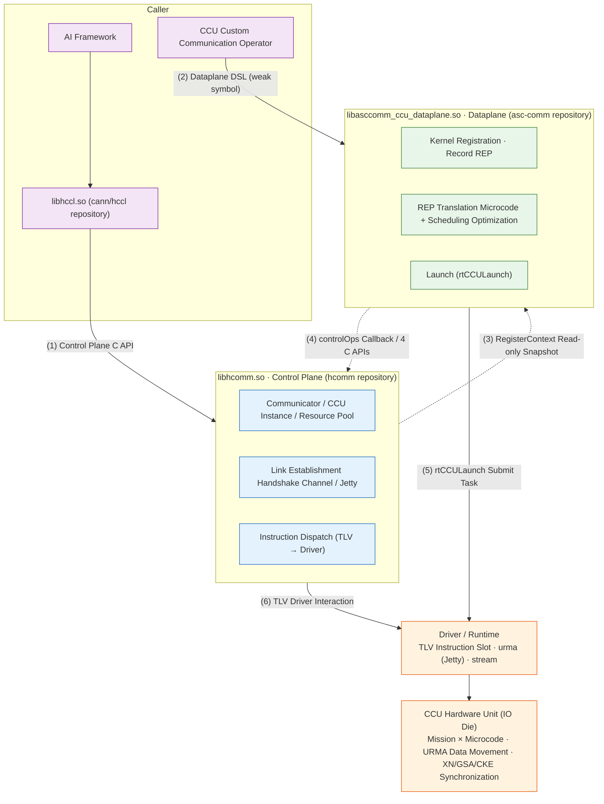

# HCOMM CCU Dataplane SO Split Architecture Diagram

HCOMM splits CCU (Collective Communication Unit) capabilities into **control plane** (hcomm repository, producing `libhcomm.so`) and **dataplane** (asc-comm repository, producing `libasccomm_ccu_dataplane.so`) as two independent SO files. These components interact through a POD ABI contract layer and support independent compilation and independent version evolution.

## Architecture Diagram (Mermaid Rendered Version)



## Simplified Architecture Diagram (Text Version, for Terminal/Plain Text Scenarios)

```text
          AI Framework ──► libhccl.so [dlsym loads hcomm]                 CCU Custom Communication Operator

            Control Plane C API                                           Dataplane DSL (weak symbol)
                  │                                                          │
                  ▼                                                          ▼

╭─────────────────────────────────╮                       ╭───────────────────────────────────╮
│                                 │                       │                                   │
│     libhcomm.so  ·  Control     │                       │    libasccomm_ccu_dataplane.so    │
│           Plane [hcomm repo]    │                       │     [asc-comm repo] · Dataplane   │
│                                 │  ◄═══  POD ABI  ═══►  │                                   │
│·  Communicator / CCU Instance  │ RegisterContext Snapshot │·  Kernel Registration · Record REP│
│   / Resource Pool              │   + controlOps Callback  │·  REP Translation Microcode +     │
│·  Link Establishment Handshake │                         │   Scheduling Optimization          │
│   Channel / Jetty              │                         │·  Launch (rtCCULaunch)             │
│·  Instruction Dispatch TLV →  │                         │                                   │
│   Driver                       │                         │                                   │
│                                 │                       │                                   │
╰─────────────────────────────────╯                       ╰───────────────────────────────────╯

                  │                                                          │
           (6) TLV                                                   (5) rtCCULaunch
                  ▼                                                          ▼

╭─────────────────────────────────────────────────────────────────────────────────────────────╮
│                Driver / Runtime Layer: TLV Instruction Slot · urma (Jetty) · stream         │
╰─────────────────────────────────────────────────────────────────────────────────────────────╯
                                                ▼

╭─────────────────────────────────────────────────────────────────────────────────────────────╮
│          CCU Hardware Unit (IO Die): Mission × Microcode · URMA Data Movement · XN/GSA/CKE  │
│          Synchronization                                                                     │
╰─────────────────────────────────────────────────────────────────────────────────────────────╯
```

Process summary: The operator registers the Kernel through the dataplane DSL (records REP → translates microcode) → The control plane delivers the resource snapshot through the POD ABI and provides callbacks (link establishment, instruction dispatch) → The dataplane `rtCCULaunch` submits the task → The CCU hardware executes the microcode for data movement.

## Complete Architecture Diagram

```text
┌────────────────────────────────────────────────────────────────────────────────────────────────────────────────────┐
│ Caller:  AI Framework ──► libhccl.so [cann/hccl repo, dlsym loads hcomm]  //  CCU Custom Communication Operator  │
│          (custom_ccu_allreduce/allgather/broadcast... samples link dataplane SO)                                 │
└────────────────────┬────────────────────────────────────────────────────────────────────┬──────────────────────────┘
   (1) Create Communicator · Bind CCU Instance · Reserve Resources                (2) Kernel Registration · Dispatch (Dataplane DSL)
                    │                                                                            │
                    ▼                                                                            ▼
┌──────────────────────────────────────┐    ╔══════════════════════════╗    ┌────────────────────────────────────────┐
│libhcomm.so  [hcomm repository]       │    ║Cross-SO ABI Contract Layer║    │libasccomm_ccu_dataplane.so             │
│━━━━━ CCU Control Plane ━━━━━        │    ║(pkg_inc/hcomm/*.h)       ║    │[asc-comm repo] ━ CCU Dataplane ━      │
│coll_communicator_mgr Communicator/   │    ║                          ║    │primitives/  CcuXxx Primitive          │
│  Topology                           │    ║Control Plane Delivers to  ║    │  Implementation                     │
│  HcclCommAssignCcuIns               │──► ║  Dataplane:              ║──► │  HcommCcuKernelRegisterStart/         │
│  HcclCommQueryCcuRegisterContext    │    ║  RegisterContextPod      ║    │  Register/End (weak symbol entry)     │
│ccu_instance/  Instance and Resource  │    ║  (CCU2 Read-only Snapshot║    │resource/kernel/ Kernel Recording     │
│  Reservation                        │    ║  + Generational Handle)  ║    │  CcuKernel·Mgr·Registry               │
│  CcuInstanceMgr / CcuInstance       │    ║  LaunchContext/Channel/  ║    │resource/representation/ REP IR        │
│  CcuResDescMgr Resource Descriptor  │    ║  InstructionLoad POD     ║    │  ~45 node types (arithmetic/movement/ │
│  CcuVarEventResMgr XN/CKE           │    ║                          ║    │  synchronization/control flow/loop)   │
│  Reservation                        │◄── ║Dataplane Callbacks to    ║◄── │  + InsGenerator V1(A5)/V2(A6)         │
│ccu_transport/  Link Establishment   │    ║  Control Plane:          ║    │resource/microcode(+microcode_opt)     │
│  Handshake                          │    ║  controlOps Function     ║    │  32B Fixed-length Microcode ·         │
│  CcuTransport/Conn/Jetty            │    ║  Table 7 Items           ║    │  Instruction Scheduling Optimization  │
│ccu_device/  Device Resources ·      │    ║  channelQuery/loadInstr  ║    │resource/common/  Resource Snapshot    │
│  Driver Interaction                 │    ║  missionCtx/loopCtx/cke/ ║    │launch: GeneTaskParams                 │
│  CcuComponent·CcuResBatchAlloc      │    ║  xn/gsa Query            ║    │  (dieId/missionId/args[13])           │
│  CcuChannelCtxMgr V1/V2·PFE         │    ║  + 4 C APIs on hcomm     ║    │  ──► rtCCULaunch(stream)              │
│  RegisterContextRegistry            │    ║  side                    ║    │(links acl_rt / runtime)               │
│  (Generational Handle Prevents      │    ║                          ║    │                                        │
│   Dangling)                         │    ║Contract: POD only, no    ║    │                                        │
│Upper Layer: include/hccl·hcomm      │    ║  C++ objects             ║    │                                        │
│  HcclComm*/HcommCcuIns* C API       │    ║  16B ABI Header (magic/  ║    │                                        │
│                                      │    ║  ver/size) + static_assert║    │                                        │
└──────────────────────────────────────┘    ╚══════════════════════════╝    └────────────────────────────────────────┘
                    │                                                                            │
                    ▼                                                                            ▼
                      (6) TLV Driver Interaction (Instruction/Channel)              (5) rtCCULaunch Submits Mission Task
┌────────────────────────────────────────────────────────────────────────────────────────────────────────────────────┐
│ Driver/Runtime Layer:  runtime(rtCCULaunch) · ascend_hal(HccpRaTlvCcuCustomChannel TLV:                           │
│   SET/GET_INSTRUCTION·CHANNEL·JETTY_CTX·MISSION_CTX·LOOP_CTX·GSA/XN/CKE) · urma(Jetty) · Socket(Handshake)         │
└──────────────────────────────────────────────────────────┬─────────────────────────────────────────────────────────┘
                                                            ▼
┌────────────────────────────────────────────────────────────────────────────────────────────────────────────────────┐
│ Hardware: Ascend IO Die Internal CCU Collective Communication Unit —— Mission (Hardware Thread) × Microcode        │
│           Instruction Slot · XN/GSA/CKE/MS Resources · URMA Unified Remote Memory Access Engine for Data Movement  │
│           (950PR/950DT, High Bandwidth Low Latency)                                                                │
└────────────────────────────────────────────────────────────────────────────────────────────────────────────────────┘
```

## Runtime Main Process

1. **Create Communicator and Reserve Resources**: Framework/HCCL → Control Plane, creates the communicator, `HcclCommAssignCcuIns` / `HcommCcuInsCreate` creates the CCU instance, reserves Variable(XN)/Event(CKE) resources and maps VA.
2. **Kernel Registration and Recording**: Operator → Dataplane, `HcommCcuKernelRegisterStart/Register/End` (weak symbol, resides in dataplane SO), executes the user kernelFunc, `CcuXxx` primitives record the REP intermediate representation.
3. **Deliver Snapshot**: Control Plane → Dataplane, `HcclCommQueryCcuRegisterContext` delivers the RegisterContext read-only snapshot (resource range view + die metadata + controlOps function table).
4. **Callback to Control Plane**: Dataplane → Control Plane, queries Channel POD and dispatches microcode through the controlOps table / 4 C APIs (`include/hcomm/hcomm_ccu_{res,channel,instruction,launch}_api.h`); The control plane writes translation products to hardware instruction slots through the TLV driver interface.
5. **Task Submission**: Dataplane assembles `CcuTaskParam(dieId/missionId/instStartId/args[13])` → `rtCCULaunch` submits the flow.
6. **Hardware Execution**: CCU Mission executes microcode, URMA engine moves data, Variable/Address/Event completes synchronization.

## Build-time Boundary Guarantees

| Mechanism | Description |
|------|------|
| Dual SO Joint Compilation | The hcomm repository searches candidate paths / uses FetchContent to pull asc-comm (`cmake/third_party/asccomm-ccu.cmake`), and the dataplane SO ships with the hcomm package; if not found, only the control plane builds |
| Source Ownership Verification (Bidirectional) | `hcomm_check_source_ownership(hcomm/hccl_v2)` + symmetric verification on the asc-comm side, prohibits cross-repository source file references |
| Link-time Verification (Bidirectional) | Both sides use `-Wl,--no-undefined`, disallows unintentional symbol dependencies |
| Single Source Dual Header | Resource repository type `pub_inc/ccu_res_repo.h` ⇔ `internal/hcomm/resource/common/ccu_res_repository_local.h` mutually exclusive macro definitions |
| POD Contract | Cross-SO transfers POD only (16B ABI header magic/version/size + `static_assert` locks layout), no C++ objects |

> Note: The current dev_rename branch represents a transitional state. libhcomm retains a legacy in-process implementation (`src/base_comm/resources/ccu/{ccu_kernel,ccu_representation,ccu_microcode}` + `primitives/api_c_adpt/ccu`) for compatibility. The diagram shows the target split configuration.

## Key Path Quick Reference

```
hcomm repository (control plane)
├── include/ccu/                      # DSL headers (Variable/Event/Buffer/Loop + ccu_res.h/ccu_launch.h weak symbols)
├── include/hcomm/hcomm_ccu_*_api.h   # 4 C APIs called by dataplane
├── pkg_inc/hcomm/hcomm_ccu_*.h       # Cross-SO POD ABI (abi/common/res/control/channel/instruction/launch/dfx)
├── src/base_comm/resources/ccu/
│   ├── ccu_instance/                 # CcuInstanceMgr/CcuInstance/CcuResDescMgr/CcuVarEventResMgr
│   ├── ccu_transport/                # CcuTransport/CcuConnection/CcuJetty Link Establishment Handshake
│   └── ccu_device/                   # CcuComponent/Resource Allocator/ChannelCtxMgr V1,V2/RegisterContextRegistry
└── cmake/third_party/asccomm-ccu.cmake  # Dataplane SO Joint Compilation and Delivery

asc-comm repository (dataplane)
├── src/ccu/hcomm/primitives/          # CcuXxx Primitive Implementation + Kernel Registration/Launch
├── src/ccu/hcomm/resource/kernel/     # CcuKernel/CcuKernelMgr/CcuKernelRegistry
├── src/ccu/hcomm/resource/representation/  # REP IR + InsGenerator V1(A5)/V2(A6) Translator
├── src/ccu/hcomm/resource/microcode(+_opt)/ # 32B Fixed-length Microcode + Instruction Scheduling Optimization
└── include/ccu/hcomm/                 # Dataplane Public DSL Headers (installed for CCU operator developers)
```
