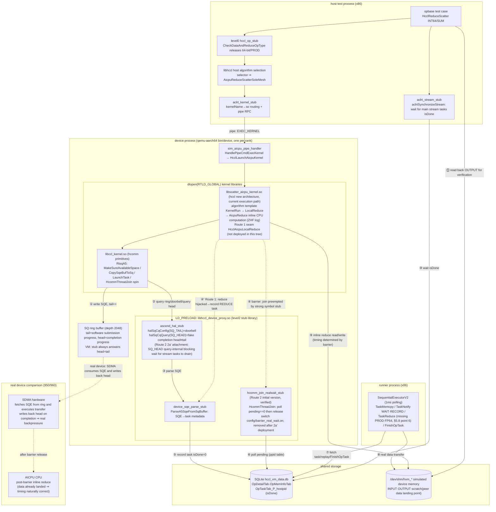

# CPU Computation Flow Analysis and Task Hijacking Scheme for 64-bit / PROD Reduction (950/960)

> **Repository Scope and Actual VM Paths (verified against `hccl_vm_install/bin/log.txt` in October 2026)**: This scheme involves two independent repositories —
> - **hccl** (`/home/teamserver/workspace/hccl`, new architecture, no instruction layer, device kernel = `libscatter_aicpu_kernel.so`): **The 64-bit reduce in the current VM is actually executed by the library from this repository**. Measured evidence (ReduceScatter / INT64(dataType=5) / SUM(reduceOp=0) test case, `hccl_reducescatter_rootinfo_test.cc:164`): `aclrt_kernel_stub` resolves `HcclLaunchAicpuKernel` via dlsym from `libscatter_aicpu_kernel.so` (`log.txt:12228`), the algorithm selects `AicpuReduceScatterSoleMesh`, and the reduction enters `LocalReduce→AicpuReduce` in hccl, where `alg_data_trans_wrapper.cc:907` prints `ZHF-LocalReduce: dataType is [5], reduceOp is [0]` (`log.txt:12662 / 12674`). Therefore the effective seam must reside in this repository (see **§5.6** for the scheme).
> - **hcomm** (`/home/teamserver/workspace/hcomm`, legacy architecture, contains instruction/`Interpret` instruction layer): **This path is not reached during current execution and belongs to the deprecated legacy**. Measured evidence: the debug marker `InsAicpuReduce: Interpret enter` added to `ins_to_sqe_rule_v82.cc` appears **0 times** in `log.txt`; no `instruction.cc` / `ins_to_sqe_rule_v82.cc` log lines appear throughout the entire run; `libccl_kernel.so` (an hcomm artifact) is loaded by the device process but is not on the 64-bit reduction computation path. The hcomm changes in the original scheme §5.1–§5.5 are only relevant to legacy/910 or the host-side `libhccl_v2.so` and are retained as historical reference.
>
> **⚠️ Deployment Status (important, verified in October 2026, correcting earlier "deployed" statements in this document)**: The exported seam `HcclAicpuLocalReduce`, the CheckerL2 dual stubs (level1 skip / level2 observe), and the REDUCE streamId tracking mechanism described in §5.2–§5.9 **are not deployed in the current code tree** — a full search of all repositories (hccl / hcomm / CheckerL2 source code) and all deployed `.so` files for `HcclAicpuLocalReduce` returns 0 hits; `aicpu_reduce_observe_stub.cc` does not exist; `hccl_task_collection.cc` does not contain `TrackLocalCopyStream` / `GetLastLocalCopyStreamDev`. The actual changes in the current workspace consist of only three debug/experimental edits: ① CheckerL2 `hccl_op_stub.cc` only comments out the `CheckDataAndReduceOpType` call site for `HcclReduceScatter` (:1109) — the function body still returns `NOT_SUPPORT` for 64-bit/PROD (:389-395), and the call sites for other operators (AllReduce :929 / Reduce :1046 / ReduceScatterV / GraphMode series) are not released; ② hccl `alg_data_trans_wrapper.cc:907` adds the `ZHF-LocalReduce` log; ③ hcomm `ins_to_sqe_rule_v82.cc` adds the `Interpret enter` log.
>
> **⚠️ Actual Execution Result**: After releasing ReduceScatter, the test case does reach hccl `AicpuReduce`, but the device process then **crashes with signal 11** inside `HcclLaunchAicpuKernelA3` in `libscatter_aicpu_kernel.so` (`crash_133229.log` / `crash_133255.log`), the host side reports `EXEC_KERNEL failed`, and the test case returns `retcode 10`. That is, **without a seam or stub, the real `AicpuReduce` directly runs a CPU loop on simulated device addresses and crashes** — this confirms the necessity of this scheme (the reduction must be hijacked into a checker task rather than performing real computation), and also demonstrates that §5.6 remains a **design to be implemented** rather than an established fact. (A subsequent run at 14:39 did not crash but the data verification failed with `total err is 4` — the root cause is temporal inversion rather than addressing, and the two repair routes and spike implementation details are described in **§9**.)
>
> **Convergence conclusion**: For the 64-bit/PROD target test case, the CCU/AIV engines lack hardware support and are forcibly excluded by the algorithm selection layer. All paths converge to a single point on the **AICPU engine** — `AicpuReduce` in hccl (`RunAicpuReduce` in hcomm is the corresponding point in the deprecated legacy and is not reached currently). See **§5.7**.
>
> **Repair route status (2026-10-24)**: Two routes are established in parallel — **Route 1 (seam + stub taskification, mainline)** is implemented and passes tests (in a separate workspace); **Route 2 (real wait)** initial version (join-layer strong symbol stub) passed spike verification on 2026-10-20 (`check_result: success`, temporal inversion confirmed as the sole root cause of data errors), and has now evolved into a **dual-form deployment**: level2 = southbound `halSqCqQuery(SQ_HEAD)` query-internal blocking wait (2a′) + level1 = L1 library existing join stub integrated with real wait, sharing the `barrier_real_wait` module (§9.2); both level1/level2 pass measured tests (2026-10-24); checker downgraded support (64-bit/PROD reduce-class operators skip semantic verification, retain memory conflict verification) is described in **§9.6**. The **timing diagrams and module diagrams for the SQE execution flow / reduce computation flow / synchronization relationships / hal ring buffer are in §10**; the **ultimate scheme (hal ring buffer slot-level true modeling, the evolution endpoint of 2a′) interface and data structure research is in §11**.
> **Gate control update (2026-11-03)**: The Route 2 real-wait gate control changes from "manual switch via environment variable `HCCL_VM_BARRIER_REAL_WAIT` / `config/barrier_real_wait.on`" to **automatic determination by operator attributes** (the latest recorded operator on the local device hits a reduce-class operator + 64-bit|PROD to automatically enable real wait; other operators remain on baseline; the determination is cached by operator row id and logs a `gate decision` entry). The environment variable and switch file are deleted, and no manual configuration is required (§9.2 D5).

## 1 Problem Overview

### 1.1 Symptom

`CheckDataAndReduceOpType` in `src/proxy/level0/hccl_op_stub.cc` returns `HCCL_E_NOT_SUPPORT` directly for **64-bit data types** (INT64 / UINT64 / FP64) and **PROD (product) reduction**, causing `HcclAllReduce` / `HcclReduce` / `HcclReduceScatter` to be intercepted at the host entry point:

```cpp
// src/proxy/level0/hccl_op_stub.cc:389
HcclResult CheckDataAndReduceOpType(HcclDataType dataType, HcclReduceOp op)
{
    if (dataType == HCCL_DATA_TYPE_INT64 || dataType == HCCL_DATA_TYPE_UINT64 ||
        dataType == HCCL_DATA_TYPE_FP64 || op == HcclReduceOp::HCCL_REDUCE_PROD) {
        return HcclResult::HCCL_E_NOT_SUPPORT;
    }
    return HcclResult::HCCL_SUCCESS;
}
```

Call sites (measured line numbers from October 2026): `hccl_op_stub.cc:929` (HcclAllReduce), `:1046` (HcclReduce), `:1109` (HcclReduceScatter, **currently commented out to release, the only released entry point**), `:1174` (HcclReduceScatterV), and each GraphMode entry point. The function body itself is unchanged and still returns `NOT_SUPPORT`.

### 1.2 Root Cause

In real hcomm workloads, reduction computation is normally **fused into SDMA copy tasks (inline reduce SQE)** — a single read-modify-write completes both "transfer + reduction". However, **the SDMA hardware supports neither 64-bit data types nor PROD multiplication**, so these two categories of reduction are redirected by the algorithm layer to **direct CPU (AICPU) C++ loop computation**, which **does not generate tasks (SQE) that the checker/runner can verify**. The CheckerL2 checker plugin relies on task artifacts for post-hoc verification; without tasks, verification is impossible, so the entry point directly returns `NOT_SUPPORT`.

### 1.3 Goal

On the **950/960** platform, provide a **stable, hijackable, symbol-hiding-immune** interface for the "CPU reduction computation" step, enabling CheckerL2 to hijack it and **forcibly generate REDUCE tasks** (the tasks are not executed by the real NPU but consumed by subsequent checker / runner plugins).

---

## 2 Key Concepts

### 2.1 Three Reduction Execution Engines

| Engine | Reductions Handled | Generates Tasks | Supports 64-bit/PROD |
|--------|-------------------|-----------------|---------------------|
| **SDMA inline reduce** | Transfer and reduction fused into one copy SQE | Yes (SDMA SQE) | **No** |
| **AIV / TBE vector kernel** (910) | Reduction inside a vector kernel | Yes (vector kernel task) | No (no atomic multiply for PROD; 64-bit not supported) |
| **AICPU CPU loop** (950/960) | Pure C++ for-loop element-wise computation | **No** (only DFX mirror information) | **Yes** (designed for this purpose) |

### 2.2 Data Type / Reduction Operator Enumerations

```
HcclDataType:  INT8=0 INT16=1 INT32=2 FP16=3 FP32=4 INT64=5 UINT64=6 UINT8=7 UINT16=8 UINT32=9 FP64=10 BFP16=11
HcclReduceOp:  SUM=0  PROD=1  MAX=2  MIN=3
HcommDataType / HcommReduceOp values are the same as above (include/hcomm_primitives.h:46-64)
```

---

## 3 Business Flow Analysis

### 3.1 Why 64-bit / PROD Does Not Use SDMA Tasks

The SDMA reduction is encoded in the **8-bit opcode** of a `MEMCPY_ASYNC` SQE: the high 4 bits encode the data type, and the low 4 bits encode the reduction kind. The bit fields physically cannot represent 64-bit or PROD:

```cpp
// src/legacy/ascend910/pub_inc/aicpu/aicpu_hccl_sqcq.h
// :220 Reduction kinds only include CPY/ADD/MAX/MIN/EQUAL — no multiplication
enum rtStarsMemcpyAsyncOperationKind { ...ADD=0x01, MAX=0x02, MIN=0x03, EQUAL=0x04 };
// :228 Data types only include INT8/16/32, UINT8/16/32, FP16/FP32/BFP16 — no 64-bit
enum rtStarsMemcpyAsyncDataType { ...FP32=0x70, BFP16=0x80 };

// :168 PROD maps to INVALID
constexpr aclrtReduceKind RK_MAP_TABLE[...] = {
    ACL_RT_MEMCPY_SDMA_AUTOMATIC_SUM,  /* SUM  */
    ACL_RT_MEMCPY_INVALID,             /* PROD */   // ← not supported
    ACL_RT_MEMCPY_SDMA_AUTOMATIC_MAX,  /* MAX  */
    ACL_RT_MEMCPY_SDMA_AUTOMATIC_MIN,  /* MIN  */
};
// :150 INT64/UINT64/FP64 map to UNDEFINED
constexpr aclDataType DT_MAP_TABLE[...] = { ... ACL_DT_UNDEFINED /*INT64*/, ACL_DT_UNDEFINED /*UINT64*/, ... ACL_DT_UNDEFINED /*FP64*/ ... };
```

The capability detection functions consistently exclude 64-bit and PROD (`src/legacy/ascend910/platform/common/device_capacity.cc`):

| Function | Location | Allowed Scope |
|----------|----------|---------------|
| `IsSupportAIVReduce` | :57 | `{int8/16/32, fp16/fp32, bfp16} × {sum,max,min}` |
| `IsDataTypeSupport` | :89 | No 64-bit |
| `IsRedOpSupport` | :112 | No PROD |
| `IsSupportSDMAReduce` | :130 | = alignment && data type && operator |
| `IsSupportRDMAReduce` | :138 | No 64-bit, no PROD |

The 950/960 capability table likewise marks INT64/UINT64/FP64 and PROD as `false`: `src/legacy/ascend950/unified_platform/common/dev_capability.cc:18-52`.

### 3.2 How the Algorithm Layer Routes Traffic

Each executor uses a uniform ternary expression to assign 64-bit/PROD to the non-inline path (repeated verbatim at approximately 12 locations), for example:

```cpp
// src/legacy/ascend910/algorithm/impl/coll_executor/coll_reduce/coll_reduce_executor.cc:95
ReduceType reduceType =
    ((param.reduceType != HCCL_REDUCE_PROD) && (param.DataDes.dataType != HCCL_DATA_TYPE_INT64))
        ? ReduceType::INLINE_REDUCE   // SDMA, fused into the copy task
        : ReduceType::TBE_REDUCE;     // 64-bit/PROD falls to a different engine
```

- **910 (legacy)**: `TBE_REDUCE` → `dispatcher_graph.cc:307` (comment: "dtype=int64 or redOp=prod both go through TbeReduce, controlled by the algorithm layer") → `TbeReduceAsync` → vector kernel `HcclTbeReduce` (`extern "C"`, cross-.so).
- **950/960**: When the algorithm selector hits 64-bit/PROD, it selects `"InsReduceAicpuReduce(Mesh2D)"`:

```cpp
// src/legacy/ascend950/service/collective/alg/selector/reduce_auto_selector.cc:266
if (op.dataType == DataType::INT64 || op.dataType == DataType::UINT64 ||
    op.dataType == DataType::FP64 || op.reduceOp == ReduceOp::PROD) {
    primQueueGenName = "InsReduceAicpuReduce";   // ← goes through AICPU CPU computation
}
// :318 SelectAivAlgo returns NOT_MATCH for PROD directly, and NOT_MATCH for UINT64/FP64 as well
```

The entry side also has `HcclCommunicator::IsReduceWithInt64OrProd` (`hccl_communicator_host.cc:4556`) to identify such operators.

### 3.3 950/960 CPU Computation: No Tasks, Only DFX Mirrors

The `InsReduceAicpuReduce` template generates `InsAicpuReduce` instructions (`AicpuReduce()` at `alg_data_trans_wrapper_mid.cc:908`). During execution, `Interpret(InsAicpuReduce)` **does not construct any SQE** and directly runs a C++ loop:

```cpp
// src/legacy/ascend950/framework/service/aicpu/ins_to_sqe_rule_v82.cc:721
void Interpret(const InsAicpuReduce& insAicpuReduce, const StreamLite& stream, ResMgrFetcher* resMgrFetcher)
{
    // Use aicpu to perform reduce, supporting int64 uint64 fp64
    ...
    insAicpuReduce.RunAicpuReduce(dst, dstSize, src, srcSize, dataType, reduceOp);  // :745 pure CPU computation
    ...
    taskParam.taskType = TaskParamType::TASK_REDUCE_INLINE;                          // :751
    resMgrFetcher->GetMirrorTaskMgrLite()->AddTaskInfo(std::move(taskInfo));         // DFX mirror only, not a hardware task
}
```

The computation body (`instruction.cc:465`):

```cpp
template <typename T>
void InsAicpuReduce::AicpuReduceTemplate(T* dst, u64 dstSize, T* src, u64 srcSize, ReduceOp reduceOp)
{
    u64 count = dstSize / u64(sizeof(T));
    for (u64 i = 0; i < count; ++i) {
        switch (reduceOp) {
            case ReduceOp::PROD: *(dst + i) = *(src + i) * *(dst + i); break;   // multiplication on CPU
            case ReduceOp::SUM:  ...
        }
    }
}
// :500 RunAicpuReduce only dispatches INT64 / UINT64 / FP64
```

> **Conclusion**: At the moment the reduction computation occurs, no SDMA reduce task representing it exists — the copy SQE used for transfer has already completed, and the CPU computation only leaves a `TASK_REDUCE_INLINE` DFX mirror. The checker has no way to verify it.

### 3.4 Timing Relationship Between SDMA Transfer and CPU Computation

**The division is a complete partition, not "extracting" PROD/64-bit from an SDMA task**: SDMA performs only pure transfer (zero arithmetic) for such data, and AICPU performs all reduction arithmetic.

Within a single operator invocation, the execution is **phased + completion barrier** serial, not interleaved element-by-element. The instruction queue generation order is linear (`ins_temp_all_reduce_aicpu_reduce.cc:110` `GenExtIns`):

```cpp
RunAllGatherMesh(...);      // Phase 1: all SDMA copy instructions (InsLocalCopy + SendRecv)
StreamSync(tempInsQues);    // Phase 2: barrier
RunAicpuLocalReduce(...);   // Phase 3: all CPU reduce instructions (InsAicpuReduce) + LocalCopy
```

The barrier **waits for the hardware to actually finish execution** — `Interpret(InsStreamSync)` (`ins_to_sqe_rule_v82.cc:679`) spin-polls until the SQ head catches the tail:

```cpp
do { head = stream.GetRtsq()->QuerySqHead(); ... } while (head != tail);   // :706 wait for SDMA to land data
```

Multi-stream rendezvous is guaranteed by `PreStreamSync` + `CheckPreStreamSync` (`ins_executor.cc:266`): all streams must arrive before unified release. The serialization is mandatory because of a **hard data dependency**: the SCRATCH that the CPU reduce reads is the same SCRATCH that SDMA writes.

The actual "interleaving" occurs at a **coarser slice/burst granularity**: when data exceeds the scratch capacity, the algorithm loops by slice (`ins_v2_reduce_sole_executor.cc:195`), and the queue shows `slice0[transfer|compute] slice1[transfer|compute] ...` alternation; this overlaps with two concurrency layers: "AICPU submission versus SDMA hardware asynchronous execution" and "multi-stream copy parallelism".

```
AICPU interpreter:  submit copy SQE ─► PreStreamSync(all-stream flush+rendezvous) ─► [spin until head==tail] ─► CPU for-loop for PROD/int64 ─► submit LocalCopy
SDMA hardware:              └──────parallel transfer of peer data to SCRATCH──────┘(complete)         (idle, data arrived)              └─transfer results─►
                                                                            ▲ barrier: computation strictly follows transfer completion
```

> This diagram is from the real device (hcomm legacy) perspective; **the complete timing diagram for the VM record-replay perspective (including hal ring buffer stub semantics, runner replay, Route 1/2 attachment points) and the three-process module diagram are in §10**.

---

## 4 Hijack Point Selection Analysis

Constraint: **C++ mangled symbols are not acceptable** (unstable), and hcomm will subsequently enable **symbol hiding** (symbols not exported externally are hidden at compile time, such as `local: *;` in `ccl_dpu.map`).

### 4.1 Southbound Interfaces (rts / hccp ra) — Not Feasible

The **fundamental reason** 64-bit/PROD falls to the CPU is that none of the southbound engines support it:

- RTS: `aclrtReduceAsync` (`orion_adapter_rts.cc:936`), `hrtReduceAsync` (`cpu_ts_thread.cc:348`) are all SDMA-backed;
- `IAicpuTsThread::SdmaReduce` (`aicpu_ts_thread_interface.cc:148`) directly returns "not supported" for 64-bit/PROD at `:35/:39`;
- HCCP/RDMA reduce capability likewise excludes 64-bit/PROD (`IsSupportRDMAReduce`).

**The computation step does not traverse any southbound interface** (the southbound layer only carries data transfer copies, which already generate tasks), so there is no hijack point on the southbound side.

### 4.2 Existing Northbound Interface `HcommLocalReduceOnThread` — Not Suitable for Direct Reuse

`HcommLocalReduceOnThread` (`include/hcomm_primitives.h:164`, `extern int32_t`, a public data-plane interface) appears ideal, but two hard obstacles exist:

1. **The instruction engine context has no ThreadHandle**: no thread handle exists within `framework/service/aicpu/` or `service/collective/instruction/`, yet the first parameter of this interface is `thread`;
2. **The A5 branch still falls to SDMA ultimately**: `aicpu_ts_primitives_c_adpt.cc:110` → `threadPtr->LocalReduce → SdmaReduce`, which rejects 64-bit/PROD.

Reusing it requires both "injecting a thread handle into the engine" and "adding a CPU fallback to the thread engine", which carries large change scope and real-device behavior risk.

> Note: CheckerL2 already hijacks `HcommLocalReduceOnThread` on both the host (`src/proxy/level1/data_local_op_stub.cc:291`) and device_arm (`src/device_arm/level1/data_op_device_stub.cc:1845`) sides and generates REDUCE tasks, and `ValidateA5Reduce` (`data_op_device_stub.cc:510`) already accepts 8-byte types (case 5/6/10) and PROD (reduceOp 0–3). However, this stub is only hit on the **data-plane programming path (SDMA inline reduce)**. The collective communication 64-bit/PROD reduction goes through `AicpuReduce` in hccl (current VM) / `InsAicpuReduce` in hcomm legacy (deprecated), neither of which passes through this stub — this is precisely why a separate `HcclAicpuLocalReduce` seam is needed.

### 4.3 Conclusion: Add a New Exported C Seam

The approach is to "slightly modify hcomm, adding a hijackable symbol", strictly following the existing hcomm export mechanism (`RunAicpuThreadInit` and others use `__attribute__((visibility("default")))`, see `aicpu_thread_kernel.h:17`; the export allowlist is in `ccl_dpu.map`), which is naturally immune to symbol hiding.

---

## 5 Solution: Add Exported Seam `HcclAicpuLocalReduce`

> **Status: designed/to be implemented (not deployed in the current tree).** All of §5.1–§5.9 in this chapter are **scheme designs**, not established facts. Deployment progress follows the "⚠️ Deployment Status" section at the top: the seam symbol, CheckerL2 dual stubs, and streamId tracking mechanism do not exist in any of the hccl/hcomm/CheckerL2 repositories; currently only a crashing level0 release experiment exists (see the top description and §5.5). §5.1–§5.5 target **hcomm (deprecated legacy)**, while §5.6 targets **hccl (the current actual path, the recommended deployment direction)**.

Sink the AICPU local reduction computation to an **`extern "C"` + weak + default-visibility + listed in `.map` allowlist** symbol; `RunAicpuReduce` reverts to a purely internal implementation (which can be hidden) and is no longer the hijack surface.

### 5.1 Target Symbol Location

- Single choke point: `InsAicpuReduce::RunAicpuReduce` (`instruction.cc:500`, declared at `instruction.h:807`), called from only one location in the entire repository at `ins_to_sqe_rule_v82.cc:745`, covering all 64-bit/PROD reductions for AllReduce / Reduce / ReduceScatter.
- **950 has no `ccl_kernel` target**: the CMakeLists for `instruction.cc` / `ins_to_sqe_rule_v82.cc` use dual mounting with `if(TARGET hccl_v2)` / `if(TARGET ccl_kernel)`; the 950 build only has `hccl_v2` (`SHARED`, `hccl_v2.cmake:12`) as a match, so both are compiled only into **`hccl_v2`**; this library **does not use `-Bsymbolic`** (only the release build attaches a version-script), intra-DSO calls go through the PLT, and can be preempted by strong symbols.
- device_arm uses `dlopen(RTLD_NOW|RTLD_GLOBAL)` to load the execution kernel library (`sim_kernel_lib_mgr.cc:34`).

### 5.2 hcomm-Side Changes (legacy, deprecated / not deployed — historical reference only)

> This section targets the hcomm legacy instruction layer path. The current VM execution **does not pass through** this path (see the top verification). The following changes **are not deployed** (a full repository search for `HcclAicpuLocalReduce` returns 0 results) and are retained only as historical/910-host reference. The effective scheme is in §5.6 (hccl repository).

**① Declaration** (design: placed in `instruction.h`, after the `InsAicpuReduce` class; both TUs see it through `ins_to_sqe_rule.h:16 → instruction.h`. `weak` is only added at the definition; the declaration uses only `visibility("default")`):

```c
// instruction.h (within namespace Hccl, extern "C" → unmangled global C symbol)
extern "C" __attribute__((visibility("default"))) int32_t HcclAicpuLocalReduce(
    void* dst, uint64_t dstSize, const void* src, uint64_t srcSize, HcclDataType dataType, HcclReduceOp reduceOp);
```

> `HcclDataType/HcclReduceOp` are already visible through `instruction.h → coll_operator.h → data_type.h/reduce_op.h → <hccl/hccl_types.h>`; `int32_t/uint64_t` are visible through `types.h → <cstdint>`. No new includes are required.

**② Real-device implementation** (`instruction.cc`, thin wrapper, behavior unchanged; reverse mappings already exist: `data_type.h:103`, `reduce_op.h:51`):

```cpp
extern "C" __attribute__((weak)) __attribute__((visibility("default"))) int32_t HcclAicpuLocalReduce(
    void* dst, uint64_t dstSize, const void* src, uint64_t srcSize, HcclDataType dataType, HcclReduceOp reduceOp)
{
    InsAicpuReduce::RunAicpuReduce(dst, static_cast<u64>(dstSize), const_cast<void*>(src), static_cast<u64>(srcSize),
        HcclDataTypeToDataType(dataType), HcclReduceOpToReduceOp(reduceOp));
    return 0;
}
```

**③ Change the single call site** at `ins_to_sqe_rule_v82.cc:745`, switching from directly calling the internal method to calling the exported seam:

```cpp
    HcclAicpuLocalReduce(dst, insAicpuReduce.GetDstSlice().GetSize(),
        src, insAicpuReduce.GetSrcSlice().GetSize(),
        DataTypeToHcclDataType(insAicpuReduce.GetDataType()),
        ReduceOpToHcclReduceOp(insAicpuReduce.GetReduceOp()));
    // The subsequent DFX mirror (:749-761) remains unchanged
```

**④ Register in the export allowlist**: In the version-script `src/legacy/ascend950/hccl_v2.map` for the library `hccl_v2` that contains `instruction.cc`, add one line to the `global:` section (`extern "C"` symbols use the unmangled pure C name):

```
    HcclAicpuLocalReduce;
```

This prevents it from being hidden by `local: *;`. (Note: `ccl_dpu.map` belongs to the host-side `ccl_dpu` library, and that library uses `-Bsymbolic`; it does not contain the instruction engine and is not the owner of this seam.)

### 5.3 CheckerL2 device_arm-Side Strong Symbol Hijacking (design, not deployed)

Completely isomorphic to the existing `HcommLocalReduceOnThread` stub (`data_op_device_stub.cc:1845`, current measured line number), reusing `TransLocalAddrToVirtual` / `InsertCollectedTask` / `GetCurRankId`:

```cpp
extern "C" int32_t HcclAicpuLocalReduce(void* dst, uint64_t dstSize, const void* src, uint64_t srcSize,
                                        HcclDataType dataType, HcclReduceOp reduceOp)
{
    if (dst == nullptr || src == nullptr || dstSize == 0 || dstSize != srcSize) {
        return static_cast<int32_t>(HCCL_E_PARA);
    }
    uint32_t curRank = 0;
    (void)GetCurRankId(&curRank);

    HcclTaskMetaData t{};                       // local reduction: src/dst same rank
    t.taskType = HccLTaskMetaType::REDUCE;
    t.commId   = 0;                             // allow degradation (consistent with HcommLocalReduceOnThread stub)
    t.rankId   = curRank;
    t.streamId = 0;                             // if an exact value is needed, add a parameter to the seam, passed from stream.GetId()
    t.taskData.reduce.srcDeviceId = curRank;
    t.taskData.reduce.srcOffset   = TransLocalAddrToVirtual(reinterpret_cast<uint64_t>(src));
    t.taskData.reduce.dstDeviceId = curRank;
    t.taskData.reduce.dstOffset   = TransLocalAddrToVirtual(reinterpret_cast<uint64_t>(dst));
    t.taskData.reduce.dataCount   = dstSize;                    // byte length, consistent with the device-side convention
    t.taskData.reduce.dataType    = static_cast<uint8_t>(dataType);   // already HcclDataType
    t.taskData.reduce.reduceOp    = static_cast<uint8_t>(reduceOp);   // already HcclReduceOp

    return InsertCollectedTask(t) == 0 ? 0 : static_cast<int32_t>(HCCL_E_INTERNAL);
    // Do not perform real computation; hand off to the runner to execute the task
}
```

Place this in the device_arm main executable (global scope). `ccl_kernel` is loaded with `dlopen(RTLD_GLOBAL)` and hcomm does not use `-Bsymbolic` → **the strong symbol preempts the weak default implementation in hcomm**, achieving stable LD_PRELOAD-style effect.

### 5.4 Prerequisite Changes (otherwise the hijack point is unreachable)

Release the level0 `CheckDataAndReduceOpType` at `hccl_op_stub.cc:389`: currently it returns `NOT_SUPPORT` for 64-bit/PROD at the host entry point and **does not forward to the real device libhccl**, so collective communication does not run and the device-side `HcclAicpuLocalReduce` is never called. Change it to release (proceed with `RecordOpDbInfo` + forward as normal).

> **Current actual status (partial release experiment, not deployed as a formal scheme)**: The `CheckDataAndReduceOpType` function body **still** returns `HCCL_E_NOT_SUPPORT` for INT64/UINT64/FP64/PROD (`hccl_op_stub.cc:389-395`, unchanged); only the single call site for `HcclReduceScatter` is entirely commented out (:1109), while the remaining call sites (`HcclAllReduce:929`, `HcclReduce:1046`, `HcclReduceScatterV:1174`, and each GraphMode entry point `:1258/:1540/:1612/:1686`) still intercept. Therefore currently only ReduceScatter with 64-bit/PROD can enter the device, and it crashes due to the missing seam/stub (see the top section). A formal deployment should change the function body to always return `HCCL_SUCCESS` (or release on demand at each entry point), rather than using scattered comments.

### 5.5 Implementation Status (October 2026 verification: **none of the following design items are deployed**)

> This section was originally titled "Deployed Change List". After verification, **items 1–6 in the table below all do not exist in the current tree** (a full search of all hccl/hcomm/CheckerL2 source code and all deployed `.so` files for `HcclAicpuLocalReduce` returns 0 hits). The table is retained as a **design checklist**, with the actual status annotated for each item:

| # | Repository | File | Change (design) | Actual status (October 2026 verification) |
|---|-----------|------|-----------------|------------------------------------------|
| 1 | hcomm | `src/legacy/ascend950/service/collective/instruction/instruction.h` | Add `extern "C" visibility("default")` declaration of `HcclAicpuLocalReduce` after the `InsAicpuReduce` class | ❌ Not deployed (hcomm does not have this symbol) |
| 2 | hcomm | `src/legacy/ascend950/service/collective/instruction/instruction.cc` | Add weak default implementation after `RunAicpuReduce`, forwarding to `RunAicpuReduce` | ❌ Not deployed |
| 3 | hcomm | `src/legacy/ascend950/framework/service/aicpu/ins_to_sqe_rule_v82.cc` | Change the `Interpret(InsAicpuReduce)` call site to call `HcclAicpuLocalReduce(...)` | ❌ Not deployed (currently only the `Interpret enter` debug log is added; the call site still uses `RunAicpuReduce`) |
| 4 | hcomm | `src/legacy/ascend950/hccl_v2.map` | Add `HcclAicpuLocalReduce;` to the `global:` section | ❌ Not deployed |
| 5 | CheckerL2 | `src/device_arm/level1/data_op_device_stub.cc` | Add `extern "C"` strong symbol `HcclAicpuLocalReduce`, constructing a REDUCE task and calling `InsertCollectedTask` | ❌ Not deployed (this file only has the `HcommLocalReduceOnThread` (:1845) stub, no `HcclAicpuLocalReduce`) |
| 6 | CheckerL2 | `src/proxy/level0/hccl_op_stub.cc` | `CheckDataAndReduceOpType` releases 64-bit/PROD (always returns `HCCL_SUCCESS`) | ⚠️ Partial only: the single call site for `HcclReduceScatter` is commented out (:1109); the function body still returns `NOT_SUPPORT` (:389-395), and the remaining entry points are not released (see §5.4) |

**Verification (original assertion is invalidated)**: The original text stated "level0 passes `-fsyntax-only`, and the device_arm stub is line-by-line isomorphic to the adjacent `HcommLocalReduceOnThread` stub" — that was a description of when items 1–5 **were once deployed**. Currently items 1–5 are all not deployed, so no corresponding artifacts exist for verification; the release fragment from item 6 compiles, but crashes at runtime in hccl `AicpuReduce` (see "⚠️ Actual Execution Result" at the top).

**Verification of integration-period assumptions (important, October 2026 measured correction, analysis still holds)**: The original scheme inferred from `instruction.cc → hccl_v2` that the export registration was in `hccl_v2.map`. Measured results reveal that this assumption only covered the **host side**, and **the current VM execution path is not in hcomm at all**:

1. `ins_to_sqe_rule_v82.cc` / `instruction.cc` are compiled by **two separate builds** in hcomm:
   - **Host x86** `libhccl_v2.so` (`build/src/legacy/ascend950`, linked with `hccl_v2.map`) — if the declaration/definition were added, `nm -D` should show `W HcclAicpuLocalReduce` (currently not added, so absent);
   - **Device aarch64** `libccl_kernel.so` (linked with `ccl_kernel.map`) and `libaicpu_custom.so` (linked with `aicpu_custom.map`) — these two map files **do not** register this symbol, and `local:*;` would hide it.
2. Furthermore, the device computation for 64-bit reduce in this VM **is not performed by hcomm at all**: `aclrt_kernel_stub` resolves `HcclLaunchAicpuKernel` via dlsym from **`libscatter_aicpu_kernel.so`** (`log.txt:12228`), and this library is built by **another repository `hccl`** (`/home/teamserver/workspace/hccl`), unrelated to hcomm; its reduction goes through hccl's own `AicpuReduce` (see §5.6). Even if a seam were added on the hcomm side, it would not enter the execution path.
3. Conclusion: **the effective seam must reside in the `hccl` repository** (§5.6). The hcomm-side changes are only relevant to legacy/910 or the host-side `libhccl_v2.so`, and are not needed by the current VM.

### 5.6 hccl Repository (New Architecture / libscatter_aicpu_kernel.so) Isomorphic Change Scheme (**Recommended Deployment Direction, Currently Not Deployed**)

> This is the actual path in the current VM (see the top verification), and the repository where the seam **should** be deployed. The following H1/H2/H3 items **are all not implemented**: `alg_data_trans_wrapper.cc` currently only has the added `ZHF-LocalReduce` debug log (:907), `AicpuReduce` is still a library-internal local C++ call, and `scatter_aicpu_kernel.map` does not contain `HcclAicpuLocalReduce`. This section is retained as a **design to be implemented**.

hccl is the new architecture repository, **without an instruction/Interpret instruction layer**: the device kernel directly runs the algorithm template's `KernelRun`, and its local reduction is uniformly dispatched through the wrapper `LocalReduce`. Therefore the seam sinks to the CPU branch `AicpuReduce` of `LocalReduce` (which corresponds one-to-one with the deprecated legacy `RunAicpuReduce` in hcomm).

**Convergence point confirmation** (unique across the entire repository, line numbers measured in October 2026): `AicpuReduce` is called from only one location in the entire repository — `LocalReduce` (defined at `alg_data_trans_wrapper.cc:901`, called at :908); `LocalReduce` is called by all AICPU reduction templates (all_reduce / reduce / reduce_scatter / reduce_scatter_v OneShot/TwoShot/NHR/AicpuReduce/order-preserved/dpu variants, approximately 15 locations total); no template bypasses `LocalReduce` to directly call `AicpuReduceTemplate`/`AicpuReduceFp16`.

```
ins_temp_all_reduce_mesh_1D_one_shot.cc  PostLocalReduce → LocalReduce(...)
  → alg_data_trans_wrapper.cc:901 LocalReduce: 64-bit/PROD branch (:907 ZHF debug log)
      → :908 AicpuReduce(thread, srcSlice, dstSlice, dataType, reduceOp)   ← sole call site in entire repository (seam)
          → :1260 AicpuReduce: switch(dataType) → AicpuReduceTemplate<int64_t/...>(:1320) CPU loop
```

Following the existing weak-alias export convention in hccl (`HcclGetDeviceType` uses `hccl_weak_alias` + `hccl.map global:`, see `common/dev_type.cc:75`, `common/dev_type.h:101`), there are 3 changes total:

| # | Repository | File | Change |
|---|-----------|------|--------|
| H1 | hccl | `src/ops/op_common/algorithm/template/wrapper/alg_data_trans_wrapper.h` | After the `AicpuReduce` declaration (:82), add an `extern "C"` declaration of `HcclAicpuLocalReduce` (signature byte-for-byte consistent with the CheckerL2 stub) |
| H2 | hccl | `src/ops/op_common/algorithm/template/wrapper/alg_data_trans_wrapper.cc` | `AicpuReduce` (:1260) retains validation + `TraceDataSlice`; the computation dispatch changes to call `HcclAicpuLocalReduce`; the original switch moves into `__HcclAicpuLocalReduce` with `hccl_weak_alias(__HcclAicpuLocalReduce, HcclAicpuLocalReduce)` |
| H3 | hccl | `src/scatter_aicpu_kernel.map` | Add `HcclAicpuLocalReduce;` to the `global:` section (this library does not use `-Bsymbolic`, intra-DSO calls go through the PLT, and can be preempted by strong symbols) |

**H1 Declaration** (`alg_data_trans_wrapper.h`, within `namespace ops_hccl`, `HcclDataType/HcclReduceOp` are already visible with the `AicpuReduce` declaration):

```cpp
extern "C" __attribute__((visibility("default"))) int32_t HcclAicpuLocalReduce(
    void* dst, uint64_t dstSize, const void* src, uint64_t srcSize, HcclDataType dataType, HcclReduceOp reduceOp);
```

**H2 Definition** (`alg_data_trans_wrapper.cc`, modify `AicpuReduce` + add weak implementation, following the `hccl_weak_alias` convention from `dev_type.cc`):

```cpp
HcclResult AicpuReduce(
    const ThreadHandle& thread, const DataSlice& srcSlice, const DataSlice& dstSlice, const HcclDataType dataType,
    const HcclReduceOp reduceOp)
{
    (void)thread;
    CHK_PRT_RET(srcSlice.size_ != dstSlice.size_, /* original error print unchanged */, HcclResult::HCCL_E_INTERNAL);
    u8* src = static_cast<u8*>(GetSliceAddr(srcSlice));
    u8* dst = static_cast<u8*>(GetSliceAddr(dstSlice));
    TraceDataSlice("AicpuReduce", "AICPU_REDUCE", 0, 1, srcSlice, dstSlice, src, dst, srcSlice.size_, dataType, reduceOp);
    // Sink through the exported seam: the real device uses the weak default implementation (CPU loop);
    // the simulation side overrides with a strong symbol to generate REDUCE tasks.
    return static_cast<HcclResult>(
        HcclAicpuLocalReduce(dst, dstSlice.size_, src, srcSlice.size_, dataType, reduceOp));
}

#ifdef __cplusplus
extern "C" {
#endif
int32_t __HcclAicpuLocalReduce(
    void* dst, uint64_t dstSize, const void* src, uint64_t srcSize, HcclDataType dataType, HcclReduceOp reduceOp)
{
    auto ret = HcclResult::HCCL_SUCCESS;
    u8* dstU8 = static_cast<u8*>(dst);
    u8* srcU8 = const_cast<u8*>(static_cast<const u8*>(src));
    switch (dataType) {   // ← the original AicpuReduce switch is moved here verbatim
        case HcclDataType::HCCL_DATA_TYPE_INT8:
            ret = AicpuReduceTemplate<int8_t>(reinterpret_cast<int8_t*>(dstU8), dstSize,
                reinterpret_cast<int8_t*>(srcU8), srcSize, reduceOp); break;
        case HcclDataType::HCCL_DATA_TYPE_INT32:
            ret = AicpuReduceTemplate<int32_t>(reinterpret_cast<int32_t*>(dstU8), dstSize,
                reinterpret_cast<int32_t*>(srcU8), srcSize, reduceOp); break;
        case HcclDataType::HCCL_DATA_TYPE_FP16:
            ret = AicpuReduceFp16(dstU8, srcU8, srcSize, reduceOp); break;
        case HcclDataType::HCCL_DATA_TYPE_FP32:
            ret = AicpuReduceTemplate<float>(reinterpret_cast<float*>(dstU8), dstSize,
                reinterpret_cast<float*>(srcU8), srcSize, reduceOp); break;
        case HcclDataType::HCCL_DATA_TYPE_INT64:
            ret = AicpuReduceTemplate<int64_t>(reinterpret_cast<int64_t*>(dstU8), dstSize,
                reinterpret_cast<int64_t*>(srcU8), srcSize, reduceOp); break;
        case HcclDataType::HCCL_DATA_TYPE_UINT64:
            ret = AicpuReduceTemplate<uint64_t>(reinterpret_cast<uint64_t*>(dstU8), dstSize,
                reinterpret_cast<uint64_t*>(srcU8), srcSize, reduceOp); break;
        case HcclDataType::HCCL_DATA_TYPE_FP64:
            ret = AicpuReduceTemplate<double>(reinterpret_cast<double*>(dstU8), dstSize,
                reinterpret_cast<double*>(srcU8), srcSize, reduceOp); break;
        default:
            HCCL_ERROR("DataType[%d] is not supported", int(dataType));
            ret = HcclResult::HCCL_E_INTERNAL; break;
    }
    return static_cast<int32_t>(ret);
}
hccl_weak_alias(__HcclAicpuLocalReduce, HcclAicpuLocalReduce);
#ifdef __cplusplus
} // extern "C"
#endif
```

> The `hccl_weak_alias` macro comes from `common/dev_type.h` (if the wrapper does not include it, add `#include "dev_type.h"`); `AicpuReduceTemplate`/`AicpuReduceFp16` are in the same TU as the weak implementation (declarations in the header at :90/:93) and can be called directly.

**H3 Export Allowlist** (the `global:` section of `src/scatter_aicpu_kernel.map`, alongside `HcclLaunchAicpuKernel`):

```
        HcclAicpuLocalReduce;
```

**Rebuild and deploy** (critical for taking effect; otherwise the changes do not enter the execution path):

```bash
cd /home/teamserver/workspace/CheckerL2_64bit
bash build_pkg.sh --install hccl   # hccl build.sh --full → .run installed into CANN → unpack aicpu_hccl.tar.gz to hccl_vm_install/lib/aarch64/
# Self-check: W/T HcclAicpuLocalReduce should appear (currently not deployed, so measured result is 0 hits)
nm -D hccl_vm_install/lib/aarch64/libscatter_aicpu_kernel.so | grep HcclAicpuLocalReduce
```

The CheckerL2 device_arm-side strong symbol stub (designed to be placed in `data_op_device_stub.cc`, loaded with `libhccl_device_proxy_level1.so` via `LD_PRELOAD` into the device process, `sim_sub_process_manager.cc:585`) **does not exist yet and must be added**; the kernel library is loaded with `dlopen(RTLD_NOW|RTLD_GLOBAL)` (`sim_kernel_lib_mgr.cc:34`) and does not use `-Bsymbolic` → the strong symbol preempts the weak default implementation.

> Note: `alg_data_trans_wrapper.cc` is also compiled into the **host** `libhccl.so` (`build/src/CMakeFiles/hccl.dir`, linked with `hccl.map`), for CCU 2-die host template calls to `LocalReduce`. This host copy is not currently overridden by the device-side strong symbol stub, and CCU does not support 64-bit/PROD (see the table below), so it has no impact on this test case; if host-side hijacking is also needed, add the same symbol name to `hccl.map global:` separately.

### 5.7 Runtime Mode Convergence Verification (CCU / AICPU / AIV)

The hijacked interface must reside at a convergence point that "as many runtime modes as possible" pass through. Verification conclusion: **for the target test cases (INT64/UINT64/FP64 and PROD), all engines are forcibly converged to the AICPU engine at the algorithm selection layer, which physically converges to the single seam at `AicpuReduce` (hccl) / `RunAicpuReduce` (hcomm)**. The CCU/AIV engines do not support these types in hardware, so bypassing is impossible.

**Engine capability matrix** (from `REGISTER_ALG_ATTRS` and selector code, consistent across both repositories):

| Engine | PROD | INT64 | UINT64/FP64 | Reduction Implementation Location | Passes Through Seam |
|--------|------|-------|-------------|-----------------------------------|---------------------|
| **AICPU** | ✓ | ✓ | ✓ | `LocalReduce`→`AicpuReduce` (hccl) / `Interpret(InsAicpuReduce)`→`RunAicpuReduce` (hcomm) | **Yes (the only engine that carries 64-bit/PROD)** |
| **CCU / CCU_MS / CCU_SCHED** | ✗ | ✗ | ✗ | CCU hardware mem2mem inline reduce (`GroupLocalReduce`/`PairwiseLocalReduce` in `ccu_kernel_*`) | No (does not support target types, cannot be selected) |
| **AIV** | ✗ | See below | ✗ | AIV kernel (real-device vector kernel / simulation `libhccl_aiv_kernel.so` `Reduce64`) | No |
| **SDMA inline** | ✗ | ✗ | ✗ | Fused into copy SQE (the `HcommLocalReduceOnThread` branch of `LocalReduce`) | Already hijacked by existing stub (`data_op_device_stub.cc:1845`, measured line number) |

Evidence:
- **Capability declarations**: In the entire hccl repository, only 2 locations have `isSupportProd = true`, and the only reduction algorithm among them is `AicpuAllReduceSequenceMeshNHRAicpuReduce` (AICPU); all CCU algorithms have `isSupportProd=false` and `unsupportedDataTypes ⊇ {INT64,UINT64,FP64}`; all AIV algorithms have `isSupportProd=false` and `unsupportedDataTypes ⊇ {UINT64,FP64}` (`alg_attrs.h:85-93`).
- **Selector enforcement**: `isDataTypeOrReduceTypeSpecial = INT64||UINT64||FP64||PROD` triggers selection of `Aicpu*` algorithms (`all_reduce_auto_selector.cc:432/:536`; hcomm `reduce_auto_selector.cc:266`).
- **Measured results (October 2026 `log.txt`, ReduceScatter/INT64/SUM test case)**: `cost_model.cc:356` `algName=AivReduceScatterSoleMesh filtered: engine=3 not in candidate engines` (`log.txt:7951`) — AIV (engine=3) is filtered out by the engine filter; `selector_engine.cc:446` `SelectMinCost: selected algName=AicpuReduceScatterSoleMesh, engine=AICPU_TS` (`log.txt:8383`), `:315` `dataType[int64] reduceType[sum]` (`log.txt:8385`) — ultimately selects `AicpuReduceScatterSoleMesh` on the AICPU engine.

**AIV INT64 boundary explanation** (the only theoretical exception, not a gap): The AIV capability table does not list INT64 as unsupported, so in theory INT64 SUM/MAX/MIN could go through AIV. However (1) the selector's special-datatype branch also assigns INT64 to AICPU; (2) even if it went through AIV, its reduction occurs inside the AIV kernel, and CheckerL2 handles it via the AIV stub `Reduce64`, which currently explicitly reports `"Not support yet!"` for int64 (`aiv_communication_base_v2.h:481-489`) — this is an explicit failure, not a silent miss; (3) on the real device, AIV INT64 reduction is an observable vector kernel task. Therefore AIV INT64 does not constitute a checker blind spot, and does not need to (and physically cannot) pass through this seam.

**Why the seam is placed at `AicpuReduce` rather than the higher-level `LocalReduce`**: `LocalReduce` is the general entry point for local reduction in AICPU (and some CCU 2-die host templates), and it branches internally — 64-bit/PROD goes to `AicpuReduce` (CPU loop, **no tasks, checker blind spot**), while the rest goes to `HcommLocalReduceOnThread` (SDMA inline, **already generates tasks and is already hijacked by the existing stub**). Placing the seam at `AicpuReduce` precisely fills only the blind-spot branch, **complementing** the existing `HcommLocalReduceOnThread` stub — the union of both = full `LocalReduce` coverage; moving it up to `LocalReduce` would cause duplicate capture with the SDMA stub. Therefore `AicpuReduce` is the correct seam point that achieves "maximum convergence without duplication".

**Convergence summary**: The reductions across the CCU/AIV/AICPU three engines are physically independent kernel implementations; no single C++ function is shared by all three. However, for the "invisible CPU reduction" (64-bit/PROD) that the checker actually misses, the capability matrix + selector guarantee that only AICPU can carry it, achieving 100% convergence to the single point `AicpuReduce`/`RunAicpuReduce`. This is the maximum convergence achievable under the premise of "not duplicating the already-observable SDMA/AIV paths".

### 5.8 Level Semantics and CheckerL2 Dual Stub Arbitration (level1 skip / level2 observe, **design; stubs not deployed**)

> **Status clarification (October 2026 verification)**: The **preload arbitration framework in this section is real** — `sim_sub_process_manager.cc:576-587` does determine `LD_PRELOAD` based on `HCCL_VM_LEVEL` (level1=`L1:L0`, level2=only `L0`), and `libhccl_device_proxy_level1.so` and `libhccl_device_proxy.so` are indeed deployed. **However, the stubs for `HcclAicpuLocalReduce` at both levels do not exist**: the level1 strong symbol stub is not added to `data_op_device_stub.cc`, and the level2 `aicpu_reduce_observe_stub.cc` file is not created (and the seam symbol itself does not exist in the kernel library either, see §5.6). Therefore the "stub semantics / data effect" columns in the table below are **design targets**, and currently cannot be triggered. The only verifiable current status is point 6 (runner-side gap).

The tool starts with one of two levels (`--level`, default 2), and the REDUCE task production mechanism under the two levels is **designed** as follows:

| Level | Preload stub library (`sim_sub_process_manager.cc:576-587`, verified to exist) | Stub semantics (design, stubs not deployed) | Data effect source |
|-------|------|------|------|
| **level1** (northbound hijacking) | `libhccl_device_proxy_level1.so` : `libhccl_device_proxy.so` | **skip**: only records tasks (designed to be placed in `data_op_device_stub.cc`, **this stub does not currently exist**) | runner replays tasks (`hccl_task_thread.cc:114 TaskReduce`, verified to exist but missing PROD/FP64) |
| **level2** (southbound hijacking, default) | Only `libhccl_device_proxy.so` | **observe**: records tasks + forwards real computation (designed file `aicpu_reduce_observe_stub.cc`, **does not currently exist**) | The stub forwards to the kernel library's own weak default implementation, completing in-process immediately |

Key points:

1. **Arbitration relies on preload order, naturally mutually exclusive**: At level1, `LD_PRELOAD=level1:level0`, so the same-named strong symbol in the level1 library is resolved first, and the observe stub is never called; at level2, only the level0 library is preloaded, so the observe stub takes effect. The observe stub additionally uses `HCCL_VM_LEVEL` as a defensive fallback (level1 semantics = record only). Both stubs **must coexist**: deleting the level1 stub would cause level1 to mistakenly enter the observe path, and combining with runner replay would cause double reduction.
2. **The hccl repository seam changes are indispensable under both levels**: Without the changes in §5.6, `libscatter_aicpu_kernel.so` has **zero dynamic references** to `HcclAicpuLocalReduce` (`LocalReduce→AicpuReduce→AicpuReduceTemplate` is a library-internal locally-bound C++ call chain, with no PLT entry and not in the export table), so no LD_PRELOAD strong symbol at any level can be called. The seam creates the "interceptable point"; the stubs are merely the interceptors.
3. **The observe stub forwarding uses "caller-location" rather than RTLD_NEXT**: `dladdr(return address)` → `dlopen(RTLD_NOLOAD)` → `dlsym(caller library handle, "HcclAicpuLocalReduce")` retrieves the **caller library's own** weak default implementation. Reason: The VM device process simultaneously loads hcomm `libccl_kernel.so` (whose default implementation only dispatches INT64/UINT64/FP64, and which loads earlier) and hccl `libscatter_aicpu_kernel.so` (full-type dispatch). RTLD_NEXT follows the global load order and would cross-bind to the narrow hcomm implementation, causing FP32/FP16/INT8/INT32+PROD to hit its `NotSupportException`. Caller-location ensures each stack resolves correctly, and the data is bit-for-bit consistent with the non-hijacked case (single source of truth = the kernel library's own implementation).
4. **The level2 recording format** follows the `device_sqe_parse_stub.cc` convention: `opDetailId → QueryOpDetailIdentity` restores the real commId/rankId/deviceId (when degraded, commId=0 + local rank, same as the level1 stub); addresses are converted to virtual addresses + physical owning device via `ResolveTaskAddress`; `dataCount` stores bytes.
5. **streamId must be restored to the main data stream (critical for ordering; design, tracking mechanism not deployed)**: The checker task graph builds intra-stream ordering edges + notify edges by `(rank, streamId)` queue (`task_graph_generator_v3.cc:GenGraph4Rank`), and the semantic simulation executes in the topological order of this DAG (`task_graph_semantic_check_v3.cc`). If REDUCE records `streamId=0`, it becomes an orphan queue with no parent nodes, and the topological order **inevitably precedes** the peer's remote write (which is deep in the peer's stream chain) → at merge time the src range has no semantics yet → `GetSourceIntersection` is empty, merge is a silent no-op → AllReduce semantic verification reports `ErrorCode 409: should combine inputs from 2 source ranks, but it actually combines 1`. Design fix: The CPU reduction occurs after the barrier join and between two copies on the main data stream, so REDUCE **inherits the streamId of the "most recent landed-local (dstDeviceId==local device) MEM_CPY"** — the tracking point is proposed at the device-side task insertion funnel `InsertTaskToCollectionDev` (`hccl_task_collection.cc`, getter `GetLastLocalCopyStreamDev`; **note: this tracking function/getter does not currently exist and must be added**); the stub insertion timing naturally places REDUCE at the correct position in that stream queue (after the preceding copy/barrier WAIT, before the result transfer copy), and cross-rank ordering is guaranteed by existing notify RECORD/WAIT edges. When no tracked value is available, fall back to 0 and log a WARN. **Details of the retrieval logic, correctness justification, rejected alternatives, and known boundaries are in §5.9.**
6. **Known runner-side gap (level1-related, to be fixed separately; verified as true, October 2026 verification still holds)**: `TaskReduce` (`hccl_task_thread.cc:114`) only dispatches MIN/MAX/SUM, with **no PROD branch** (`:123 default: break` directly returns success = no-op); additionally `MemReduceMin/MaxTemplate` loops start from `index=1` (`hccl_task_reduce_process.cc:36/:50`, missing the 0th element), and `MemReduce*` has no FP64 branch (only int8/16/32/64, uint8/16/32/64, FP16, float). Under level1, PROD/FP64 test case replay data will be incorrect, and runner semantics need to be supplemented (aligned with hccl `AicpuReduceTemplate`). The level2 observe mode is not affected (computation is completed by the kernel library default implementation). **Note: this gap is only triggered after the §5.6 seam + level1 stub are deployed; currently both are missing, so it has not yet manifested.**

### 5.9 REDUCE Task streamId Restoration (Seam Has No Stream Context, **Design; Tracking Mechanism Not Deployed**)

> **Status (October 2026 verification)**: The insertion-funnel tracking mechanism described in this section **does not currently exist** — `hccl_task_collection.cc` does not contain `TrackLocalCopyStream` / `GetLastLocalCopyStreamDev` / `g_lastLocalCopyStream`, and the `aicpu_reduce_observe_stub.cc` file also does not exist. The line numbers and "measured dev1→stream15..." data below come from an implementation period that **was once deployed and subsequently reverted**, and cannot be reproduced currently; they are retained as design justification only. Deploying this section requires first deploying the §5.6 seam and the §5.8 dual stubs.

**Problem**: The seam signature `HcclAicpuLocalReduce(dst, dstSize, src, srcSize, dataType, reduceOp)` does not carry stream/thread context, and it cannot be inexpensively supplemented — the hccl-side call site `AicpuReduce(thread, ...)` only has `ThreadHandle` (which is `(void)`-ed out), and the hcomm northbound primitives do not expose any thread→stream mapping (there are 0 stream-related APIs in `hcomm_primitives.h`); only the hcomm-side `Interpret(InsAicpuReduce)` has `stream.GetId()` to pass. Meanwhile, the checker task graph builds intra-stream ordering edges by `(rank, streamId)` queue, and a REDUCE with `streamId=0` becomes an orphan node whose topological order inevitably precedes the peer's remote write, causing a semantic merge no-op (the 409 failure from §5.8 point 5).

**Design scheme: insertion-funnel tracking + inheritance** (no change to seam ABI, purely CheckerL2 side; the following files/functions all need to be added):

```
Every device-side task insertion passes through InsertTaskToCollectionDev (device executable, --export-dynamic for stub library calls)
  └─ TrackLocalCopyStream(task)                     hccl_task_collection.cc:57 → :27-38
       Condition: taskType==MEM_CPY and transMem.dstDeviceId==GetCurDeviceKey() (copies that "land locally")
       Action: g_lastLocalCopyStream[deviceId] = task.streamId   (mutex protected)
  └─ GetLastLocalCopyStreamDev(deviceId)            hccl_task_collection.cc:41-46 (returns UINT64_MAX if no tracked value)

When the observe stub records REDUCE:                            aicpu_reduce_observe_stub.cc:136-146
  taskMeta.streamId = GetLastLocalCopyStreamDev(localDeviceId); no value → fall back to 0 + WARN
```

**Correctness justification**:
1. **Temporal fact**: The CPU reduction is executed by the kernel main thread after the barrier join and before its next data copy; the immediately preceding "landed-local" copy is the baseline data transfer on the main data stream (the main thread SQ) (in this sample, dev1's INPUT→scratchA on stream15). This premise comes from the general phased model of the AICPU reduction algorithm family (§3.4), not specific to 64-bit allreduce; **loop reduction scenarios are verified**: TwoShot performs consecutive `LocalReduce` by sliceIdx (`ins_temp_all_reduce_mesh_1D_two_shot.cc:353-359`), ReduceScatter accumulates by peer loop after the barrier (`ins_temp_reduce_scatter_mesh_1D.cc:206-220`), with no new copies between multiple reduces → all inherit the same stream, and the insertion order = the true order of the template comment "deterministic computation, sequential Reduce".
2. **Filter correctness**: Outbound remote writes (dst=peer) are excluded by the `dstDeviceId==local device` condition; inbound tasks where the peer writes into the local rank scratch are inserted in the **peer process**, so they do not pollute the local rank tracking, and their cross-rank ordering is expressed by notify RECORD/WAIT edges.
3. **Queue position**: Each rank's task table is ordered by auto-incrementing id, which is the real temporal order; the REDUCE insertion time naturally falls at the correct position in that stream queue (after the preceding copy/barrier WAIT, before the result transfer copy), and the checker's intra-stream ordering edges yield the correct partial order from this. Measured results: dev1→stream15 (`COPY(12310)→WAIT 5(12311)→[REDUCE]→COPY(12492)`), dev2→stream9, cross-rank chain `dev1 COPY→RECORD 131082→dev2 WAIT→…→dev2 REDUCE` verified edge-by-edge.

**Rejected alternatives**:
| Alternative | Rejection reason |
|-------------|-----------------|
| Add streamId/thread parameter to the seam ABI | The hccl side cannot obtain the value (no thread→stream API); requires simultaneous ABI changes in both repositories + three stub locations (level1/level2) |
| Use the main stream from opDetails | That is the host launch stream space (for example, 2/4), which is a different space from the device SQ (9/10/15/16); the main stream queue only has a mainStart→queue-head edge with no ordering constraint on SQE tasks |
| Keep streamId=0 | Orphan node → 409 semantic failure (measured) |
| Checker-side "cross-stream cut" for stream0 tasks by global insertion order | Semantically the most rigorous, but requires passing row ids into the generator, and the host/device two-process DB merged by rank has no unified real-time order; large change scope and high regression risk. **Retained as an evolution direction** (to be adopted if the heuristic fails for some algorithm) |

**Known boundaries** (recorded as-is):
- When no "landed-local" MEM_CPY has been inserted in the current process yet (for example, inplace algorithms omit the baseline copy, and inbound data is entirely delivered by peer remote writes), the fallback is `streamId=0` + WARN — ordering may again be incorrect; at that point the tracking source needs to be extended (for example, barrier WAIT stream) or the checker cross-stream cut scheme needs to be enabled.
- If some algorithm's last landed copy before the reduce is initiated by a **secondary stream**, REDUCE inherits the secondary stream id, and the ordering between it and the main-stream result copy degrades to relying on the notify chain (usually present in barrier scenarios, but weaker than same-stream ordering).

---

## 6 Scheme Key Points and Conventions

### 6.1 Why This Hijack Point Is Stable and Reliable

| Concern | Guarantee |
|---------|-----------|
| Symbol stability | `extern "C"`, no C++ mangling; the signature uses only C scalars/pointers, ABI stable |
| Not hidden | `visibility("default")` + listed in `.map` `global:` allowlist, same mechanism as `RunAicpu*`; symbol hiding only hides `local: *` |
| Reliable preemption | hcomm side is weak, CheckerL2 side is strong, cross-`dlopen(RTLD_GLOBAL)` override is unambiguous, does not depend on compiler interposition defaults |
| Coverage | Single choke point, one change covers all 64-bit/PROD for three reduction operators |

### 6.2 Key Conventions

1. **skip vs observe (designed dual-mode semantics, stubs not deployed, see §5.8)**: The level1 stub **skips** inline computation, consistent with the existing `HcommLocalReduceOnThread` stub contract of "record only, no computation, executed by runner" (SDMA reduce also has no real hardware in simulation and relies on the runner to write back; the two are symmetric); level2 has no task replay phase, so the observe stub "records then forwards real computation", and the data effect completes in-process immediately. **Currently neither stub is created**, so this convention is a deployment target rather than current status.
2. **dataCount stores bytes**: `dstSize` is already a byte count, stored directly, matching the device-side `count*typeSize` convention (see the `HcommLocalReduceOnThread` stub in `data_op_device_stub.cc`), so the Checker can perform address range conflict analysis.
3. **Enumeration consistency**: The seam passes `HcclDataType/HcclReduceOp`, aligned with the `hccl_types.h` enumerations expected by the task metadata `taskData.reduce.dataType/reduceOp` (`include/sim_common_defs.h:283-289`).

---

## 7 Alternative Schemes

### 7.1 Reuse Existing Northbound `HcommLocalReduceOnThread` (Not Recommended)

Requires two hcomm changes: (a) inject/synthesize a `ThreadHandle` into the instruction engine and pass it to `Interpret`; (b) add a "unsupported type → CPU loop" fallback before A5 `LocalReduce` / `IAicpuTsThread::SdmaReduce` (bypassing the not-supported at `aicpu_ts_thread_interface.cc:35/39`). Both the change scope and real-device behavior risk are higher than adding a dedicated seam.

### 7.2 Pure CheckerL2-Side Hijacking of Mangled Symbol (Emergency, Fragile)

LD_PRELOAD a strong definition of the mangled C++ symbol for `RunAicpuReduce` to preempt `ccl_kernel` (because it is not `-Bsymbolic` and internal calls go through the PLT). The symbol name is obtained with `nm -D libccl_kernel.so | grep RunAicpuReduce`. Drawbacks: depends on mangling/ABI and the concrete type of `u64`, and **is directly broken by the subsequent symbol hiding feature** — does not satisfy the constraints, emergency use only.

---

## 8 Key Code Index

### CheckerL2

> Line numbers are measured from October 2026; markers: ✅=exists in current tree, ❌=design not deployed (does not currently exist), ⚠️=partial/experimental.

| Description | Location | Status |
|-------------|----------|--------|
| Entry interception `CheckDataAndReduceOpType` | `src/proxy/level0/hccl_op_stub.cc:389` | ✅ |
| HcclAllReduce / HcclReduce / HcclReduceScatter | `hccl_op_stub.cc:925 / :1042 / :1105` | ✅ |
| level0 release of 64-bit/PROD | `hccl_op_stub.cc:1109` (only the `HcclReduceScatter` call site is commented out; function body :389-395 still returns `NOT_SUPPORT`, remaining entry points :929/:1046/:1174/:1258/:1540/:1612/:1686 are not released) | ⚠️ Partial experiment |
| Host-side `HcommLocalReduceOnThread` stub | `src/proxy/level1/data_local_op_stub.cc:291` | ✅ |
| device_arm-side `HcommLocalReduceOnThread` stub | `src/device_arm/level1/data_op_device_stub.cc:1845` | ✅ |
| device_arm-side `HcclAicpuLocalReduce` strong symbol stub (level1 skip, compiled into `libhccl_device_proxy_level1.so`) | Designed for `src/device_arm/level1/data_op_device_stub.cc` | ❌ Not deployed |
| device_arm-side `HcclAicpuLocalReduce` observe stub (level2: record + forward weak default implementation, compiled into `libhccl_device_proxy.so`) | Designed file `src/device_arm/level2/proxy/aicpu_reduce_observe_stub.cc` | ❌ File does not exist |
| REDUCE streamId restoration: landed-local copy stream tracking + getter (§5.9) | Designed for `src/device_arm/common/hccl_task_collection.cc` (`TrackLocalCopyStream`/`GetLastLocalCopyStreamDev`) | ❌ Functions do not exist |
| Device subprocess LD_PRELOAD injection (level1=`L1:L0`, level2=`L0`, arbitration basis) | `src/common/sim_sub_process_manager.cc:576-587` (`HCCL_VM_LEVEL` :576; L1 path :505) | ✅ |
| level2 task recording convention (opDetailId identity restoration / ResolveTaskAddress) | `src/device_arm/level2/proxy/device_sqe_parse_stub.cc` (`QueryOpDetailIdentity` :66; `ResolveTaskAddress` :246) | ✅ |
| Runner REDUCE replay (missing PROD/FP64 branches, see §5.8 point 6) | `src/plugin/runner/runner_utils/hccl_task_thread.cc:114` (no PROD, :123 default); `hccl_task_reduce_process.cc:36/:50` (Min/Max from index=1, no FP64) | ✅ (gap verified) |
| `ValidateA5Reduce` (accepts 8-byte + PROD) | `data_op_device_stub.cc:510` | ✅ |
| Kernel library dlopen(RTLD_GLOBAL) | `src/device_arm/common/sim_kernel_lib_mgr.cc:34` | ✅ |
| kernelName→soName routing (host resolves kernel.json) | `src/proxy/level2/aclrt_kernel_stub.cc:256-310` (`ParseKernelJson` :256; `soName` :310) | ✅ |
| AIV kernel simulation (int64 `Reduce64` currently Not support yet) | `src/proxy/level2/aiv_kernel/hccl_op_stub/aiv_communication_base_v2.h:481-489` | ✅ |
| REDUCE task metadata fields | `include/sim_common_defs.h:283-289` | ✅ |
| Deployment script (rebuild hccl/hcomm and unpack aicpu kernel to `hccl_vm_install/lib/aarch64/`) | `build_pkg.sh --install <hccl\|hcomm>` | ✅ |

### hcomm (legacy, deprecated / current execution does not reach — historical reference only)

> The table below is the code index for the hcomm legacy instruction layer path. October 2026 verification: the current VM's 64-bit reduce **does not pass through** hcomm (the `InsAicpuReduce: Interpret enter` debug marker appears 0 times in `log.txt`), so all seam-related entries below are **design, not deployed**; analysis-type entries (capability tables/selector/instruction layer structure) can still serve as legacy reference.

| Description | Location |
|-------------|----------|
| SDMA opcode mapping (PROD→INVALID, 64-bit→UNDEFINED) | `src/legacy/ascend910/pub_inc/aicpu/aicpu_hccl_sqcq.h:150 / :168 / :220 / :228` |
| Capability detection (AIV/SDMA/RDMA reduce) | `src/legacy/ascend910/platform/common/device_capacity.cc:57 / :89 / :112 / :130 / :138` |
| 950 capability table (INT64/PROD=false) | `src/legacy/ascend950/unified_platform/common/dev_capability.cc:18-52` |
| 910 routing ternary expression | `.../coll_executor/coll_reduce/coll_reduce_executor.cc:95` |
| 910 TBE dispatch (comment) | `src/legacy/ascend910/platform/task/dispatcher_graph.cc:307` |
| 950 selector routes to AICPU reduce | `src/legacy/ascend950/service/collective/alg/selector/reduce_auto_selector.cc:266 / :318` |
| CPU computation body `AicpuReduceTemplate` / `RunAicpuReduce` | `src/legacy/ascend950/service/collective/instruction/instruction.cc:465 / :500` |
| `InsAicpuReduce` class declaration | `.../instruction/instruction.h:792 / :807` |
| `Interpret(InsAicpuReduce)` (sole call site; currently only the `Interpret enter` debug log is added, not changed to call the seam) | `src/legacy/ascend950/framework/service/aicpu/ins_to_sqe_rule_v82.cc:721 / :745` |
| `Interpret(InsStreamSync)` completion barrier | `ins_to_sqe_rule_v82.cc:679 / :706` |
| Instruction executor / PreStreamSync rendezvous | `src/legacy/ascend950/framework/service/aicpu/ins_executor.cc:131 / :200 / :266` |
| AllReduce AICPU template (transfer→barrier→compute) | `.../ins_alg_template/ins_temp_all_reduce_aicpu_reduce.cc:110 / :130-132` |
| Slice loop | `.../ins_alg_executor/reduce/ins_v2_reduce_sole_executor.cc:195` |
| Northbound data-plane reduction primitive | `include/hcomm_primitives.h:164`; implementation `src/base_comm/primitives/api_c_adpt/{cpu,aicpu_ts}_primitives_c_adpt.cc` |
| Southbound SDMA reduce (rejects 64-bit/PROD) | `src/legacy/ascend950/interface/aicpu_ts_thread_interface.cc:35 / :39 / :148` |
| Export allowlist (symbol hiding mechanism) | `src/legacy/ascend950/ccl_dpu.map` |
| **version-script (seam ❌ not deployed)**: host `libhccl_v2.so`←`hccl_v2.map`, device `libccl_kernel.so`←`ascend910/framework/ccl_kernel.map`, `libaicpu_custom.so`←`aicpu_custom.map` — all three **do not** register `HcclAicpuLocalReduce` (because this symbol does not exist in the hcomm source code at all); for the hcomm device side to take effect, it must be added to `ccl_kernel.map` and `aicpu_custom.map` | `hccl_v2.map:15` / `ccl_kernel.map` / `aicpu_custom.map` |
| Default-visibility exported symbol reference | `src/base_comm/resources/comm_engine_res/threads/device/aicpu_thread_kernel.h:17` |
| Enumeration forward/reverse mappings | `src/legacy/ascend950/common/types/data_type.h:94 / :103`; `reduce_op.h:42 / :51` |
| 910 cross-.so vector reduce entry point | `test/stub/depends/include/hcomm-legacy/hccl_tbe_task.h:19 / :44` |

### hccl (New Architecture / Current VM Actual Execution Path)

> Repository root: `/home/teamserver/workspace/hccl`. The device kernel artifact `libscatter_aicpu_kernel.so` is built by `src/scatter_aicpu_kernel.cmake` (`AICPU_COMPILE`) and is the actual library carrying 64-bit reduce in this VM (`log.txt:12228` dlsym, `:8383` selected `AicpuReduceScatterSoleMesh`). Line numbers are measured from October 2026; seam-related entries are **design, not deployed**.

| Description | Location | Status |
|-------------|----------|--------|
| Local reduction general entry point `LocalReduce` (64-bit/PROD→AicpuReduce, others→SDMA) | `src/ops/op_common/algorithm/template/wrapper/alg_data_trans_wrapper.cc:901` (:907 ZHF debug log, :908 calls AicpuReduce) | ✅ (:907 log is experimental) |
| **Seam point** `AicpuReduce` (sole call site in entire repository = LocalReduce) | `alg_data_trans_wrapper.cc:1260` | ✅ (seam ❌ not added) |
| CPU reduction loop body `AicpuReduceTemplate` / FP16 specialization | `alg_data_trans_wrapper.cc:1320 / :1238` | ✅ |
| `AicpuReduce`/`AicpuReduceTemplate` declarations | `alg_data_trans_wrapper.h:82 / :90 / :93` | ✅ |
| OneShot AllReduce template calls LocalReduce | `src/ops/all_reduce/algorithm/template/aicpu/ins_temp_all_reduce_mesh_1D_one_shot.cc` | ✅ |
| AICPU reduce template family (all_reduce/reduce/reduce_scatter/reduce_scatter_v) | `src/ops/*/algorithm/template/aicpu/*.cc` (approximately 15 `LocalReduce(` locations) | ✅ |
| Device kernel export allowlist (**design needs to add `HcclAicpuLocalReduce;`, currently absent**) | `src/scatter_aicpu_kernel.map` (`global:` :12-15 only `HcclLaunchAicpuKernel*`; no `-Bsymbolic`) | ✅ (symbol ❌ not registered) |
| weak-alias export convention reference `HcclGetDeviceType` | `src/common/dev_type.cc:75`; macro `src/common/dev_type.h:101` | ✅ |
| Engine capability preset sets (UNSUPPORTED_64BIT / _UINT64_FP64) | `src/ops/op_common/selector/alg_attrs.h:85-93` | ✅ |
| Selector enforces 64-bit/PROD→AICPU (`isDataTypeOrReduceTypeSpecial`) | `src/ops/all_reduce/selector/all_reduce_auto_selector.cc:432 / :536`; AIV rejects UINT64/FP64 `:643` | ✅ |
| Engine enumeration `EngineType{AICPU,CCU,CCU_CIR_MODE,AIV,CPU}` | `src/ops/op_common/selector/cost_model.h:102` | ✅ |
| Engine candidate filtering ("engine=N not in candidate engines") | `src/ops/op_common/selector/cost_model.cc:338-357` (measured `log.txt:7951`) | ✅ |
| CCU hardware reduce (does not go through seam, 64-bit/PROD not supported) | `src/ops/*/algorithm/template/ccu/kernel/ccu_kernel_*.cc` (`GroupLocalReduce`/`PairwiseLocalReduce`) | ✅ |
| CCU 2-die host template calls LocalReduce (takes the SDMA branch) | `src/ops/reduce_scatter/algorithm/template/ccu/ccu_temp_reduce_scatter_mesh2die.cc:202` | ✅ |
| Host copy link script (if host-side hijacking is needed, add the symbol separately) | `src/hccl.map` (`build/src/CMakeFiles/hccl.dir`) | ✅ |
| AIV kernel simulation (int64 `Reduce64` = Not support yet) | CheckerL2 `src/proxy/level2/aiv_kernel/hccl_op_stub/aiv_communication_base_v2.h:481` | ✅ |
| Device loads libscatter + dlsym evidence | `log.txt:12227-12228` (`loaded so:...libscatter_aicpu_kernel.so` / `dlsym(HcclLaunchAicpuKernel)`) | ✅ |
| 64-bit reduce enters `LocalReduce→AicpuReduce` evidence | `log.txt:12662 / 12674` (`ZHF-LocalReduce: dataType is [5], reduceOp is [0]`) | ✅ |
| **Current crash evidence** (no hijack → real AicpuReduce out-of-bounds) | `hccl_vm_install/bin/crash_133229.log` / `crash_133255.log` (`HcclLaunchAicpuKernelA3` signal 11); host reports `EXEC_KERNEL failed`, `retcode 10` | ✅ |

---

## 9 Two Repair Routes: Route 1 (Taskification, Verified) and Route 2 (Barrier Real Wait, Spike Experiment)

> Background (measured 2026-10-19 14:39): After level0 releases ReduceScatter/INT64/SUM, the test case no longer crashes (different from the 12:06 run), but **data verification fails** — `total err is 4`, `check_result: failed` (`log.txt:14448/14468`, all 4 int64 output elements on both ranks are wrong). The root cause analysis (§9.0) shows this is not an addressing error but a **temporal inversion** under the record-replay architecture. Based on this, two repair routes are formed: Route 1 is implemented and passes tests; Route 2 completes a spike implementation (CheckerL2 side only) in this round for cross-verification.

### 9.0 Root Cause: Generation/Replay Timeline Decoupling, Barrier Backpressure Is Stubbed Out

**Real device (single timeline)**: hccl places a dedicated barrier before `LocalReduce` for 64-bit/PROD (`ins_temp_reduce_scatter_mesh_1D.cc:198-205`: `HcommBatchModeEnd/Start` + per-thread `HcommThreadJoin`); `HcommThreadJoin` (hcomm `aicpu_ts_primitives_c_adpt.cc:1136`) spins `do { head = QuerySqHead(); } while (head != tail)`, where **tail is advanced by software submission and head is advanced by SDMA hardware completion** — the generation thread is backpressure-blocked until data physically lands, and the inline CPU reduce after the barrier is naturally safe.

**VM (dual timeline)**: `halSqCqQuery` in `ascend_hal_stub.cc:296-303` always answers SQ_HEAD with `GetSqTail(sqId)` (comment: "represents sqBuffer always being empty") → the join do-while passes on the first iteration (`log.txt`: `SqCqQuery is empty` → immediately `HcommThreadJoin SUCCESS. RTSQ's head[9]==tail[9]`), and the barrier degrades to a no-op. Data transfers (MEM_CPY/NOTIFY) are only recorded into the database by `device_sqe_parse_stub` during the generation phase; all real data effects are deferred to the runner replay phase (during the host `aclrtSynchronizeStream` wait for isDone). Therefore the inline reduce has two fatal problems that no race condition can salvage:

1. **Cannot read the producer**: At execution time the scratch does not yet contain peer data (the peer's remote write tasks have not been replayed);
2. **Cannot outlast the replayer**: Its written OUTPUT will subsequently be overwritten by the replayed local copy tasks — the last writer of OUTPUT is always in the replay sequence, and the replay sequence does not contain REDUCE.

The inter-task ordering itself is faithful (intra-stream by id FIFO, cross-stream/cross-device by NOTIFY_WAIT/RECORD partial order + runner HOLD yield), so the key to the fix = placing the inline reduce at the correct position in the timeline. The two routes diverge from here: **Route 1 migrates the reduce to the replay timeline (taskification)**; **Route 2 pulls the replay data back to the generation timeline (barrier real wait)**.

#### 9.0.1 Measured Task Flow Decode (14:39 run, rank0/dev1, opIter0, `OpTaskTab_P_322656` BLOB decoded entry by entry)

```
#1  stream4  NOTIFY_RECORD(notifyId=6)                 main stream handshake
#2  stream9  NOTIFY_WAIT(6)   #3 RECORD(7)   #4 WAIT(5)
#5-#7  stream10 WAIT(7)/RECORD(131081→dev2)/WAIT(9)
#8  stream10 MEM_CPY dev1:INPUT+32 → dev2:0x2000000400001(peer scratch) len=32   ← remote write peer half
#9  stream10 NOTIFY_RECORD(131082→dev2)   #10 WAIT(10)   #11 RECORD(5)
#12 stream9  MEM_CPY dev1:INPUT+0 → dev1:OUTPUT+0 len=32                        ← local half into output
#13-#15 post-barrier cleanup: RECORD(2)/WAIT(2)/SYNC_STREAM
REDUCE tasks: 0 (taskType distribution = 12×NOTIFY_WAIT + 12×NOTIFY_RECORD + 4×MEM_CPY + 2×SYNC_STREAM, all isDone=1)
```

Cross-device data dependency chain (how the replay partial order guarantees peer data lands in the local rank scratch):
`rank0 reduce reads scratch ⇠ rank0 #10 WAIT(10) ⇠ rank1 #9 RECORD(10) ⇠ rank1 #8 COPY(→rank0 scratch)`;
and rank0 stream9's `#4 WAIT(5) ⇠ rank0 #11 RECORD(5)` (stream10, ordered after #10) propagates this dependency into the stream where the reduce resides — **the REDUCE task position after #12 is naturally correct** (the ordering basis for Route 1), while the generation-phase inline reduce completely detaches from this chain (Route 2 fixes precisely this point).

### 9.1 Route 1: Seam + Stub (Reduce Taskification, Migrated to Replay Timeline) — Implemented and Test-Passed

> Status: The implementer deployed and passed tests in a separate workspace in October 2026 (the current tree does not contain these changes, see "⚠️ Deployment Status" at the top). The detailed design is this document's §5.6 (hccl seam H1/H2/H3), §5.3 (level1 skip stub), §5.8 (dual stub arbitration), §5.9 (streamId inheritance); this section records only the conclusions and data timeline.

**Data timeline (after deployment)**:

```
Generation phase (device): launch #8/#12/notify (record) → barrier (idle spin, harmless) → reduce intercepted by HcclAicpuLocalReduce stub
                → only record REDUCE task (streamId inherited from the stream where #12 resides, §5.9), no real computation
Replay phase (runner): … → rank1#8 (peer data lands in scratch) → #12 (OUTPUT=local half) → REDUCE (OUTPUT+=scratch) ✓
checker: REDUCE node enters task graph → semantic merge sees 2 source ranks ✓
```

**Deployment checklist** (numbering follows §5.5/§5.6): hccl repository H1/H2/H3 + `build_pkg.sh --install hccl` rebuild and deploy; CheckerL2 level1 skip stub, level2 observe stub, streamId tracking (§5.9), level0 `CheckDataAndReduceOpType` formal release; for full runner coverage, additionally supplement the `TaskReduce` PROD branch and `MemReduce*` FP64/index0 (§5.8 point 6; the INT64/SUM test case uses the existing `MemReduceSumTemplate<int64_t>`, `hccl_task_reduce_process.cc:67`).

**Advantages**: Data correctness + checker verifiability both achieved; isomorphic to the existing stub system (`HcommLocalReduceOnThread`); no new cross-process wait surface; level1 skip additionally eliminates the generation-phase real-computation crash risk (12:06-type signal 11).
**Cost/boundaries**: Cross-repository seam maintenance (must be maintained as hccl evolves upstream); weak/strong preemption depends on build conventions (§6.1); the §5.9 streamId heuristic falls back to 0 in "no preceding local copy" scenarios, potentially reproducing 409.

### 9.2 Route 2: Barrier Real Wait (Restore Backpressure, Inline Real Computation) — Dual-Form Deployed (2026-10-24; CheckerL2 Side Only, No hccl Repository Changes)

> **Implementation location evolution**: The initial version was **2b join-layer strong symbol stub** (preempting `HcommThreadJoin`, passed spike verification on 2026-10-20, §9.3 first through fourth rounds document it); on 2026-10-21 the design was updated to **2a' southbound hal query-internal wait**; on 2026-10-24 **dual-form deployment**: **level2 = hal `halSqCqQuery(SQ_HEAD)` query-internal wait (2a') + level1 = L1 library existing join stub integrated with real wait**, sharing the same wait module `barrier_real_wait`; the initial L0 join strong symbol stub is removed (to avoid double waiting with the hal layer, and the original hcomm join spin is restored with better log observability).

**Principle**: The only signal for real-device backpressure semantics is "SQ head is advanced by hardware completion" (§11.2/§11.3); the current stub always answers head as `GetSqTail` (fake completion). 2a' **does not change the counting contract of head** (after completion it still answers head=tail, avoiding counting space misalignment), instead **moving the wait inside the query**: `halSqCqQuery(SQ_HEAD)` blocks with polling (runner replay completion) when that sqId has unfinished tasks, and returns only after draining. Thus under level2 **all head consumers** — `HcommThreadJoin`/`HcommThreadSynchronize` spin, `MakeSureAvailableSpace` capacity check, `PollCompletion` completion harvesting — uniformly obtain real backpressure, without any northbound symbol preemption. Under level1, northbound hijacking prevents SQE/doorbell generation entirely and short-circuits the hal path (verified in the fifth round on 2026-10-24), so the level1 real wait is placed inside the **L1 library's existing `HcommThreadJoin` no-op stub** (whole-table wait, initial version already verified semantically). This is equivalent to replacing the real device's "head advanced by SDMA hardware completion" with "task isDone advanced by runner replay".

**Variant trade-offs (updated)**:
- ~~2a (head directly answers by task completion count)~~: head/tail is the SQE ring counting space, which is not ordered the same as task rows (not every SQE produces a task row, mod-2048 wrapping), creating a risk of "never equal → barrier stuck". Rejected.
- **2a' (query-internal blocking wait, current level2 implementation)**: Maintains the "head==tail means pass" counting contract unchanged; the wait occurs inside the stub — no counting misalignment risk; the hal stub is the **sole implementation** of these interfaces (not preemption), and does not depend on strong symbols/RTLD_NEXT/preload order. Under level1 the hal path is short-circuited by northbound stubs and does not trigger → supplemented by the L1 join stub form (below).
- **level1 join stub form (current implementation)**: The L1 library's existing no-op `HcommThreadJoin` stub (`dpu_rpc_device_stub.cc`) integrates the shared wait module (when the gate is enabled, it first performs whole-table real wait then returns 0; when disabled, it maintains the original no-op). Under level1, tasks are synthesized by northbound stubs (not through SQE), and join is the only rendezvous point in the template; the semantics are consistent with the initial 2b version (verified in the third round).
- 2b (L0 join-layer strong symbol stub, initial version/verified/removed): Only covered `HcommThreadJoin` under level2; depended on strong symbol preemption + RTLD_NEXT forwarding. Its verification conclusions and anti-deadlock gate are all inherited into the shared module.

**Implementation (deployed on 2026-10-24, 5 changes)**:

| # | File | Change |
|---|------|--------|
| D1 | `src/device_arm/common/barrier_real_wait.{h,cc}` (new) | Shared wait module, **compiled into the device executable** (`--export-dynamic`, both proxy libraries reference it as an undefined symbol, resolved at load time — same pattern as `InsertTaskToCollectionDev`, guaranteeing unique in-process gate cache/throttle state). Provides `BarrierRealWaitEnabled` (dual-channel gate + entry self-check log) and `BarrierRealWait(streamId, wholeTable, tag)` (blocks until pending==0; built-in runner installation gate/300s cap/60s stall triple fail-open, 2ms polling, 500ms throttle log `[BarrierRealWait]`) |
| D2 | `src/device_arm/level2/proxy/ascend_hal_stub.cc` | `halSqCqQuery` **only the `DRV_SQCQ_PROP_SQ_HEAD` branch** integrates `BarrierRealWait(sqId, per-stream, "L2-SqHead")`, after waiting returns `GetSqTail(sqId)` per the original contract; **all other props (SQ_TAIL/SQ_DEPTH/SQ_BASE and so on) and `halSqCqConfig` behavior are byte-for-byte unchanged**; when the gate is off, SQ_HEAD is also consistent with baseline |
| D3 | `src/device_arm/level1/dpu_rpc_device_stub.cc` | `HcommThreadJoin` stub integrates `BarrierRealWait(0, whole-table, "L1-Join")`; when the gate is off, maintains the original no-op log and semantics |
| D4 | `include/operation_data/operation_data_ops.h` + `.cc` | Add export `QueryPendingOpTaskCountByStreamDev(streamId, total, pending)`: ppid scope + streamId filter (per-SQ granularity, streamId shares the same space as the task table = device SQ id); the existing whole-table version `QueryPendingOpTaskCountDev` is retained (used by the level1 form) |
| D5 | `src/device_arm/common/barrier_real_wait.{h,cc}` + `include/operation_data/operation_data_ops.h` + `.cc` | **Gate automation (2026-11-03)**: Delete the env/switch-file dual-channel determination and `BarrierRealWaitEnabled` export; change to automatic determination by current operator attributes (reduce class + 64-bit/PROD triggers real wait; determination cached by operator row id); add supporting `QueryLatestOpDetailBlobByDeviceId` (id/opDetail two-column projection, empty table silently returns 0) |
| R' | `src/device_arm/level2/proxy/hcomm_join_realwait_stub.cc` | **Removed** (along with CMake mounting) — level2 wait responsibility transferred to D2, avoiding join+hal double-layer waiting; the original hcomm join spin is restored (`[HcommThreadJoin] START/SUCCESS` logs return, better observability) |

**Gate control and anti-deadlock (built into D1, shared by both forms)**:
- **Operator attribute automatic determination (from 2026-11-03, replacing the original env `HCCL_VM_BARRIER_REAL_WAIT` + `config/barrier_real_wait.on` dual-channel manual switch, both deleted)**: Retrieves the "latest recorded operator row on the local device (`GetCurDeviceKey`)" (`OpDetailTab` filtered by deviceId, id descending, takes the first row; the host level0 `RecordOpDbInfo` writes it before kernel launch, so it is always the current operator during device kernel execution), parses its `opDetail` BLOB (fixed-length `OpDetails`: opType/dataType/reduceType), and matches **reduce-class operators (ALLREDUCE/REDUCE/REDUCE_SCATTER/REDUCE_SCATTER_V) + 64-bit (INT64/UINT64/FP64) or PROD reduction** — that is, the hit conditions for the hccl `LocalReduce→AicpuReduce` inline CPU reduction branch (strictly consistent with the checker §9.6 blind spot determination) — to enable real wait; other operators remain on the baseline timeline, requiring no manual switch. The determination is cached by operator row id (each query pays only one two-column projection SELECT), and re-determines on operator change with a `gate decision` log; no operator row (init kernel phase) / deviceKey not set / BLOB truncated / query failure all result in OFF (fail-open, falls back to baseline). New query API: `QueryLatestOpDetailBlobByDeviceId` (`operation_data_ops.{h,cc}`, retrieves only the id/opDetail two columns, does not read the opExtInfo large BLOB; empty table returns 0 silently, backend error WARN + -1).
- Runner installation gate: runtime DB `Plugin` table row with `tag=="runner"` (same criterion as host `aclrt_stream_stub.cc:228`; statically cached) — if not installed, skip waiting and fall back to baseline directly (root fix for the 10-21 fourth-round hang incident).
- Full fail-open coverage: query failure / 60s stall / 300s cap → release + WARN/ERROR, never hang indefinitely.

**Completion determination mechanism (how "runner has finished execution" is perceived)**: The waiter and the runner have **no direct communication**; the only medium is the `isDone` column in the shared task table (SQLite WAL, write commits are cross-process visible immediately):
- **Writer (runner, the sole advancer)**: `SequentialExecutorV2::Execute` fetches unfinished tasks every 1ms and replays by stream — MEM_CPY counts as complete only after the real memcpy on shm; NOTIFY_WAIT returns **HOLD (does not set done, yields)** when the notify is not set, and completes only after the notify is set (cross-stream/cross-device dependencies are translated to isDone here); then `FinishOpTask` → `UPDATE OpTaskTab_P_<task.pid> SET isDone=1 WHERE id=..` (`hccl_task_sequential_execute_v2.cc:228`, `operation_data_ops.cc:952`).
- **Reader (BarrierRealWait)**: One aggregate COUNT every 2ms — `CountMatches<OpTaskTab>(Process(getppid()), [Eq(streamId),] Eq(isDone,false))` → `pending==0` means drained, release (DB-side counting, does not pull task rows).
- **Correctness propagation chain**: MEM_CPY done ⇔ data has been physically transferred; NOTIFY_WAIT done ⇔ corresponding RECORD done ⇔ (intra-stream id order) its preceding COPY done — cross-device chain `local rank WAIT(10) ⇐ peer RECORD(10) ⇐ peer COPY(→local rank scratch)` (§9.0.1) ⇒ pending cleared to zero = all peer data that this phase depends on has landed.
- **Semantic precision**: isDone=1 means "runner has processed to **terminal state**" not "succeeded" (hard failures also set done to prevent the host from waiting forever; failures are exposed by ERROR logs and data verification); the reader selects the table by `getppid()`, the writer selects by `task.pid`, and both point to the same `OpTaskTab_P_<hostpid>`.

**Wait set and deadlock analysis (difference between the two forms)**:
1. level1 (whole table): wait set = all unfinished tasks in the local rank table; same as the initial 2b version (third round verified: the pre-barrier task notify dependency chain has no cycles, and is inductively drainable);
2. level2 (per-sqId): wait set = recorded tasks on that SQ stream, closer to real-device per-SQ semantics; at the barrier the join spin's first head query blocks until that stream drains → head==tail releases;
3. **level2 submission path new coupling surface (recorded as-is)**: `MakeSureAvailableSpace` queries SQ_HEAD once per LaunchTask → when the gate is on, this becomes "wait for the stream to drain before each batch submission" (the real device only waits when the ring is full at 2048). No deadlock; depends on the "record before wait" submission discipline (§9.0.1 decoded chain evidence); if future algorithms exhibit a cross-rank "wait before its record" circular pattern, mutual waiting is possible — the stall gate (60s) provides the fallback;
4. Cross-rank data correctness: local stream drained ⇒ local stream WAIT completed ⇒ peer RECORD/COPY completed (notify chain propagation, §9.0.1).

**Route 2 inherent boundaries (do not change with implementation location)**:
- **Checker blind spot remains (downgraded support already in place)**: The CPU reduction does not produce REDUCE task artifacts; in the task graph OUTPUT has only the local copy as a writer; if semantic verification executes, it necessarily reports insufficient merge sources (409-class) — therefore the checker implements on-demand degradation: **reduce-class operators + (64-bit|PROD) skip semantic verification, retain single-task/synchronization/memory conflict verification** (§9.6). Route 2 only fixes data timing and **does not constitute a complete verification scheme** (the fundamental difference from Route 1);
- Kernel blocking = host pipe RPC (`HandlePipeCmdExecKernel`→`LaunchAICPUKernelFunc`) synchronous blocking: waiting beyond the host-side EXEC_KERNEL window may falsely report "pipe error or device process abnormal" (replay for this test case is sub-second, with ample margin; level2 per-launch step lock amplifies cumulative waiting, and heavy workloads need evaluation);
- CCU/AIV expansion mode not verified: In that mode the host side also inserts tasks into the same ppid table (`aclrt_kernel_stub.cc:2176/2239`, `hccp_ccu_stub.cc`), and the wait set semantics need separate confirmation — **limited to the AICPU flow**;
- Performance: level2 step-lock granularity (per launch) is finer than level1 (per join), and simulation duration elongation is more pronounced; the runner 1ms polling constitutes a delay lower bound;
- **Runner dependency is a structural prerequisite** (made explicit by the Plugin table gate): When no runner is installed, directly answer fake completion / do not wait (baseline). Startup order: `hccl-vm start` → `hccl-vm plugin install @runner` → test case.

**Relationship to the §11 ultimate scheme**: Both share the same attachment point (`halSqCqQuery(SQ_HEAD)`). 2a' = **query-blocking form** (head externally has only two states "unfinished/finished", the wait is hidden inside the stub, no mapping table needed); ultimate scheme = **slot-level incremental advancement form** (head advances slot-by-slot as each SQE completes, requires slot↔task mapping and a cross-process completion feedback channel, and simultaneously restores capacity backpressure and the CQ channel, with `PollCompletion` slot-by-slot harvesting gaining real semantics). 2a' is a simplified intermediate form of the ultimate scheme; evolving toward it requires zero changes to the consumer side (hcomm/hccl) and is fully transparent.

### 9.3 Spike Experiment Steps (Route 2 Verification)

> **Historical round notes**: The first through fourth rounds below are the implementation and verification records for the **initial 2b version (join-layer strong symbol stub)** (the `[BarrierRealWait]` log signature belongs to that version), retained for archival; their conclusions (temporal inversion = sole root cause, runner gate necessity, switch file placed in `config/`) apply equally to the 2a' hal-layer implementation. The 2a' experiment steps are at the end of this section.

> **First round (2026-10-20 09:32) did not take effect**: Re-run showed `[BarrierRealWait]` 0 log entries, the original join passed on the first iteration (`head[3]==tail[3]`), ZHF reduce still preceded host `Waiting for stream`, and err=4 was reproduced. Investigation: the stub library was deployed and loaded (the same library's hal/sqe stub logs were active, `nm` showed `T HcommThreadJoin`, `strings` contained the stub body); the `device` executable does not define join (no "executable takes priority" trap); `libscatter` link.txt only has `--version-script` without `-Bsymbolic*` (PLT preemptible) → conclusion: **the gate environment variable was not passed to the device process**, and the stub silently forwarded the original implementation by design (indistinguishable from having no stub, exposing a diagnostic blind spot). Fix: added entry self-check log + file-based fallback switch (see §9.2 key parameters).
>
> **Second round (2026-10-20 12:03) did not take effect**: The entry log was printed normally with complete information — `stub entry: env=[<unset>], flagFile[.../data/barrier_real_wait.on]=absent, gate=OFF`, confirming the stub was called, preemption was established, and the installation root was resolved correctly; but **the switch file was deleted by `hccl-vm start`'s `envInit()` along with the entire `data/` directory via `remove_all`** (`src/main.cc:41`). Fix: the switch file was migrated to `config/barrier_real_wait.on` (`envInit` only clears `data/` and `logs/`), the stub was updated with the new path and rebuilt/deployed (12:07).
>
> **Third round (2026-10-20 14:06) ✅ Spike verification passed**: `stub entry: ... flagFile[.../config/barrier_real_wait.on]=present, gate=ON(real-wait)` (`log.txt:12686/12703`, both device processes); 7 entries of `waiting runner replay: N/M pending` (for example, `:12696` 3/11) → 16 entries of `barrier drained: all 11/12 task(s) done` (4 joins × 2 ops × 2 ranks); **`ZHF-LocalReduce` (`:12763`) appeared for the first time after drained (`:12761/12762`)** — reduce occurred after data landing, temporal inversion eliminated; test `check_result: success`, no `total err` line (`:13820-13821`). Data-side verification (`hccl_vm_data_backup_20261020_140717.db`): 30 tasks per rank (12 WAIT + 12 RECORD + 4 MEM_CPY + 2 SYNC) all `isDone=1`, **REDUCE=0 entries** — as expected (Route 2 does not produce task artifacts, checker blind spot remains, see §9.2 boundaries). **Conclusion: temporal inversion is the sole root cause of data errors; the address mapping and reduction computation logic themselves are correct; Route 2 data feasibility is established.**
>
> **Fourth round (2026-10-21 17:57) ❌ Hang incident → anti-deadlock reinforcement**: Re-running the same test case, both ranks stuck at `waiting runner replay: 11/11`, 0 drained entries, logs flooded with waiting throttle lines and device background thread (`aicpu_daemon_service`) `SqCqQuery` lines (44199 lines total), manifesting as an "infinite loop". Evidence (`hccl_vm_data_backup_20261021_175900.db`): all 22 tasks `done=0`, **even the first `NOTIFY_RECORD` which has no dependencies and should complete in milliseconds was not executed** ⇒ in this round **the runner did not consume the DB at all** (not started, or a stale runner held the lock but was bound to the old DB inode deleted by envInit); the host side stopped at `LaunchAICPUKernelFunc` pipe RPC and never reached sync. **Ruled out stub logic deadlock**: the pre-barrier task dependency chain has no cycles (#1 RECORD is self-consistent, cross-rank notify pairs are matched, both sides' pre-barrier tasks are already inserted), and the 14:06 success round drained in sub-second time, proving the mechanism itself works. Root cause = the real wait turned "runner is installed and consuming the current round's DB" from an implicit assumption into a hard dependency, and in this round the user did not run `hccl-vm plugin install @runner`. Reinforcement (deployed): before waiting, check the Plugin table `tag=="runner"` row to determine whether the runner is installed (if not, release without real wait) + 300s wait cap + 60s zero-progress fail-open (§9.2 initial version archived) — under the same scenario, the system now immediately logs `runner plugin NOT installed ... real-wait disabled` (INFO) and falls back to baseline, without hanging. (The initial reinforcement used flock lock file probing, changed to Plugin table query because the lock path might not resolve to the daemon resource root in the device subprocess; the criterion is consistent with the host side.)
>
> **Fifth round (2026-10-24 14:46) ❌ Under level1, real wait is short-circuited by the L1 no-op join stub (not a defect, a documented boundary)**: This round ran at **level1** (`HCCL_VM_LEVEL=1`, log shows `[HCCL-VM-DPU_RPC_DEV]` tag ×16 confirming L1 library preload), and `total err is 4` was reproduced. Evidence: ① All 18 join log entries are `dpu_rpc_device_stub.cc`'s `HcommThreadJoin: thread=N, no-op` (the L1 existing no-op stub preempts by preload order L1:L0, zero wait, returns directly); ② `[BarrierRealWait]`/`JOIN_REALWAIT` 0 entries — the L0 real-wait stub is never called; ③ `HCCL-VM-STUB` (hal stub) and `PrintTaskMetaData` (SQE parse) both 0 entries — **level1 northbound hijacking short-circuits SQE generation entirely, and the southbound hal path does not trigger** (this confirms: 2a' is also ineffective under level1, §9.2 variant trade-offs are corrected); ④ `ZHF-LocalReduce` ×8 (inline real computation runs as before, races ahead); ⑤ DB per-rank 30 tasks (12W+12R+4MEM_CPY+2SYNC) all done, REDUCE=0 — the L1 library in this tree does not have the Route 1 `HcclAicpuLocalReduce` skip stub, so the reduce is not taskified. Conclusion: this round = pure baseline behavior, err=4 is inevitable; **both Route 2 forms are effective only under level2, and the only correct fix for level1 64-bit is the Route 1 L1 skip stub**. Resolution: To verify Route 2, `unset HCCL_VM_LEVEL` (level2) and re-run; to use level1, Route 1 must be deployed first (§9.1 checklist).

**Initial version (2b join stub) experiment steps archived**: Build self-check (`nm -D libhccl_device_proxy.so` shows `T HcommThreadJoin`, `nm -D bin/device` shows `T QueryPendingOpTaskCountDev`) → `touch config/barrier_real_wait.on` + `hccl-vm plugin install @runner` → re-run → diagnose by `[BarrierRealWait]` signature (stub entry gate=ON / waiting N/M / barrier drained / runner NOT installed / zero progress / wait cap). The third round verified success (see above).

**Dual-form (deployed 2026-10-24) experiment steps**:

```bash
# 0) Build and deploy self-check (bash build.sh --aicpu --package-path <CANN> --hcomm-path <hcomm> --hccl-path <hccl>)
nm -D hccl_vm_install/bin/device | grep -E "BarrierRealWait|QueryPendingOpTaskCountByStreamDev"
#      Expect T: sim::BarrierRealWait / QueryPendingOpTaskCount{Dev,ByStreamDev}
nm -D hccl_vm_install/lib/aarch64/libhccl_device_proxy.so | grep -cE "T HcommThreadJoin"   # Expect 0 (initial stub removed)
nm -D hccl_vm_install/lib/aarch64/libhccl_device_proxy.so | grep BarrierRealWait           # Expect U
nm -D hccl_vm_install/lib/aarch64/libhccl_device_proxy_level1.so | grep -E "T HcommThreadJoin|BarrierRealWait"
#      Expect T HcommThreadJoin (L1 join stub, integrated with real wait) + U BarrierRealWait

# 1) Prerequisites (shared by both forms; gate is now automatic, no switches of any kind)
./hccl-vm plugin install @runner                      # If runner not installed → no wait, direct baseline (Plugin table gate)

# 2) Startup order: hccl-vm start <yaml> → plugin install @runner → run opbase test
#    level2 (default): hal SQ_HEAD query-internal wait takes effect; level1 (HCCL_VM_LEVEL=1): L1 join stub real wait takes effect
#    Gate automatically determines by operator attributes: running 64-bit/PROD reduce-class test cases automatically enables, no touch/env needed

# 3) Expected observations (hccl_vm_install/bin/log.txt, in temporal order; both forms' logs share the prefix [BarrierRealWait], distinguished by tag):
#    a. [BarrierRealWait] gate decision (auto by op attrs): ... opType=7, dataType=5, reduceType=0, gate=ON(real-wait)
#                                                              ← one entry per device process per operator; determination automatically hits
#    b. [BarrierRealWait] L2-SqHead|L1-Join waiting runner replay: N/M task(s) pending   ← real wait in progress
#    c. [BarrierRealWait] ... drained: all M recorded task(s) done, pass                 ← drained, release
#    d. level2 additionally shows: the original [HcommThreadJoin] START/SUCCESS logs return (the join spin is satisfied by real data landing,
#       SUCCESS always appears after the same-stream c line); level1 shows "HcommThreadJoin: thread=N, real-wait pass"
#    e. ZHF-LocalReduce appears after c/d; total err is 0; check_result: success
# 4) Diagnostic decision tree (match by log signature):
#    - No a line                             → Wait path not triggered: for level2 check if the hal stub is called (SqCqQuery log),
#                                            for level1 check if [HCCL-VM-DPU_RPC_DEV] join log exists
#    - a line gate=OFF(baseline)             → Automatic determination did not match: verify opType/dataType/reduceType is
#                                            reduce class + 64-bit/PROD; "no op recorded ... yet" is normal during the init phase
#    - "runner plugin NOT installed"       → Runner not installed: first `hccl-vm plugin install @runner` (err=4 is expected)
#    - "zero progress for 60s fail-open"   → Runner installed but not consuming (crashed / stale runner bound to deleted DB) → clean up and re-run
#    - "wait cap 300s fail-open"           → Replay too slow / stuck → check isDone progress and notify chain
#    - b line pending not decreasing        → Decode that stream's tasks: does the WAIT's notifyId have a corresponding RECORD already inserted
#    - level2 submission path noticeably slower → Per-launch step lock amplification (§9.2 risk 3); confirm no cross-rank circular wait pattern
# 5) Control group: Run the same-shape fp32/SUM reduce_scatter test case (automatic gate does not match, gate=OFF) → baseline timeline unchanged;
#    the 64-bit test case without runner should log "runner plugin NOT installed" and reproduce err=4 (baseline invariance, same for both forms)
# 6) Checker side expected (§9.6 degradation implemented): task table still has no taskType=2 (REDUCE); the semantic verification phase
#    logs WARN "[SemanticCheckSkip] ... missing REDUCE SQE task ... skipping semantic verification flow ..."、
#    stage=SemanticCheck status=skipped reason=missing-reduce-sqe-task(64bit-or-PROD);
#    single-task/synchronization/memory conflict verification executes as normal and should pass
```

### 9.4 Comparison and Positioning of the Two Schemes

| Dimension | Route 1 (Taskification, §5.6/§5.8/§5.9) | Route 2 (Barrier Real Wait, §9.2) |
|-----------|------------------------------------------|-----------------------------------|
| Data correctness | ✓ Guaranteed by replay sequence (REDUCE task ordered after #8/#12) | ✓ Real wait then inline real computation (same code as real device) |
| Checker verifiability | ✓ REDUCE artifacts enter the task graph | ✗ Artifacts missing (structural); downgraded support in place: 64-bit/PROD reduce-class operators skip semantic verification, retain memory conflict verification (§9.6) |
| Change scope | hccl repository 3 locations + CheckerL2 4-5 locations | CheckerL2 only: `ascend_hal_stub.cc` `halSqCqQuery` SQ_HEAD branch + 1 per-stream query API (2a') |
| Behavior impact scope | Only the 64-bit/PROD hijacked path | When the gate is on, **all SQ_HEAD consumers** (Join/Synchronize spin, MakeSureAvailableSpace capacity check, PollCompletion) — widest coverage, closest to real device |
| Wait surface / deadlock risk | None added | New device↔runner cross-process wait; barrier path inductively has no cycles; submission path depends on "record before wait" submission discipline (§9.2 analysis); CCU/AIV not verified |
| Runner semantic completion | Needs PROD/FP64 supplementation (§5.8 point 6) | Not needed (real device code computes, naturally all types) |
| Generation-phase real computation crash risk (12:06 type) | level1 skip eliminates it | Still exists (real computation runs, just at the correct time) |
| Performance | No impact | Generation↔replay step lock (2a' granularity is per launch, finer than the initial per-barrier) |
| Level applicability | level1 skip / level2 observe dual mode | **Dual-level coverage (2026-10-24 dual-form implementation)**: level2 = hal `SQ_HEAD` query-internal wait (2a'); level1 = L1 library existing join stub integrated with real wait (hal path is short-circuited by northbound hijacking under level1, fifth-round evidence). Shares `barrier_real_wait` module |
| Cross-repository maintenance | Seam must be maintained as hccl evolves upstream | None |
| Symbol mechanism dependency | weak/strong preemption + map allowlist | **None** (the hal stub is already the sole implementation, does not depend on preemption/RTLD_NEXT) |
| Status | **Implemented and test-passed (mainline scheme)** | Initial 2b (join stub) **spike verification passed** (2026-10-20: gate=ON → drained → reduce deferred → `check_result: success`); **2a' (hal-layer query-internal wait) is the current design, to be implemented** (§9.2) |

**Positioning conclusion**: Route 1 is the productization mainline (verifiability is the raison d'etre of CheckerL2); Route 2 is used to verify "temporal inversion is the sole root cause of data errors" (the initial version verified this), and serves as a general timing fallback for other "generation-phase inline computation" class problems. The two are not mutually exclusive: Route 2 gate automatically determines by operator attributes and only matches 64-bit/PROD reduce-class operators (other operators remain on baseline), so it does not affect the Route 1 path; after Route 1 is deployed, Route 2 can still be retained as a debug comparison. **Evolution path (three granularity levels, progressive application of the same backpressure idea)**: Initial 2b waits at the join stub layer (coarse granularity, only at barrier points) → current design 2a' blocks inside the hal `halSqCqQuery(SQ_HEAD)` query (covers all head consumers, head still has only "unfinished/finished" two states) → ultimate scheme performs SQ ring buffer slot-level modeling at the hal layer (head advances incrementally as each SQE completes, capacity backpressure and CQ channel both restored) — 2a' is the query-blocking simplified form of the ultimate scheme; interface and ring structure research is in **§11**.

### 9.5 Route 2 Code Index (Dual-Form, Deployed 2026-10-24)

| Description | Location | Status |
|-------------|----------|--------|
| Shared wait module (gate/runner gate/300s cap/60s stall/throttle log; compiled into device executable via `--export-dynamic` for both proxy libraries to resolve) | `src/device_arm/common/barrier_real_wait.{h,cc}`; mounted at `src/device_arm/CMakeLists.txt` (device sources) | ✅ D1 |
| level2 form: `halSqCqQuery` only `SQ_HEAD` branch query-internal wait (per-sqId), other props unchanged | `src/device_arm/level2/proxy/ascend_hal_stub.cc` (SQ_HEAD case) | ✅ D2 |
| level1 form: L1 existing `HcommThreadJoin` stub integrated with real wait (whole table; gate off maintains no-op) | `src/device_arm/level1/dpu_rpc_device_stub.cc` | ✅ D3 |
| Per-stream ppid-scoped completion query API (used by level2); whole-table version (used by level1) | `include/operation_data/operation_data_ops.h` + `.cc`: `QueryPendingOpTaskCountByStreamDev` / `QueryPendingOpTaskCountDev` | ✅ D4 |
| Initial L0 join strong symbol stub (2b, verified) | ~~`src/device_arm/level2/proxy/hcomm_join_realwait_stub.cc`~~ | 🗑 Removed (R', responsibility transferred to D2; original hcomm join spin and logs restored) |
| Gate control (shared by both forms; from 2026-11-03 automatic by operator attributes, env/switch file deleted) | `barrier_real_wait.cc` internal `RealWaitAutoGateHit`: local device's latest operator row (`QueryLatestOpDetailBlobByDeviceId`, id/opDetail two-column projection) matches reduce class + 64-bit/PROD to enable real wait; determination cached by operator row id, switches log a `gate decision` entry; no row / failure all result in OFF (fail-open) | ✅ |
| Runner installation criterion (Plugin table tag='runner') | Implemented in shared module; same criterion as host `src/proxy/level2/aclrt_stream_stub.cc:227-231` | ✅ |
| Real device barrier reference implementation | hcomm `src/base_comm/primitives/api_c_adpt/aicpu_ts_primitives_c_adpt.cc:1136` (`HcommThreadJoin` do-while head!=tail) | Reference |
| Real device head consumer overview (capacity backpressure / completion harvesting) | hcomm `rtsq_a5.cc` (`MakeSureAvailableSpace`/`PollCompletion`), see §11.2.3 | Reference |
| 64-bit template barrier call site | hccl `src/ops/reduce_scatter/algorithm/template/aicpu/ins_temp_reduce_scatter_mesh_1D.cc:198-205` | Reference |

### 9.6 Checker Downgraded Support: 64-bit/PROD Reduce-Class Operators Skip Semantic Verification (Deployed 2026-10-24)

**Motivation**: Under Route 2 the data is correct (real wait then inline real computation), but the CPU reduction does not produce REDUCE task artifacts (§9.2 inherent blind spot) — the checker's task graph lacks the reduction node, and **semantic verification** (per-node memory source simulation along DAG dependencies, verifying each rank's output layout / merge sources) necessarily reports "insufficient merge sources" (ErrorCode 409 class), which is an expected blind spot rather than a business error. Goal: **identify such operators and directly skip semantic verification, retaining only memory-class verification**.

**Degradation determination** (`checker.cc IsReduceSemanticBlindSpotOp`, strictly consistent with the hccl `LocalReduce→AicpuReduce` branch hit conditions, `alg_data_trans_wrapper.cc:905`):

```
reduce-class operators: cmdType ∈ {ALLREDUCE, REDUCE, REDUCE_SCATTER, REDUCE_SCATTER_V}
and (64-bit type: dataType ∈ {INT64, UINT64, FP64}  or  PROD reduction: reduceType == HCCL_REDUCE_PROD)
```

**Attachment point and behavior**:
- Location: `src/plugin/checker/src/checker/checker.cc` `CheckGraphV3Semantic` entry (semantic verification is the last of the four V3 pipeline stages: single-task memory → sync resource → memory conflict → **semantic**; `GenAndCheckGraphV3` is called by `main.cc:323` **per op group**, and the determination takes the current op attributes from `StorageManager::GetCheckerParam()` — **degradation granularity = single op**, other normal operators in the same round are not affected);
- On hit: Log a user-facing WARN — `[SemanticCheckSkip] the current operator is a reduce-class operator matching 64-bit data type or PROD reduction (cmdType=.., dataType=.., reduceType=..): in this scenario the reduction is completed by device-side AICPU inline computation, lacking a REDUCE SQE task (the task graph does not contain a reduction node, a known Route 2 blind spot), data flow merge derivation cannot be performed, so the semantic verification flow is skipped; single-task memory / sync resource / memory conflict verification still executes normally.`; the stage timer status records `skipped`, with `reason=missing-reduce-sqe-task(64bit-or-PROD)` appended, returns SUCCESS;
- **Retained verification**: Single-task memory verification (CheckGraphV3TaskMem), sync resource verification (SyncConflict), **memory conflict verification (MemConflict)** all execute as normal — that is, "skip semantics, retain memory conflict";
- The large-graph path (`BigGraphCheckerV3::SemanticCheck`) already returns NOT_SUPPORT and does not need handling.

**Boundaries and evolution**:
- The determination is based on **op attributes** rather than "whether the task graph is missing a REDUCE node" (a simplified criterion specified by the user): If Route 1 is deployed in the future (REDUCE task artifacts exist, semantic verification is feasible), this degradation would **over-skip** — at that point this determination should be removed, or evolved to detect by "whether the graph for this op contains a REDUCE node" (more fundamental, at the cost of post-graph-construction scanning);
- Operators outside reduce-class + 64-bit/PROD (including fp32 SUM and other SDMA inline paths) have unchanged semantic verification behavior.

---

## 10 Timing and Module Views (SQE Execution Flow × Reduce Computation Flow × Synchronization Relationships × hal ring buffer)

> Reading guide: The two diagrams in this section converge the mechanisms scattered throughout the preceding text into a single view. **The timing diagram (§10.1)** shows across five phases how the "normal SQE task generation→execution flow" and the "reduce computation flow" converge at the barrier — the real device relies on **SQ ring buffer head/tail hardware backpressure** (head is written back by SDMA completion), the VM baseline stubs it to **fake completion** (head≡tail) causing temporal inversion (§9.0 failure root cause), Route 2 uses **task isDone backpressure** to restore the barrier (initial version at the join layer already verified; current design is the southbound `halSqCqQuery(SQ_HEAD)` query-internal wait, §9.2 2a'), and Route 1 **migrates the reduce into the replay sequence** to avoid the wait. **The module diagram (§10.2)** provides a three-process + shared storage + real-device comparison component view, annotating the two schemes' attachment points and the ①–⑪ data/control flow numbers. Invariant: generation order = task recording order = replay partial order; the schemes differ only in "who is responsible for landing the data before the reduce".

### 10.1 Timing Diagram: Synchronization Relationship Between SQE Task Flow and Reduce Computation Flow

```mermaid
sequenceDiagram
    autonumber
    participant K as hccl algorithm template<br/>(libscatter, device process)
    participant P as hcomm primitives/RtsqA5<br/>(libccl_kernel)
    participant H as HAL layer<br/>(real device: driver+SDMA / VM: ascend_hal_stub)
    participant R as SQ ring buffer<br/>(depth 2048, head/tail)
    participant DB as task DB OpTaskTab_P_ppid<br/>(SQLite, isDone)
    participant RUN as runner process<br/>(SequentialExecutorV2)
    participant M as simulated device memory /dev/shm<br/>(INPUT·OUTPUT·scratch)

    rect rgb(232,244,253)
    note over K,M: Phase 1 SQE submission (once per copy/notify primitive, looped within the algorithm; using ReduceScatter as sample = remote write + local copy + notify)
    K->>P: LocalCopy / SendRecv / NotifyRecord
    P->>H: halSqCqQuery(SQ_HEAD) — MakeSureAvailableSpace ring capacity check
    H-->>P: head (free = depth - (tail - head))
    P->>R: CopySqeBufToSq — SQE written to ring at tail position, tail++
    P->>H: doorbell — halSqCqConfig(SQ_TAIL = tail)
    alt Real device 950/960
        H->>R: SDMA hardware fetches SQE from ring and executes
        H->>M: Data physically transferred (local copy / remote write to peer scratch)
        R-->>P: On completion hardware writes back head++ (completion progress, backpressure basis)
    else VM record-replay
        H->>DB: ParseA5SqeFromSqBuffer — parse SQE→task row isDone=0 (data untouched)
        note over H,R: Stub semantics: SQ_HEAD query always answers tail (sqBuffer always empty = fake completion)
    end
    end

    rect rgb(232,250,235)
    note over DB,M: Phase 2 runner replay (VM-specific; concurrent with Phase 1, 1ms DB polling)
    loop Until all tasks isDone=1
        RUN->>DB: Fetch unfinished tasks — intra-stream id FIFO, cross-stream/cross-device by notify partial order
        note over RUN: NOTIFY_WAIT not satisfied → HOLD yield, advance other streams first
        RUN->>M: TaskMemcpy real transfer (local half→OUTPUT, peer half→local rank scratch)
        RUN->>DB: TaskNotifyRecord set bit / FinishOpTask isDone=1
    end
    end

    rect rgb(253,246,227)
    note over K,M: Phase 3 barrier (64-bit/PROD specific: HcommBatchModeEnd/Start + per-thread HcommThreadJoin)
    K->>P: HcommThreadJoin(thread, timeout=1836s)
    alt Real device — hardware backpressure (baseline semantics)
        P->>H: tail = QuerySqTail()
        P->>H: spin QuerySqHead() until head == tail (with timeout)
        note over H,M: head is only advanced by SDMA completion ⇒ when released, data must have physically landed
    else VM baseline — fake completion (14:39 failure root cause)
        P->>H: same spin as above
        H-->>P: head always equals tail ⇒ passes on first iteration, barrier idle
        note over K,M: reduce races ahead of Phase 2 ⇒ computes on empty data, writes overwritten by replay copies ⇒ err=4
    else VM Route 2 — isDone backpressure (2a': southbound hal query-internal wait; initial join-layer stub verified)
        P->>H: spin QuerySqHead()
        H->>DB: halSqCqQuery(SQ_HEAD) stub internally blocks polling unfinished tasks for that sqId (2ms, ppid table)
        DB-->>H: pending==0 ⇒ answer head=tail (log [SqHeadRealWait] waiting→drained)
        note over DB,M: head released ⇒ all tasks on this stream have been replayed and landed (cross-device dependencies closed via notify chain)
    end
    end

    rect rgb(253,232,240)
    note over K,M: Phase 4 CPU reduce (LocalReduce 64-bit/PROD branch → AicpuReduce → AicpuReduceTemplate)
    alt Real device and VM Route 2
        K->>M: OUTPUT[i] = OUTPUT[i] + scratch[i] (peer data has landed ⇒ result correct)
    else VM baseline
        K->>M: reads un-landed scratch, writes OUTPUT that will be overwritten ⇒ net effect equals no computation
    else Route 1 taskification (mainline, verified in a separate deployment)
        K->>DB: HcclAicpuLocalReduce stub intercepts ⇒ only records REDUCE task (streamId inherited, ordered after copy tasks)
        RUN->>M: Replay phase TaskReduce — OUTPUT += scratch (data correct and checker-verifiable)
    end
    end

    rect rgb(238,232,250)
    note over K,DB: Phase 5 cleanup (isomorphic across all three schemes)
    K->>DB: Post-barrier SQEs (cleanup RECORD/WAIT, SYNC_STREAM) continue recording and replay
    note over RUN,DB: host aclrtSynchronizeStream waits for main stream tasks all isDone ⇒ test reads back OUTPUT for verification
    end
```

### 10.2 Module Diagram: Three-Process Component View and Two Scheme Attachment Points



### 10.3 Synchronization Relationship Quick Reference (who waits for whom, through what medium)

| Synchronization Point | Real Device | VM Baseline (failure form) | Route 2 (verified) | Route 1 (mainline) |
|-----------------------|-------------|---------------------------|---------------------|---------------------|
| Copy completion → CPU reduce | SQ ring head/tail: head is written back by SDMA hardware completion, `HcommThreadJoin` spin = backpressure | head≡tail fake completion, barrier idle ⇒ reduce races ahead (reads empty data + writes overwritten) | `halSqCqQuery(SQ_HEAD)` query-internal blocking wait until all tasks on that stream are isDone before answering head=tail (2a'; initial version at join-layer polling, verified) ⇒ reduce occurs after replay | No wait needed: reduce itself is a task, replay sequence naturally ordered after copies |
| Cross-device data visibility | Remote write SQE + notify (hardware executes in stream order) | NOTIFY_RECORD/WAIT tasks gated by runner (partial order faithful) | Same as baseline | Same as baseline |
| host ↔ device convergence | Stream synchronization (hardware CQ completion) | `aclrtSynchronizeStream` polls main stream tasks isDone | Same as baseline | Same as baseline |
| Ring buffer capacity backpressure | head advancement frees ring space | head≡tail "always empty" (capacity backpressure also fails, no impact for small traffic) | Capacity check also goes through SQ_HEAD query-internal wait (submission path step lock is a side effect, §9.2 risk 3); head slot-by-slot incremental advancement deferred to ultimate scheme (§11.5) | Same as baseline |

> Diagram note: The four ring operations in the timing diagram Phase 1/3 at the hal layer (query head for capacity check, write ring tail++, doorbell, completion write-back head) constitute the complete set of "hal-layer ring buffer operations that maintain synchronization"; the VM stub drops the "completion write-back" one (replaced by task recording + isDone advanced by runner), Route 2 uses isDone counting to restore it at the join point, and Route 1 makes the reduce no longer depend on this synchronization (it enters the sequence being synchronized).

---

## 11 Ultimate Scheme Research: hal SQ/CQ Interface and Ring Buffer Real-Device Modeling (2026-10-21)

> **Positioning**: The root cause of the current 64-bit reduce timing problem is that the `halSqCqQuery` and related stubs answer the SQ ring **head (hardware completion progress) as always equal to tail (fake completion)**, which invalidates all synchronization primitives built on head/tail (§9.0). The ultimate scheme = re-implement these hal stubs to **fully model the SQ queue (ring buffer)**, letting head be truly advanced by "runner replay completion" — that is, evolving Route 2 (2a', already at the same attachment point doing "query-internal blocking wait", §9.2) into **slot-level head incremental advancement**, restoring all synchronization primitives and capacity backpressure at once. This section is an archive of the pre-implementation interface/data structure/real-device semantics research.

### 11.1 Layer Overview (Interface Consumer Chain)

```
hccl algorithm template (libscatter)   LocalCopy/SendRecv/Notify/HcommThreadJoin/LocalReduce
  → hcomm northbound primitives (libccl_kernel)   HcommLocalCopyOnThread / HcommThreadJoin ...
    → AicpuTsThread thread engine → StreamLite (one per aicpu stream, holds sqId)
      → RtsqA5 : RtsqBase            ← SQ ring buffer manager (modeling target)
        → sqe_build_a5  BuildA5SqeSdmaCopy/NotifyWait/... → 64B SQE
        → hal interfaces: drvGetLocalDevIDByHostDevID / halSqCqQuery / halSqCqConfig
          ├─ Real device: driver → TS/SDMA hardware (head written back by hardware completion)
          └─ VM: ascend_hal_stub (head≡tail fake completion → backpressure/barrier all fail)
```

### 11.2 hal Interface List (Definition, Function, Real-Device Semantics vs Current Stub Semantics)

Interface declarations: CANN `pkg_inc/driver/ascend_hal_base.h`; structures/enums: `pkg_inc/driver/hal_pkg/trs_pkg.h`.

#### 11.2.1 Core Interfaces (forming the ring buffer protocol)

**① `drvError_t halSqCqQuery(uint32_t devId, struct halSqCqQueryInfo* info)`** (`ascend_hal_base.h:4370`)

```c
struct halSqCqQueryInfo {          // trs_pkg.h:108
    drvSqCqType_t type;            // normal/callback/logic/shm/ctrl/gdb
    uint32_t tsId;                 // TS(task scheduler) stream id
    uint32_t sqId;  uint32_t cqId;
    drvSqCqPropType_t prop;        // query property
    uint32_t value[8];             // output parameter (SQ_BASE uses value[0/1]=low/high 32 bits)
};
```

Reads SQ/CQ properties by `prop` (`drvSqCqPropType_t`, `trs_pkg.h:77-96`):

| prop | Function | Real-device semantics | Current stub (`ascend_hal_stub.cc:287`) |
|------|----------|----------------------|----------------------------------------|
| `SQ_HEAD`(0x1) | **Consumption progress** | Hardware writes back +1 for each completed SQE — the only system-wide "data has physically landed" signal source | `=GetSqTail(sqId)` **always equals tail (fake completion, root cause)** |
| `SQ_TAIL`(0x2) | Production progress | Most recent software doorbell value | `=GetSqTail` (comment: "represents sqBuffer always being empty") |
| `SQ_DEPTH`(0x7) | Ring depth | 2048 | Constant `HCCL_SQE_MAX_CNT`=2048 ✓ |
| `SQ_BASE`(0x6) | Ring memory base address | Driver allocates independently per SQ | **Global static array** `sqBuffer[64×2048]` (`hccl_device_pub.cc:71`, all SQs share) |
| `SQ_CQE_STATUS`(0x4) | CQE status (read-clear) | Completion queue status bits | Not modeled |
| Others | SQ_STATUS / SQ_REG_BASE / SQ_PAUSE / SQ_RESUME / SQ_MEM_ATTR / SQCQ_RESET / CQ_DEPTH / SQE_SIZE / CQE_SIZE / H2D(D2D)_ASYNC_JETTY_INFO | Status/control/size class | Empty implementation |

**② `drvError_t halSqCqConfig(uint32_t devId, struct halSqCqConfigInfo* info)`** (`:4380`, `ASCEND_HAL_WEAK`)

```c
struct halSqCqConfigInfo {         // trs_pkg.h:100
    drvSqCqType_t type;  uint32_t tsId;
    uint32_t sqId;  uint32_t cqId;         // U32_MAX = pause/resume applies to all queues in the process
    drvSqCqPropType_t prop;
    uint32_t value[8];                     // value[7]=flag: 0 local / 1 remote
};
```

Writes properties; **core purpose = doorbell**: `prop=SQ_TAIL, value[0]=newTail` → notifies the chip "fetch SQEs from head to newTail for execution". Current stub (`:322`): SQ_TAIL → `ParseA5SqeFromSqBuffer` (at doorbell time, synchronously parses new SQEs in the ring → task insertion isDone=0), other props no-op. **This half is faithful** (task production source); the distortion lies in "parse and insert" being treated as "complete".

**③ `drvGetLocalDevIDByHostDevID(devPhyId, &localDevId)`** — device number mapping (first line in `RtsqBase` constructor), all hal calls use localDevId as devId.

#### 11.2.2 Peripheral Interfaces (same family, not on A5 hot path)

| Interface | Key definition points | Notes |
|-----------|----------------------|-------|
| `halSqCqAllocate(devId, halSqCqInputInfo*, halSqCqOutputInfo*)` (`:4349`) | Creates SQ/CQ pair; `halSqCqInputInfo{type, tsId, sqeSize=64B, cqeSize=12B, sqeDepth, cqeDepth, grpId, flag, sqId/cqId, info[5](mailbox), ext_info}` (`trs_pkg.h:45`) | On A5, SQ is allocated by TS/driver during thread creation; hcomm business code only Queries, never Allocates; current VM does not stub this (static buffer substitutes) |
| `halSqCqFree(devId, halSqCqFreeInfo*)` (`:4360`) | Releases (free cqsq first, then free stream_id) | Same as above |
| `halSqMemGet(devId, in, out)` (`:4450`) | SQ memory query | Not on A5 path |
| `halTaskSend` / `halReportRecv` (`trs_pkg.h:163/175`: `{sqe_addr, sqe_num, timeout, output pos}` / `{cqe_addr, cqe_num, stream_id, task_id(all 1s=no strict match)}`) | Batch submit / blocking CQE receive **alternative channel** | Used by 910 legacy (`aicpu_hccl_sqcq.cc:296`, `aicpu_utils.cc:106`); A5 uses ring+doorbell |
| `halShrId*` family (Create/Open/InfoGet/Record/SetPid..., `:1775-1871`) | Shared resource id (notify handles and other cross-process resources) | Stub already has `halShrIdInfoGet` (`ascend_hal_stub.cc:331`) |
| esched family (`halEschedAttachDevice/CreateGrpEx/QueryInfo/SubmitEvent/RegisterAckFunc`) | TS scheduling group management | Stub all empty (`:35-108`) |

#### 11.2.3 hcomm Real-Device Consumer Mapping (RtsqBase/RtsqA5 → hal)

| hcomm method | hal call | Real-device function |
|-------------|----------|---------------------|
| `RtsqBase::RtsqBase` ctor (`rtsq_base.cc:19-27`) | `QuerySqHead/Tail/Depth/BaseAddr` = `halSqCqQuery`×4 | Initialization: fetch ring parameters and current progress |
| `QuerySqHead/Tail/Depth/CqeStatus` (`:105-108`) | `halSqCqQuery(prop)` (unified entry `QuerySqStatusByType:65`) | Progress/status query |
| `ConfigSqTail(v)` (`:131`) | `halSqCqConfig(SQ_TAIL,v)` | **Doorbell** |
| `ConfigSqDisableToEnable` (`:136`) | `halSqCqConfig(SQ_DISABLE_TO_ENABLE)` | Queue enable |
| `MakeSureAvailableSpace` (`rtsq_a5.cc`) | Loop `QuerySqHead` | **Capacity backpressure**: `while(GetTailToHeadDist()<=pendingSqeCnt){ head=QuerySqHead(); 30s throttle print; timeout(1836+20s) }` |
| `LaunchTask` (`rtsq_a5.cc:229-274`) | `CopySqeBufToSq(locBuf)` + `ConfigSqTail((tail+cnt)%depth)` | Batch write to ring + one doorbell |
| `PollCompletion` | `QuerySqHead` → slot-by-slot comparison with `dbSendSlots_[].absSlotIdx` | UB doorbell-send completion harvesting (head-driven dequeue) |
| `HcommThreadJoin/Synchronize` (`aicpu_ts_primitives_c_adpt.cc:1136`) | `QuerySqTail` once + spin `QuerySqHead` until head==tail | **Completion barrier** (64-bit reduce timing anchor; Route 2 stubs at this layer) |

### 11.3 Ring Buffer (RTSQ) Definition and Functions

#### 11.3.1 Data Structures

```
Constants (rtsq_base.h:33-35): RTSQ_SQE_SIZE=64B; PER_LAUNCH_SQE_CNT=128 (local staging batch size);
                               RTSQ_FULL_TIMEOUT_DEFAULT=1836+20s
Ring memory: depth(2048) × 64B contiguous slots, base address from SQ_BASE query
             (real device = driver allocates independently per SQ; VM stub = global shared static array — one simplification)
Three elements: tail (producer cursor: next software write position), head (consumer cursor: hardware completed position), depth
Free space GetTailToHeadDist (rtsq_a5.cc):
       head==tail → depth (empty); tail<head → head-tail; otherwise depth-(tail-head)   ← ring wrap semantics
Local staging: locBuf[128×64B] — SQEs are first built in the staging area (pendingSqeCnt accumulated),
       LaunchTask/batch-end writes batch to ring + one doorbell (HcommBatchModeStart/End amortizes doorbell overhead)
```

#### 11.3.2 SQE Format (64B, `sqe_v82.h:139/449`)

```c
struct Rt91095StarsSqeHeader {      // word0-1, common header for all SQEs
    uint8_t type:6;                 // SQE type (memcpy/notify/db-send...)
    uint8_t lock:1, unlock:1, ie:1; // lock semantics / interrupt enable
    uint8_t preP:1, postP:1;
    uint8_t wrCqe:1;                // whether to write CQE on completion (CQ channel switch)
    uint8_t ptrMode:1, rttMode:1, headUpdate:1, sqeProf:1;
    uint16_t numBlocks;
    uint16_t rtStreamId;  uint16_t taskId;   // ← source of VM parse stub recording task streamId
};
struct Rt91095StarsMemcpySqe {      // from word4
    uint32_t opcode:8;              // ★ 0=pure copy; ≠0=fused reduction: high 4 bits data type | low 4 bits reduction kind
                                    //  (BuildA5SqeSdmaCopy writes (op|type); 64-bit/PROD cannot be encoded → CPU path)
    uint32_t sssv:1, dssv:1, sns:1, dns:1, ...;   // source/destination address space bits
    uint16_t sqeId; uint8_t mapamPartId; ...      // word5
    // followed by srcAddrLow/High, dstAddrLow/High, length (parse stub GetFull64BitAddr assembles 64-bit address)
};
```

(CheckerL2-side mirror definition: `src/device_arm/level2/proxy/sqe_v82_stub.h`; parse entry `device_sqe_parse_stub.cc:126 ParseA5SqeFromSqBuffer` already handles wrap with `sqeCnt=(2048+tail-head)%2048`.)

#### 11.3.3 Protocol Functions (why the ring exists)

1. **Producer-consumer decoupling**: kernel thread (software) and SDMA/TS (hardware) advance asynchronously, doorbell batch handoff;
2. **Capacity backpressure**: `MakeSureAvailableSpace` waits for head to free slots, preventing overwrite of unexecuted SQEs;
3. **Completion notification (most critical)**: head is only written back by hardware ⇒ "head catches tail" = data physically landed — the common foundation for Join/Synchronize/PollCompletion/PreStreamSync and all synchronization primitives;
4. **Intra-stream ordering**: single SQ fetches and executes in ring order ⇒ intra-stream task order = submission order (the fidelity basis for VM runner "intra-stream id FIFO replay");
5. **Wrap-around**: `CopySqeBufToSq` performs two-segment memcpy when tail+cnt>depth;
6. **CQ side**: cqeSize=12B, written per SQE header `wrCqe`; `SQ_CQE_STATUS` read-clear — A5 hot path primarily uses head polling, CQE used for UB db-send and similar scenarios.

#### 11.3.4 Real Device Complete Submission Timing

```
Build SQE→locBuf(pendingSqeCnt++) → MakeSureAvailableSpace(query head, spin-wait if insufficient ←capacity backpressure)
→ CopySqeBufToSq(locBuf→ring[tail..], wrap two-segment copy) → ConfigSqTail((tail+cnt)%depth) ←doorbell
→ [HARDWARE] fetch SQEs in head order → SDMA executes (transfer/fused reduction) → head++ per completion (wrCqe→write CQE)
→ [SOFTWARE] QuerySqHead polling (Join spin/PollCompletion) observes head==tail ⇒ all landed
```

### 11.4 Current Stub Fidelity Comparison Table

| Aspect | Real Device | Current Stub | Fidelity |
|--------|-------------|-------------|----------|
| Ring memory | Independently allocated per SQ | Global shared static `sqBuffer` (`hccl_device_pub.cc:71`) | ⚠️ Multi-SQ concurrent cross-talk risk (not exposed at small scale) |
| Ring write/wrap | CopySqeBufToSq | Same hcomm code executes faithfully | ✓ |
| Doorbell | Triggers hardware consumption | Triggers parse and insert isDone=0 (`halSqCqConfig`→`ParseA5SqeFromSqBuffer`) | ✓ Form preserved (executor changed to runner) |
| **head** | **Hardware completion write-back** | **Always=tail (fake completion)** | ✗ Root cause of backpressure/barrier failure |
| Capacity backpressure | Waits for head to free slots | Never triggers ("always empty") | ✗ Lost (harmless for small traffic) |
| Completion barrier | Join real spin | Passes on first iteration | ✗ Source of 64-bit temporal inversion (§9.0) |
| CQ/CQE | wrCqe→CQE, read-clear status | None | ✗ (A5 hot path does not depend on it, not exposed) |

### 11.5 Ultimate Scheme Re-implementation Key Points (in dependency order)

1. **Per-SQ ring state modeling**: `{base(independent buffer), depth=2048, tail, head, slot→task mapping table}`;
2. **Completion feedback channel (core addition)**: runner `FinishOpTask(isDone=1)` → advance head **continuously** in ring order (skip uncompleted slots); the mapping must cover "SQEs that do not produce task rows also occupy slots and complete on insertion" — the counting space misalignment problem that previously caused the rejection of the 2a simplified version (§9.2) is fundamentally resolved under full modeling with slot↔task 1:1 mapping; recommended medium is shared memory (low-latency reads by device; DB polling is the degraded form of the Route 2 2ms polling);
3. **halSqCqQuery real semantics**: SQ_HEAD returns real head, SQ_TAIL returns real tail (abolish "always empty"); DEPTH/BASE return per-SQ independent buffer;
4. **Doorbell semantics preserved**: `halSqCqConfig(SQ_TAIL)` still synchronously parses and inserts (task production source unchanged), but **insertion ≠ completion**;
5. **Benefits**: All synchronization primitives built on head/tail (Join/Synchronize/MakeSureAvailableSpace/PollCompletion/PreStreamSync) restore real-device semantics at once — 64-bit inline reduce naturally falls after data lands (the Route 2 query-blocking wait also becomes unnecessary: head itself is the real completion progress), and the capacity backpressure blind spot is simultaneously fixed; does not conflict with Route 1 (REDUCE task artifacts still recorded via the Route 1 seam, checker verifiability is complementary between the two);
6. **Risk surface**: Global behavior change (regression = full test suite); head advancement depends on runner being alive (delay/loss → Join 1836s timeout hangs kernel, needs fail-open fallback); runner↔device cross-process shared memory protocol wrap/concurrency correctness (`PollCompletion`'s `absSlotIdx` slot-by-slot matching is an existing reference).

**Positioning**: The ultimate scheme and Route 2 (2a') share the **same attachment point** (`halSqCqQuery(SQ_HEAD)`), differing in the form of head — 2a' is the **query-blocking form** (head externally has only two states "unfinished/finished", the wait is hidden inside the stub, no mapping table needed); the ultimate scheme is the **slot-level incremental advancement form** (head advances slot-by-slot as each SQE completes, requires slot↔task mapping and a cross-process completion feedback channel, and simultaneously restores capacity backpressure and the CQ channel, with `PollCompletion` slot-by-slot harvesting gaining real semantics). 2a' is the simplified intermediate form of the ultimate scheme; evolving toward it requires zero changes to the consumer side (hcomm/hccl) and is fully transparent. Architecturally the ultimate scheme is the most correct (isomorphic to the real device), at the cost of the largest regression surface, and checker verifiability still requires the Route 1 seam as complement. Three-scheme relationship: **Route 1 (taskification, mainline, verified) ⊥ Route 2 (real wait: initial join-layer verified → current design hal-layer 2a', §9.2) ⊂ ultimate scheme (hal ring slot-level true modeling, direction)**.

### 11.6 Key Code Index (Research Attachment Points in This Section)

| Description | Location |
|-------------|----------|
| hal interface declarations (SqCq family/ShrId family/SqMemGet) | CANN `pkg_inc/driver/ascend_hal_base.h:4349/4360/4370/4380/4450/1775-1871` |
| Structures and enums (QueryInfo/ConfigInfo/InputInfo/prop enum/SQE header field reference) | CANN `pkg_inc/driver/hal_pkg/trs_pkg.h:45/77-96/100/108/163/175` |
| RtsqBase (ctor fetches ring parameters / QuerySq* / ConfigSqTail / DisableToEnable) | hcomm `src/legacy/ascend950/unified_platform/resource/stream/aicpu/rtsq_base.cc:19-27/65/105-108/110-136` |
| Ring constants (SQE 64B / batch 128 / full timeout 1836+20s) | hcomm `rtsq_base.h:33-35` |
| RtsqA5 (capacity backpressure / ring write wrap / doorbell / completion harvesting) | hcomm `rtsq_a5.cc` (`MakeSureAvailableSpace` / `CopySqeBufToSq` / `LaunchTask:229-274` / `PollCompletion` / `GetTailToHeadDist`) |
| SQE structure (common header / Memcpy fused opcode) | hcomm `sqe_v82.h:139-175/449-480`; build `sqe_build_a5.cc BuildA5SqeSdmaCopy` |
| Completion barrier consumer | hcomm `aicpu_ts_primitives_c_adpt.cc:1136` (`HcommThreadJoin` spin head==tail) |
| VM stub: fake completion semantics (modification target) | CheckerL2 `src/device_arm/level2/proxy/ascend_hal_stub.cc:287-330` (`halSqCqQuery` head=GetSqTail), `:322` (`halSqCqConfig`→parse and insert) |
| VM stub: ring memory and tail bookkeeping | CheckerL2 `src/device_arm/common/hccl_device_pub.cc:71` (shared static `sqBuffer`), `:91-94` (`sqTailMap/GetSqTail/UpdateSqTail`); constants `hccl_device_pub.h:24-26` |
| VM stub: SQE parse and insert (doorbell timing) | CheckerL2 `src/device_arm/level2/proxy/device_sqe_parse_stub.cc:126` (`ParseA5SqeFromSqBuffer`, including wrap copy), `:203/271` (opcode==0→MEM_CPY, ≠0→REDUCE fused parse) |
| Completion advancement status (where the real head source should connect) | CheckerL2 `src/plugin/runner/runner_utils/hccl_task_thread.cc FinishOpTask` (isDone=1) → `operation_data_ops.cc:952` |
