# HCCL Simulator Runner Data Model Design

> **Naming and source conventions**: Entity name = struct name in `include/runnerdb/sim_models.h` (CamelCase, implementation takes precedence); field name = field name in that file (snake_case). See `include/runnerdb/db_sim_sqlite_db.h` for database table names; some differ from struct names: `VirtualMemBlock` maps to table `VirMem`, `PhyMemBlock` maps to table `PhMem`, `IpcMemWhiteList` maps to table `IpMemWhiteList`. Legacy kebab-case names not yet replaced section by section (such as `phy-mem-id`) map to implementation field names by replacing `-` with `_`. Entities not from `sim_models.h` (such as the ACL-side `KernelLaunchCfg`) retain their actual field names; do not force snake_case conversion.
>
> **Interface name convention**: `aclrt*` in this document refers to ACL external interfaces (`runtime/include/external/acl/acl_rt.h`); for brevity, the flowcharts and interface tables in section 7 omit the `acl` prefix (`rtLaunchKernel` refers to `aclrtLaunchKernel`). This notation has the same form as the RTS-layer actual names `rt*` (`runtime/pkg_inc/runtime/runtime/kernel.h`), but all references follow the ACL layer; ACL type names (such as `aclrtLaunchKernelCfg`, `aclrtLaunchKernelAttr`) retain full names.

## Table of Contents

- [1. Software and Hardware Resource Interaction Modeling](#1-software-and-hardware-resource-interaction-modeling)
- [2. Device, Context, Stream, and Other Hardware Resource Relationship Modeling](#2-device-context-stream-and-other-hardware-resource-relationship-modeling)
  - [2.1 Basic Device Relationship Modeling](#21-basic-device-relationship-modeling)
    - [2.1.1 Hierarchical Structure Overview](#211-hierarchical-structure-overview)
    - [2.1.2 Network Communication Resources](#212-network-communication-resources)
    - [2.1.3 Key Relationship Description](#213-key-relationship-description)
    - [2.1.4 Interface Mapping Table](#214-interface-mapping-table)
  - [2.2 Basic Memory Management Relationship Modeling](#22-basic-memory-management-relationship-modeling)
    - [2.2.1 Key Relationship Description (Basic Memory Management Relationship Modeling)](#221-key-relationship-description-basic-memory-management-relationship-modeling)
    - [2.2.2 Interface Mapping Table (Basic Memory Management Relationship Modeling)](#222-interface-mapping-table-basic-memory-management-relationship-modeling)
- [3. Extending Data Task Models on the Base Model](#3-extending-data-task-models-on-the-base-model)
  - [3.1 Data and Task Flow Modeling](#31-data-and-task-flow-modeling)
  - [3.2 CCU Resource Modeling](#32-ccu-resource-modeling)
    - [3.2.1 Interface Mapping Table (CCU Resource Modeling)](#321-interface-mapping-table-ccu-resource-modeling)
    - [3.2.2 CCU Resource Lifecycle Description](#322-ccu-resource-lifecycle-description)
  - [3.3 Asynchronous and Synchronous Execution Modeling](#33-asynchronous-and-synchronous-execution-modeling)
    - [3.3.1 Notify Resource Management](#331-notify-resource-management)
    - [3.3.2 Notify Synchronization Control](#332-notify-synchronization-control)
    - [3.3.3 Event Resource Management](#333-event-resource-management)
    - [3.3.4 Event Flow Control](#334-event-flow-control)
- [4. Communicator Modeling](#4-communicator-modeling)
  - [4.1 Communicator Core Concepts](#41-communicator-core-concepts)
    - [4.1.1 Communicator Basic Definition](#411-communicator-basic-definition)
    - [4.1.2 Control Plane: Socket Communication](#412-control-plane-socket-communication)
    - [4.1.3 Data Plane: RDMA Communication](#413-data-plane-rdma-communication)
    - [4.1.4 Data Plane: UB Unified Bus](#414-data-plane-ub-unified-bus)
    - [4.1.5 Asynchronous Request Management](#415-asynchronous-request-management)
    - [4.1.6 Communicator Architecture Summary](#416-communicator-architecture-summary)
    - [4.1.7 Key Entity Comparison Table](#417-key-entity-comparison-table)
    - [4.1.8 HCCP Interface Classification](#418-hccp-interface-classification)
- [5. Callback and Report Relationship Modeling](#5-callback-and-report-relationship-modeling)
  - [5.1 Key Relationship Description (Callback and Report Relationship Modeling)](#51-key-relationship-description-callback-and-report-relationship-modeling)
    - [5.1.1 Interface Mapping Table (Callback and Report Relationship Modeling)](#511-interface-mapping-table-callback-and-report-relationship-modeling)
- [6. Fine-Grained Low-Level Extension of the Base Device Model](#6-fine-grained-low-level-extension-of-the-base-device-model)
  - [6.1 Key Relationship Description (Fine-Grained Low-Level Extension of the Base Device Model)](#61-key-relationship-description-fine-grained-low-level-extension-of-the-base-device-model)
    - [6.1.1 Interface Mapping Table (Fine-Grained Low-Level Extension of the Base Device Model)](#611-interface-mapping-table-fine-grained-low-level-extension-of-the-base-device-model)
- [7. Kernel Runtime Relationship Modeling](#7-kernel-runtime-relationship-modeling)
  - [7.1 Key Relationship Description (Kernel Runtime Relationship Modeling)](#71-key-relationship-description-kernel-runtime-relationship-modeling)
    - [7.1.1 Interface Mapping Table (Kernel Runtime Relationship Modeling)](#711-interface-mapping-table-kernel-runtime-relationship-modeling)

## Related Documents

- [`hccl_simulator.md`](./hccl_simulator.md): HCCL Simulator Requirements Analysis (upstream requirements for this document)
- [`checker_quick_intro.md`](./checker_quick_intro.md): Checker Quick Start Guide (basic concepts and processing flow)
- [`hccl_vm_binary_file_format.md`](./hccl_vm_binary_file_format.md): HCCL VM Binary File Format Specification (database file format)
- [`header_dependency.md`](./header_dependency.md): CheckerL2 Third-Party Header Dependency List
- [`insightV3_guide.md`](./insightV3_guide.md): HVRM Insight V3 User Guide
- [`ranktable_rankid_device_conflict_analysis.md`](./ranktable_rankid_device_conflict_analysis.md): Conflict Analysis Between rankId and Device Physical ID Mapping in Ranktable

## 1. Software and Hardware Resource Interaction Modeling

Data flow interaction diagram.

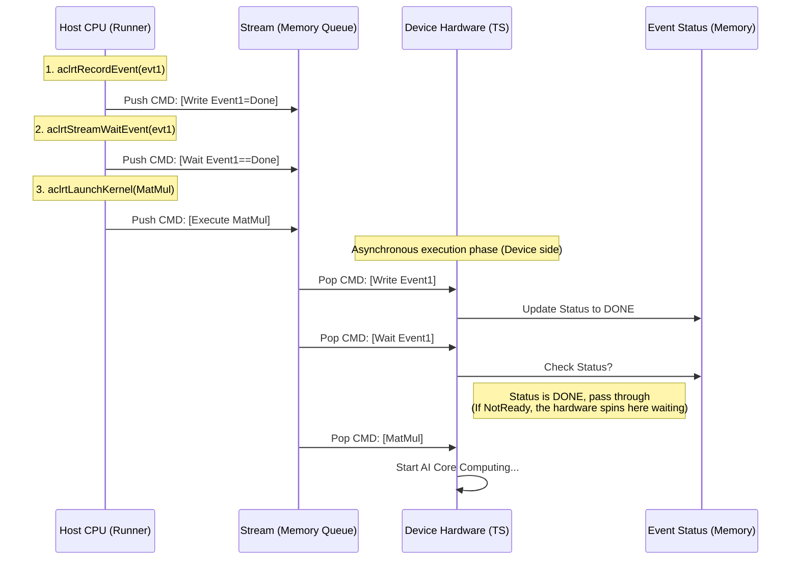

Everything pushed into a Stream is executed by the Device hardware.

## 2. Device, Context, Stream, and Other Hardware Resource Relationship Modeling

Relationships among Device, Context, Stream, and user host threads. For communicator-side resources (Socket/RDMA/UB interfaces), see [section 4 Communicator Modeling](#4-communicator-modeling).

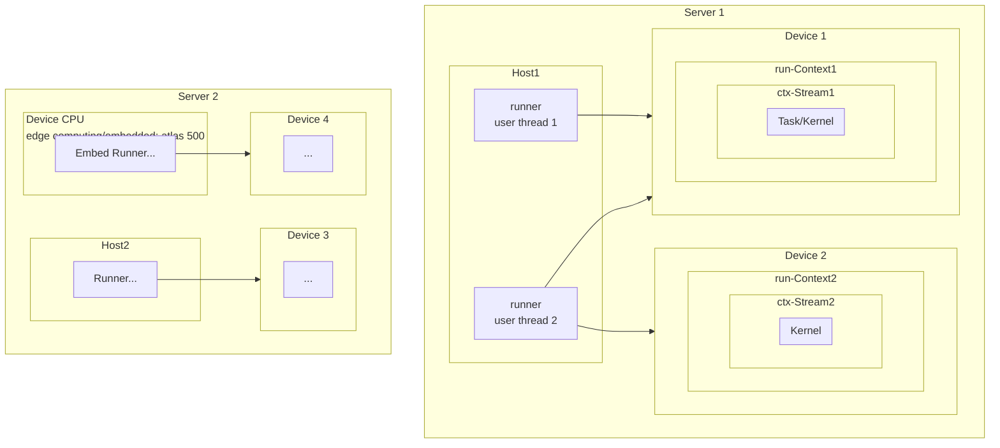

### 2.1 Basic Device Relationship Modeling

#### 2.1.1 Hierarchical Structure Overview

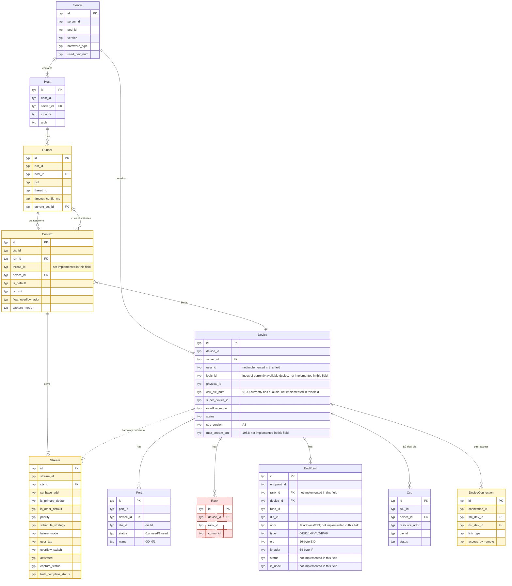

#### 2.1.2 Network Communication Resources

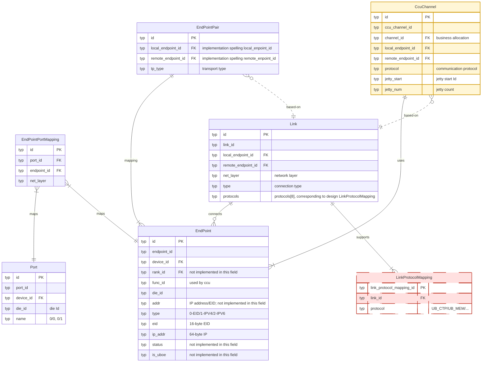

> `LinkProtocolMapping` is not an independent struct/table in the implementation but rather an array field `Link.protocols[8]` (see `include/runnerdb/sim_models.h`). When troubleshooting or creating tables, treat it as an array field; do not split it into an independent table based on this diagram.

#### 2.1.3 Key Relationship Description

##### Layer 1: Physical Topology Layer

| Relationship | Meaning | Description/Notes |
| --- | --- | --- |
| Server to Host | A Server may contain multiple Host instances | For example, multi-socket CPU or virtualization environments |
| Server to Device | A Server contains multiple AI devices | Corresponds to /dev/davinci0, /dev/davinci1, and so on |

##### Layer 2: Process and Context Layer

| Relationship | Meaning | Description/Notes |
| --- | --- | --- |
| Host to Runner | Each host has multiple application threads (Runner) | Each Runner can create multiple Contexts |
| Runner to Context | A thread creates or switches to different Contexts | Uses aclrtCreateContext() and aclrtSetCurrentContext() |
| Context to Device | A Context binds to a Device | Cannot span devices once created |
| Context to Stream | Each Context can create multiple Streams | Corresponds to aclrtCreateStream() |
| Runner and Context (current) | Current context activation state | aclrtGetCurrentContext(), aclrtSetCurrentContext() |
| Device to Stream | Resource upper-limit constraint | The Stream count is limited by hardware (`max_stream_cnt`, source `src/proxy/level2/aclrt_stream_stub.cc:244,287`) |

##### Layer 3: Device Internal Resource Layer

| Relationship | Meaning | Description/Notes |
| --- | --- | --- |
| Device to Port | A Device contains multiple communication ports | Used for network topology connections, format such as "0/0, 0/1" |
| Device to Rank | A Device associates with communication Ranks | A Rank is a participating node identifier in a communicator |
| Device to EndPoint | A Device contains multiple EndPoints | IP address/EID addressing identifiers, used for network communication |
| Device to Ccu | A Device contains multiple CCU units | 910D uses a dual-die architecture, one CCU per die |
| Device to DeviceConnection | Inter-device communication channel | aclrtDeviceCanAccessPeer(), aclrtDeviceEnablePeerAccess() |

##### Network Communication Resource Layer

| Relationship | Meaning | Description/Notes |
| --- | --- | --- |
| EndPoint to Port | EndPoint-to-Port mapping | Implements many-to-many mapping through EndPointPortMapping |
| Link to EndPoint | Physical connection associates EndPoints | Defined by topo.json, describes physical topology |
| Link to LinkProtocolMapping | Protocols supported by a connection | A Link can support multiple protocols (UB_CTP/UB_MEM and so on) |

#### 2.1.4 Interface Mapping Table

##### Base and Device Layer (Device / Server)

| Entity/Property                   | Key API Interfaces                                                                                          |
| --------------------------- | ---------------------------------------------------------------------------------------------------- |
| Server/Host                 | `aclInit`, `aclFinalize`                                                                             |
| Runner.pid                  | `rtDeviceGetBareTgid`                                                                                |
| Device                      | `rtGetDeviceCount`                                                                                   |
| Device.id             | `rtSetDevice`,`rtResetDevice`,`rtGetDevice`,`rtsGetLogicDevIdByPhyDevId`                             |
| Device.id          | `rtGetPhyDevIdByLogicDevId`                                                                          |
| Device.name             | `rtGetSocName`                                                                                       |
| Device.mode        | `rtSetDeviceSatMode`,`rtGetDeviceSatMode`                                                            |
| DeviceConnection            | `rtGetDevicesTopo`,`rtDeviceDisablePeerAccess`,`rtDeviceEnablePeerAccess`,`rtDevicePeerAccessStatus` |
| Context.id          | `rtCreateContext`,`rtDestroyContext`                                                                 |
| Context.default          | `rtSetCurrentContext`,`rtGetCurrentContext`                                                          |
| Context.addr | `rtCtxGetFloatOverflowAddr`                                                                          |
| Stream table                    | `aclrtGetStreamAvailableNum`                                                                         |
| Stream.id            | `rtCreateStream`,`rtCreateStreamWithConfig`,`rtDestroyStream`,`rtDestroyStreamForce`                 |
| Stream.status | `rtSynchronizeStream`, `rtSynchronizeStreamWithTimeout`                                              |
| Stream.activated            | `rtStreamStop`                                                                                       |
| Stream.mode         | `rtSetStreamAttribute`,`rtGetStreamAttribute`                                                        |

### 2.2 Basic Memory Management Relationship Modeling

The interfaces corresponding to local memory blocks and remote memory import (`RaCtxLmemRegister` / `RaCtxRmemImport`) are described in [section 4.1.4 Data Plane: UB Unified Bus](#414-data-plane-ub-unified-bus).

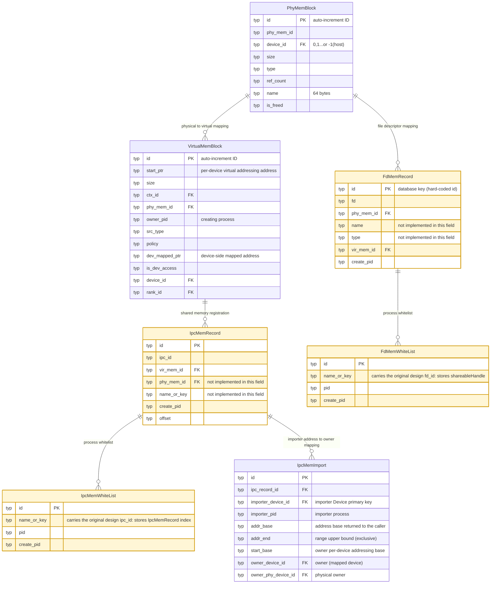

> **Database table names**: The entities in this diagram map to tables registered in `include/runnerdb/db_sim_sqlite_db.h`. When querying or modifying the database, use the table names: `PhyMemBlock` maps to `PhMem`, `VirtualMemBlock` maps to `VirMem`, `IpcMemWhiteList` maps to `IpMemWhiteList`; see `include/runnerdb/sim_models.h` for field name mapping.

#### 2.2.1 Key Relationship Description (Basic Memory Management Relationship Modeling)

1. **Physical memory is the core entity**.
   `PhyMemBlock` serves as the base entity, associating with all other entities through `phy_mem_id`, which reflects the Ascend "physical memory pooling" design philosophy.
2. **Three-layer mapping system**:

   - Physical to virtual (`VirtualMemBlock`)
   - Physical to IPC sharing (`IpcMemRecord`)
   - Physical to file descriptor (`fdMemRecord`)
3. **Security control**:
   `IpcMemWhiteList` implements Huawei HCCS (Huawei Collective Communication Service) secure sharing through a process PID whitelist mechanism.
4. **Special mapping types**:
   `MemMapRecord` records dual virtual address mapping scenarios (such as mappings produced by `aclrtMapMem`), supporting zero-copy data transfer on Huawei NPU.
5. **Cross-device (P2P/PCIe) address owner reverse lookup**:
   `IpcMemImport` registers the "importer address range to memory owner (mapped device / physical owner)" mapping when `aclrtIpcMemImportByKey` succeeds.
   This must persist in the database because A5 P2P transfers write the peer buffer address directly into the SDMA SQE (`BuildA5SqeSdmaCopy` only fills srcAddr/dstAddr/length/opcode/partId);
   the SQE contains neither `rmtEid` nor deviceId (in contrast to UBDMA which relies on the WQE `rmtEid` to locate the peer). The device process can only reverse-lookup this table by
   `(importer_device_id, addr_base <= addr < addr_end)` to obtain the peer device, then convert to the owner per-device virtual address
   (`virtualAddress = start_base + (addr - addr_base)`, see `ResolveImportedTaskAddress` / `ResolveTaskAddressLocalOrImported` in `src/device_arm/common/hccl_device_pub.cc`).
   The A3 (910) `hrtIpcOpenMemory` uses the same import interface,
   and the mapping also applies (A3 tasks use the level1 northbound path and do not consume this table).

#### 2.2.2 Interface Mapping Table (Basic Memory Management Relationship Modeling)

| Entity                           | Key Management Interfaces                                                                                                                                    |
| ------------------------------ | ----------------------------------------------------------------------------------------------------------------------------------------------- |
| PhyMemBlock                    | `rtMallocPhysical`, `rtFreePhysical`                                                                                                            |
| VirtualMemBlock            | `rtMallocWithCfg`,`rtMallocForTaskScheduler`,`rtMallocHostWithCfg`,`rtFree`,`rtReserveMemAddress`,`ReleaseMemAddress`, `rtMapMem`, `rtUnmapMem` |
| VirtualMemBlock.ctx_id | `rtPointerGetAttributes`                                                                                                                        |
| FdMemRecord.fd                 | `rtMemExportToShareableHandle`, `rtMemImportFromShareableHandle`                                                                                |
| FdMemWhiteList.pid             | `rtMemSetPidToShareableHandle`                                                                                                                  |
| IpcMemRecord.name_or_key       | `rtIpcMemGetExportKey`                                                                                                                          |
| IpcMemRecord.id            | `rtIpcMemImportByKey`,`IpcMemClose`                                                                                                             |
| IpcMemWhiteList.pid            | `rtIpcMemSetImportPid`                                                                                                                          |
| IpcMemImport (entire row)          | Registered when `aclrtIpcMemImportByKey` import succeeds; cascade cleanup by `ipc_record_id` on `aclrtIpcMemClose`; `hccl-vm reset` performs `DeleteAll` together with memory tables                |
| IpcMemImport.addr_base/addr_end | Device-side `ResolveImportedTaskAddress` range hit (A5 cross-device SDMA SQE peer resolution)                                                            |
| IpcMemImport.owner_phy_device_id | Task field `srcDeviceId`/`dstDeviceId` physical owner scope (consistent with `ResolveTaskAddress` step 3)                                                 |
| MemMapRecord                   | `rtHostRegister`, `rtHostUnRegister`                                                                                                            |

## 3. Extending Data Task Models on the Base Model

### 3.1 Data and Task Flow Modeling

Task arrangement on a Stream; the Task family is implemented by `Task` / `EventSyncTask`; for synchronization primitives, see [section 3.3 Asynchronous and Synchronous Execution Modeling](#33-asynchronous-and-synchronous-execution-modeling).

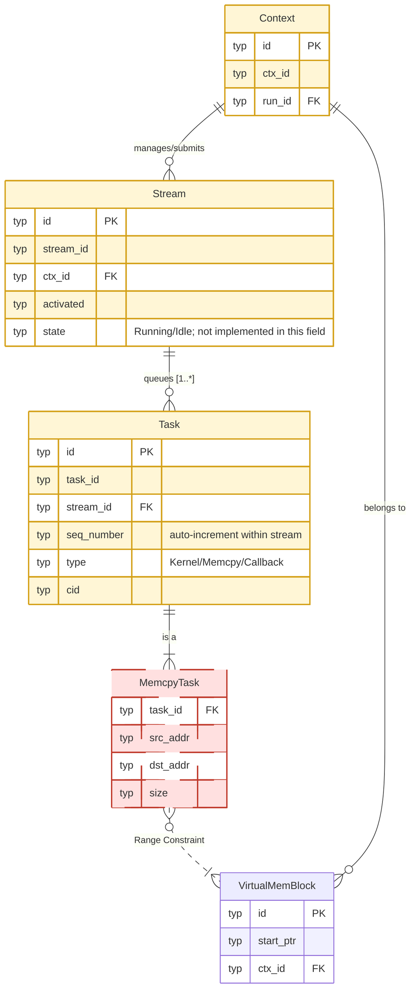

### 3.2 CCU Resource Modeling

An NPU device contains 2 CCUs, one for die0 and one for die1. For CCU die-level hardware synchronization resources (Notify), see [section 3.3.1 Notify Resource Management](#331-notify-resource-management); for UB-side context interfaces, see [section 4.1.4 Data Plane: UB Unified Bus](#414-data-plane-ub-unified-bus).

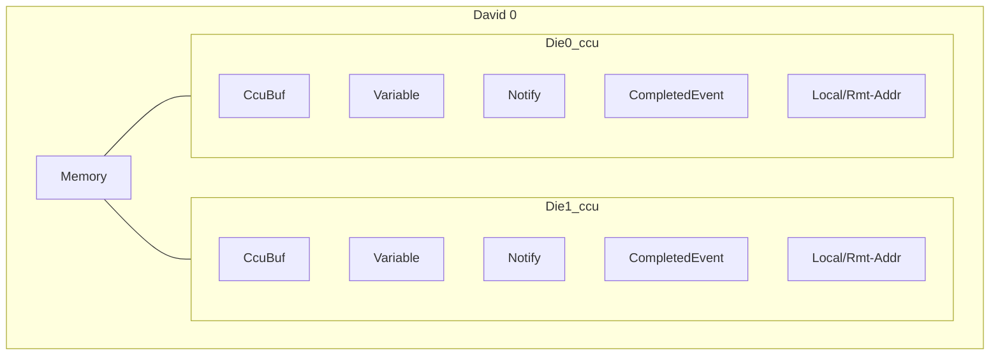

#### 3.2.1 Interface Mapping Table (CCU Resource Modeling)

| Entity               | Key Management Interfaces                                             |
| ------------------ | -------------------------------------------------------- |
| CcuBuf             | `rtCcuBufAlloc`, `rtCcuBufFree`, `rtCcuBufGetAddr`       |
| Variable           | `rtVariableCreate`, `rtVariableDestroy`, `rtVariableSet` |
| Notify             | `rtCreateNotify`, `rtDestroyNotify`                      |
| CompletedEvent     | `rtCreateEvent`, `rtDestroyEvent`                        |
| Local/Rmt-Addr     | `rtGetDeviceLocalAddr`, `rtGetDeviceRemoteAddr`          |
| CCU resource query        | `rtGetCcudieInfo`, `rtGetCcudieNum`                      |

#### 3.2.2 CCU Resource Lifecycle Description

**CCU initialization flow**:

1. When a Device starts, both CCUs (die0/die1) initialize automatically.
2. Each CCU allocates independent CcuBuf, Variable, and Notify resource pools.
3. CompletedEvent is used to notify task completion status.

**Resource constraints**:

- The CcuBuf count per CCU is limited (depends on Device.version)
- Variable stores shared variables during communication.
- Notify is used for cross-CCU synchronization notification.
- Local/Rmt-Addr is used for address translation during cross-die communication.

> Note: The Notify inside a CCU is a die-level hardware synchronization resource (an hcomm-side concept); it is not the same entity as the `Notify` managed by `rtCreateNotify` in section 3.3.1 (Device/Context level, database table `sim::Notify`: `create_ctx_id` + `device_notify_seq`).

### 3.3 Asynchronous and Synchronous Execution Modeling

#### 3.3.1 [Notify Resource Management](https://www.hiascend.com/document/detail/zh/CANNCommunityEdition/850alpha001/appdevg/acldevg/aclcppdevg_000524.html)

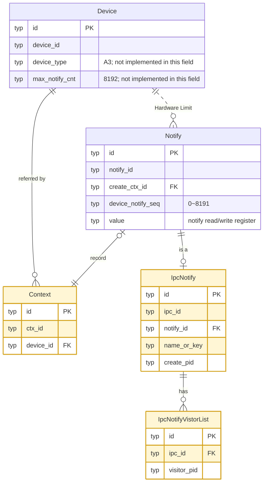

##### Key Relationship Description ([Notify Resource Management](https://www.hiascend.com/document/detail/zh/CANNCommunityEdition/850alpha001/appdevg/acldevg/aclcppdevg_000524.html))

**Hardware constraints between Notify and Device**:

- The maximum Notify count per Device is `max_notify_cnt` (for example, the A3 chip supports 8192, source `src/plugin/runner/runner_utils/device_resource.h:22 MAX_NOTIFY_NUM`)
- `device_notify_seq` is the physical index of the Notify within the Device (0 to 8191)
- When creating a Notify, the owning Context must be specified, and the Context is bound to a specific Device.

**Notify IPC sharing mechanism**:

- `IpcNotify` allows cross-process sharing of Notify instances.
- `name_or_key` is the sharing identifier, obtained through `rtNotifyGetExportKey`.
- Other processes import and use it through `rtNotifyImportByKey`.
- `IpcNotifyVistorList` records the PIDs of processes authorized to access the Notify.

**Notify state management**:

- The `value` field maps to a hardware register for read/write state.
- `rtWaitAndResetNotify` waits for the Notify to become Ready and then resets it.
- Notify is used for inter-Stream synchronization and cross-process synchronization scenarios.

##### Interface Mapping Table ([Notify Resource Management](https://www.hiascend.com/document/detail/zh/CANNCommunityEdition/850alpha001/appdevg/acldevg/aclcppdevg_000524.html))

| Entity                       | Key Management Interfaces                                        |
| -------------------------- | --------------------------------------------------- |
| Notify.id           | `rtCreateNotify`,`rtDestroyNotify`, `rtGetNotifyId` |
| Notify.value               | `lrtWaitAndResetNotify`, `rtWaitAndResetNotify`     |
| IpcNotify.name_or_key      | `rtNotifyGetExportKey`,`rtNotifyImportByKey`        |
| IpcNotifyVistorList.ipc_id | `rtNotifySetImportPid`                              |

#### 3.3.2 Notify Synchronization Control

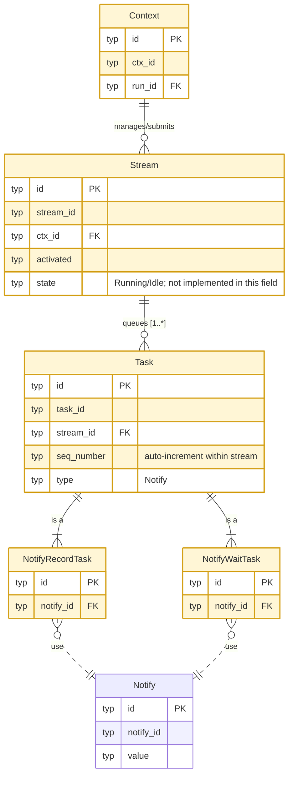

##### Key Relationship Description (Notify Synchronization Control)

**Notify task types**:

- `NotifyRecordTask`: Sets the Notify status to Ready, indicating that an event has completed.
- `NotifyWaitTask`: Waits for the Notify status to become Ready, implementing inter-Stream synchronization.

**Task execution order**:

- NotifyRecordTask runs on StreamA and sets the Notify to Ready.
- NotifyWaitTask runs on StreamB and waits for the same Notify.
- After the Notify becomes Ready, subsequent tasks on StreamB can continue execution.

**Cross-Stream synchronization sample**:

```text
StreamA: Task1 -> NotifyRecordTask(notify_id=1) -> Task2
StreamB: NotifyWaitTask(notify_id=1) -> Task3
// Task3 must wait for Task1 to complete before execution
```

##### Interface Mapping Table (Notify Synchronization Control)

| Entity             | Key Management Interfaces            |
| ---------------- | ----------------------- |
| NotifyRecordTask | `rtRecordNotify`        |
| NotifyWaitTask   | `lrtWaitAndResetNotify` |

#### 3.3.3 Event Resource Management

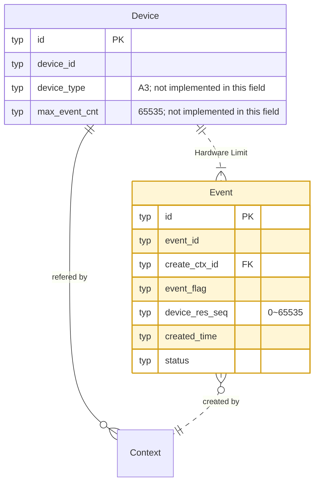

##### Key Relationship Description (Event Resource Management)

**Hardware constraints between Event and Device**:

- The maximum Event count per Device is `max_event_cnt` (for example, the A3 chip supports 65535, source `src/proxy/level2/aclrt_event_stub.cc:191,220`)
- `device_res_seq` is the physical index of the Event within the Device (0 to 65535)
- When creating an Event, the owning Context must be specified, and the Context is bound to a specific Device.

**Relationship between Event and Context**:

- `create_ctx_id` records the Context that created the Event.
- An Event can be shared across multiple Streams but must belong to the same Context.
- Cross-Context Event sharing requires an IPC mechanism (similar to Notify)

**Event state management**:

- The `status` field indicates the current Event state: NotRecorded/Recorded/Completed.
- `event_flag` controls Event behavior (such as whether to auto-reset)
- `created_time` is used for performance statistics.

##### Interface Mapping Table (Event Resource Management)

| Entity           | Key Management Interfaces                                                             |
| -------------- | ------------------------------------------------------------------------ |
| Event.id | `rtCreateEvent`, `rtCreateEventWithFlag`,`rtDestroyEvent`,`rtGetEventId` |
| Event.status   | `rtRecordEvent`,`rtQueryEventStatus`                                     |

#### 3.3.4 Event Flow Control

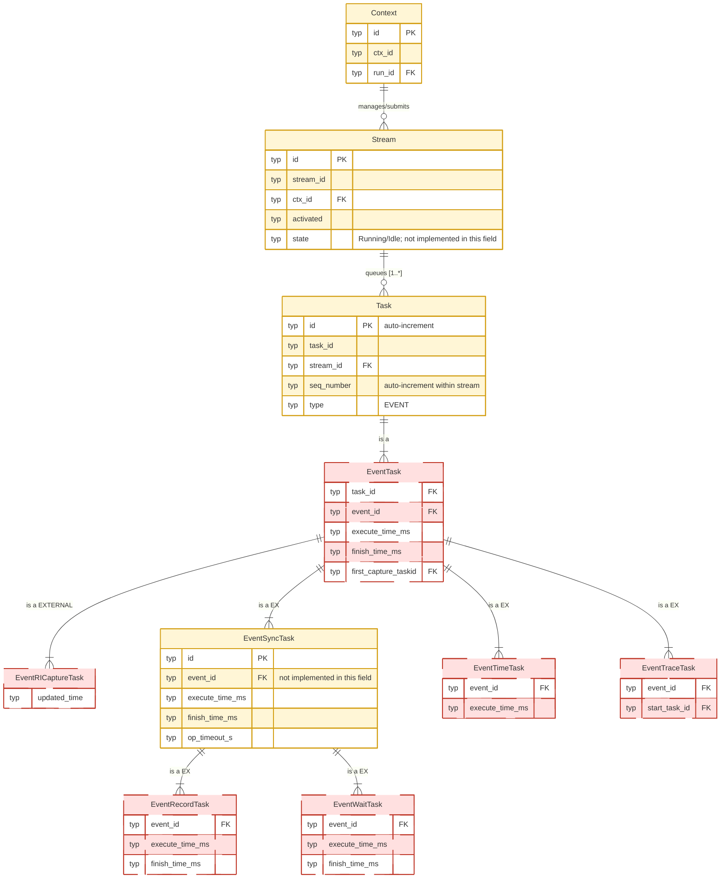

##### Key Relationship Description (Event Flow Control)

**Event task type classification**:

- `EventRecordTask`: Sets the Event status to Recorded/Completed.
- `EventWaitTask`: Waits for the Event status to become Completed.
- `EventSyncTask`: Synchronously waits for Event completion (blocking call)
- `EventRICaptureTask`: A special record task in RI Capture mode.
- `EventTimeTask`: Records timestamp-related tasks.
- `EventTraceTask`: A task record used for performance tracing.

**Event task inheritance**:

- `EventTask` is the base class, containing task-id, event-id, execute-time, and finish-time. (In the implementation, `EventSyncTask` has no `task_id`/`event_id`; the Event identity is `Event.id`; the time fields are implemented as `execute_time_ms`/`finish_time_ms`)
- `EventSyncTask` inherits EventTask and adds the op_timeout_s timeout parameter.
- `EventRecordTask` and `EventWaitTask` inherit EventSyncTask.
- `EventRICaptureTask`, `EventTimeTask`, and `EventTraceTask` directly inherit EventTask.

**Event execution flow**:

```text
StreamA: KernelTask -> EventRecordTask(event_id=1)
StreamB: EventWaitTask(event_id=1) -> KernelTask2
// KernelTask2 on StreamB must wait for KernelTask on StreamA to complete
```

**Task tracing relationships**:

- `first_capture_task_id` records the Task ID of the first Capture.
- `EventTraceTask.id` associates with the tracing start task.
- EventRecordTask maps through EventWaitTask to implement cross-Stream synchronization.

##### Interface Mapping Table (Event Flow Control)

| Entity            | Key Management Interfaces                                         |
| --------------- | ---------------------------------------------------- |
| EventTask       | `rtRecordEvent`, `rtResetEvent`,`rtSynchronizeEvent` |
| EventRecordTask | `rtRecordEvent`, `rtResetEvent`                      |
| EventWaitTask   | `rtStreamWaitEvent`, `rtQueryEventWaitStatus`        |
| EventTimeTask   | `rtResetEvent`, `rtRecordEvent`                      |
| EventTraceTask  | `rtResetEvent`, `rtRecordEvent`                      |

## 4. Communicator Modeling

Cross-machine communication involves multi-communicator hybrid task orchestration.
A communicator is essentially a multi-card network topology maintained by HCCL at the framework layer through the link-establishment capability provided by Rdma_Agent, stored in the host process. For the interface list of each plane, see [section 4.1.8 HCCP Interface Classification](#418-hccp-interface-classification).

### 4.1 Communicator Core Concepts

A Communicator is the basic abstraction for HCCL collective communication. Each communicator defines a set of participating Ranks and their topology relationships. For Rank / EndPoint entity modeling, see [section 2.1.2 Network Communication Resources](#212-network-communication-resources).

#### 4.1.1 Communicator Basic Definition

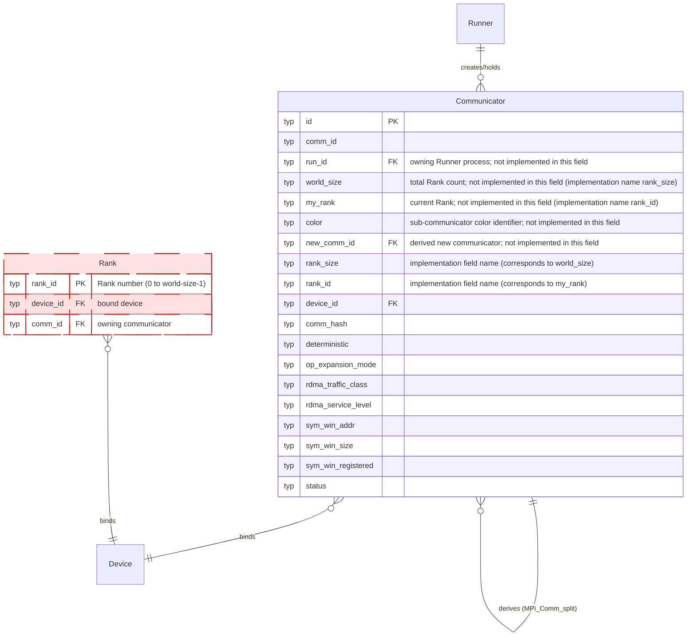

#### 4.1.2 Control Plane: Socket Communication

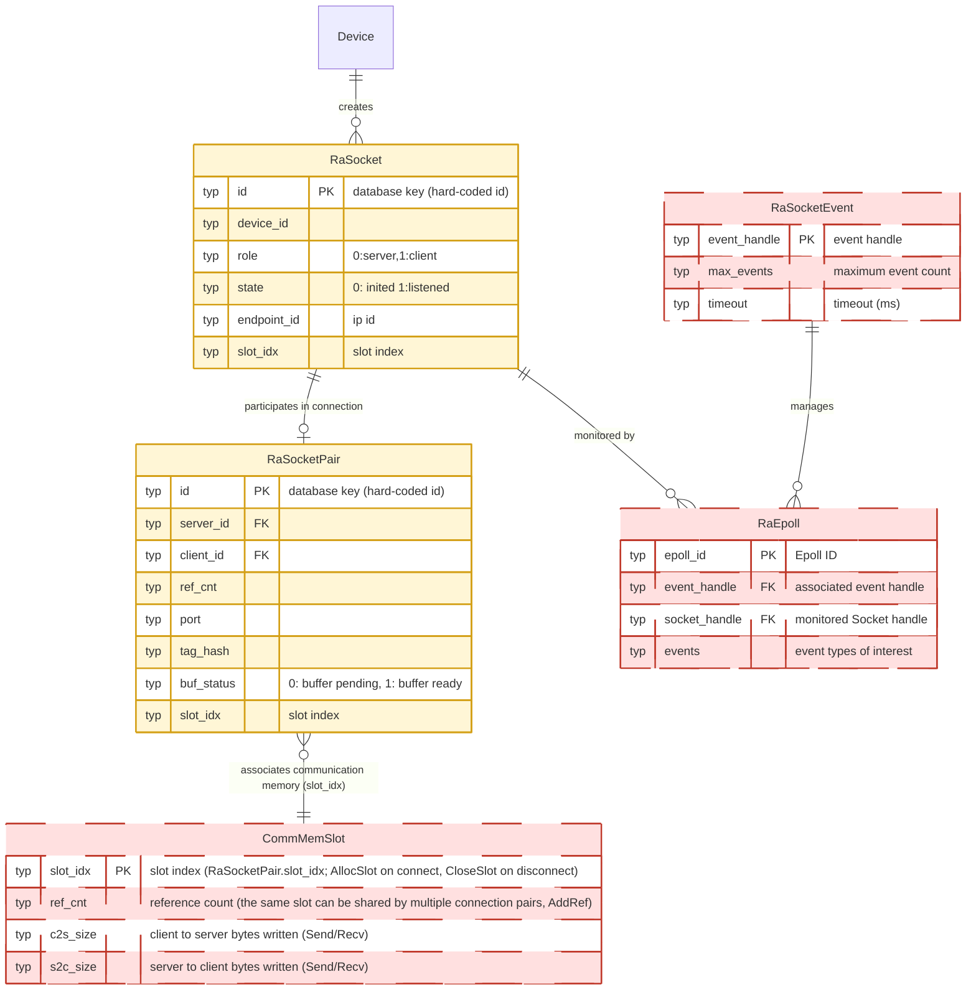

#### 4.1.3 Data Plane: RDMA Communication

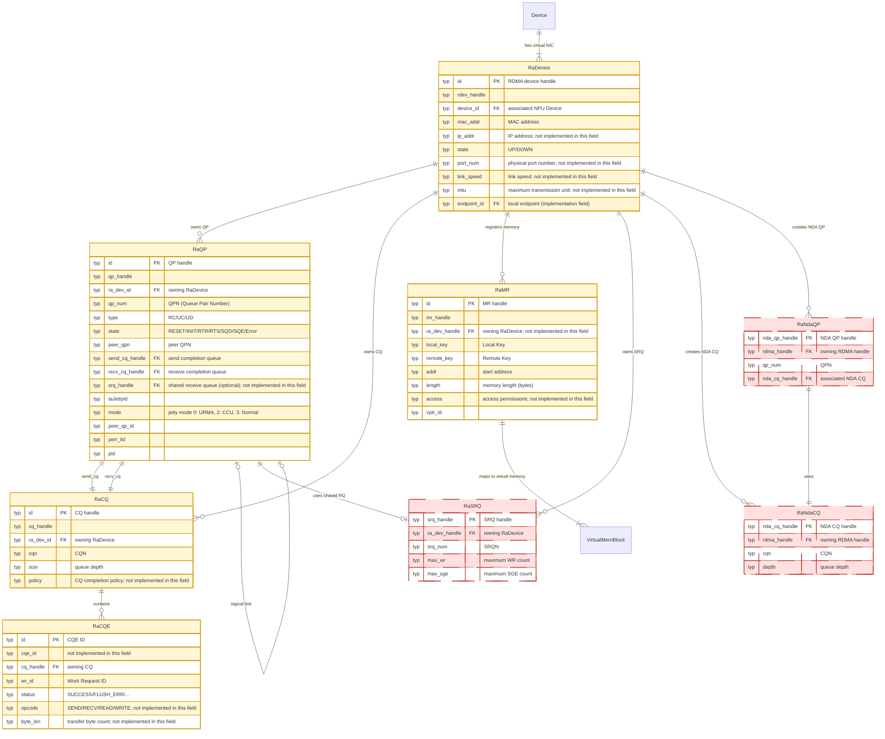

#### 4.1.4 Data Plane: UB Unified Bus

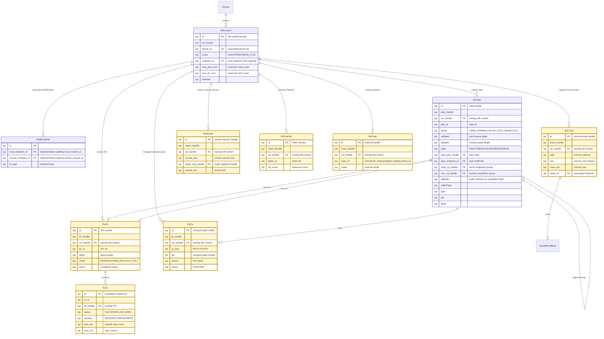

#### 4.1.5 Asynchronous Request Management

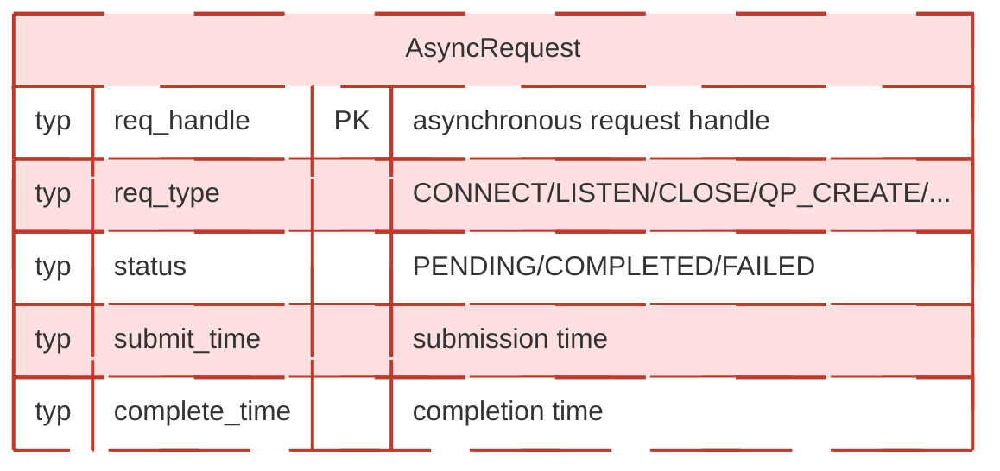

> Note: `AsyncRequest` is an internal implementation object and does not need modeling at this time (no corresponding struct or database table exists).

#### 4.1.6 Communicator Architecture Summary

```text
+------------------------------------------------------------------+
|                    HCCL Communicator Architecture                 |
+------------------------------------------------------------------+
|  Application Layer                                                |
|  +------------------------------------------------------------+  |
|  |  Communicator                                               |  |
|  |  +-- Rank[0..N] (participating nodes, each bound to Device) |  |
|  +------------------------------------------------------------+  |
+------------------------------------------------------------------+
|  Control Plane (link establishment/handshake)                     |
|  +------------------------------------------------------------+  |
|  |  RaSocket (Socket Communication)                            |  |
|  |  +-- RaSocketPair (connection pair)                         |  |
|  |  +-- RaEpoll (event monitoring)                             |  |
|  +------------------------------------------------------------+  |
+------------------------------------------------------------------+
|  Data Plane (data transfer)                                       |
|  +------------------------+    +------------------------+        |
|  |  RDMA (traditional mode)|    |  UB (unified bus)      |        |
|  |  +-- RaDevice           |    |  +-- RaContext         |        |
|  |  +-- RaQP (queue pair)  |    |  +-- RaJetty (QP)      |        |
|  |  +-- RaCQ (comp queue)  |    |  +-- RaJfc (CQ)        |        |
|  |  +-- RaMR (memory reg)  |    |  +-- RaLmem/Rmem       |        |
|  |  +-- RaSRQ (shared RQ)  |    |  +-- RaTp (trans path) |        |
|  +------------------------+    +------------------------+        |
+------------------------------------------------------------------+
```

#### 4.1.7 Key Entity Comparison Table

| Concept | RDMA Mode | UB Mode | Description |
| --- | --- | --- | --- |
| Context | RaDevice | RaContext | Device/context handle |
| Queue Pair | RaQP | RaJetty | Data transfer channel |
| Completion Queue | RaCQ | RaJfc | Completion notification |
| Completion Element | RaCQE | RaCr | Completion status |
| Local Memory | RaMR | RaLmem | Memory registration |
| Remote Memory | - | RaRmem | Remote memory import |
| Transport Path | - | RaTp | Physical path management |
| Security Token | - | RaTokenId | Access control |

#### 4.1.8 HCCP Interface Classification

> The "Implementation" column in the table: paths omit the common prefix `src/proxy/level2/`; `hcomm/ only` indicates no implementation in this repository (the implementation is in `hcomm/src/base_comm/resources/hccp/inc/network/hccp_nda.h`); indicates not modeled.

```text
HCCP Network API
+-- Control Plane (Socket Communication)
|   +-- Initialization: RaSocketInit/RaSocketDeinit (Socket)
|   +-- Connection Management: RaSocketBatchConnect/Close/Abort
|   +-- Listener Management: RaSocketListenStart/Stop
|   +-- Data Send/Recv: RaSocketSend/Recv
|   +-- Status Query: RaGetSockets
|   +-- Event Management: RaEpollCtlAdd/Mod/Del
+-- Data Plane - RDMA
|   +-- Initialization: RaRdevInit/RaRdevDeinit (RDMA device)
|   +-- QP Management: RaQpCreate/Destroy/ConnectAsync
|   +-- CQ Management: RaCqCreate/Destroy
|   +-- MR Management: RaMrReg/Dereg
|   +-- Work Requests: RaSendWr/RaRecvWrlist
|   +-- Completion Polling: RaPollCq
+-- Data Plane - UB
|   +-- Initialization: RaCtxInit/RaCtxDeinit (unified context)
|   +-- Jetty Management: RaCtxQpCreate/Destroy/Import/Bind
|   +-- JFC Management: RaCtxCqCreate/Destroy
|   +-- Memory Management: RaCtxLmemRegister/RmemImport
|   +-- Token Management: RaCtxTokenIdAlloc/Free
|   +-- Work Requests: RaBatchSendWr
+-- Asynchronous Operations
|   +-- RaSocketBatchConnectAsync
|   +-- RaCtxQpCreateAsync/DestroyAsync
|   +-- RaGetAsyncReqResult
+-- Network Diagnostics
|   +-- RaPingInit/RaPingDeinit (Ping)
|   +-- RaPingTargetAdd/Del
|   +-- RaPingTaskStart/Stop
|   +-- RaPingGetResults
+-- TLV Messages
|   +-- RaTlvInit/RaTlvDeinit (TLV)
    +-- RaTlvRequest
```

##### Socket Communication Interfaces

| Interface                   | Function           | Key Parameters                                                                 | Implementation |
| ---------------------- | -------------- | ------------------------------------------------------------------------ | -------- |
| `RaSocketInit`         | Socket initialization    | `mode`, `rdevInfo`, `socketHandle`                                      | `hccp_ra_socket_stub.cc:66` |
| `RaSocketDeinit`       | Socket de-initialization | `socketHandle`                                                           | `hccp_ra_socket_stub.cc:110` |
| `RaSocketBatchConnect` | Batch connection       | `SocketConnectInfoT[]`, `num`                                            | `hccp_ra_socket_stub.cc:138` |
| `RaSocketBatchClose`   | Batch close       | `SocketCloseInfoT[]`, `num`                                              | `hccp_ra_socket_stub.cc:254` |
| `RaSocketBatchAbort`   | Batch abort       | `SocketConnectInfoT[]`, `num`                                            | `hccp_ra_socket_stub.cc:279` |
| `RaSocketListenStart`  | Start listening       | `SocketListenInfoT[]`, `num`                                             | `hccp_ra_socket_stub.cc:118` |
| `RaSocketListenStop`   | Stop listening       | `SocketListenInfoT[]`, `num`                                             | `hccp_ra_socket_stub.cc:128` |
| `RaGetSockets`         | Get Socket status | `role`, `SocketInfoT[]`, `num`, `connectedNum`                           | `hccp_ra_socket_stub.cc:188` |
| `RaSocketSend`         | Send data       | `fdHandle`, `data`, `size`, `sentSize`                                   | `hccp_ra_socket_stub.cc:286` |
| `RaSocketRecv`         | Receive data       | `fdHandle`, `data`, `size`, `receivedSize`                               | `hccp_ra_socket_stub.cc:298` |
| `RaEpollCtlAdd`        | Add Epoll event  | `fdHandle`, `event`                                                      | `hccp_ra_socket_stub.cc:313` |
| `RaEpollCtlMod`        | Modify Epoll event  | `fdHandle`, `event`                                                      | `hccp_ra_socket_stub.cc:320` |
| `RaEpollCtlDel`        | Delete Epoll event  | `fdHandle`                                                               | `hccp_ra_socket_stub.cc:327` |
| `RaCreateEventHandle`  | Create event handle   | `eventHandle`                                                            | `hccp_stub.cc:486` |
| `RaWaitEventHandle`    | Wait for event       | `eventHandle`, `SocketEventInfoT[]`, `timeout`, `maxevents`, `eventsNum` | `hccp_stub.cc:498` |
| `RaDestroyEventHandle` | Destroy event handle   | `eventHandle`                                                            | `hccp_stub.cc:505` |
| `RaSocketWhiteListAdd` | Add whitelist     | `socketHandle`, `SocketWlistInfoT[]`, `num`                              | `hccp_stub.cc:1605` |
| `RaSocketWhiteListDel` | Delete whitelist     | `socketHandle`, `SocketWlistInfoT[]`, `num`                              | `hccp_stub.cc:1611` |

###### RDMA Operation Interfaces

| Interface                  | Function           | Key Parameters                                                                | Implementation |
| --------------------- | -------------- | ----------------------------------------------------------------------- | -------- |
| `RaRdevInit`           | RDMA device initialization       | `mode`, `notifyType`, `rdevInfo`, `rdmaHandle`      | `hccp_stub.cc:976` |
| `RaRdevInitV2`         | RDMA device initialization (extended) | `RdevInitInfo`, `rdevInfo`, `rdmaHandle`            | `hccp_stub.cc:948` |
| `RaRdevInitWithBackup` | Initialization with backup       | `initInfo`, `rdevInfo`, `backupRdevInfo`            | `hccp_stub.cc:796` |
| `RaRdevDeinit`         | RDMA device de-initialization     | `rdmaHandle`, `notifyType`                          | `hccp_stub.cc:983` |
| `RaQpCreate`          | Create QP         | `rdevHandle`, `flag`, `qpMode`, `qpHandle`                              | `hccp_stub.cc:1049` |
| `RaQpCreateWithAttrs` | Create QP (with attributes) | `rdevHandle`, `QpExtAttrs`, `qpHandle`                                  | `hccp_stub.cc:1085` |
| `RaAiQpCreate`        | Create AI QP      | `rdevHandle`, `QpExtAttrs`, `AiQpInfo`, `qpHandle`                      | `hccp_stub.cc:1126` |
| `RaLoopbackQpCreate`  | Create loopback QP     | `rdevHandle`, `LoopbackQpPair`, `qpHandle`                              | `hccp_stub.cc:522` |
| `RaTypicalQpCreate`   | Create typical QP     | `rdevHandle`, `flag`, `qpMode`, `TypicalQp`, `qpHandle`                 | `hccp_stub.cc:1132` |
| `RaQpDestroy`         | Destroy QP         | `qpHandle`                                                              | `hccp_stub.cc:1217` |
| `RaQpConnectAsync`    | Connect QP asynchronously     | `qpHandle`, `fdHandle`                                                  | `hccp_stub.cc:587` |
| `RaGetQpStatus`       | Get QP status     | `qpHandle`, `status`                                                    | `hccp_stub.cc:803` |
| `RaTypicalQpModify`   | Modify typical QP     | `qpHandle`, `localQpInfo`, `remoteQpInfo`                               | `hccp_stub.cc:1483` |
| `RaMrReg`             | Register MR         | `qpHandle`, `MrInfoT`                                                   | `hccp_stub.cc:324` |
| `RaMrDereg`           | Deregister MR         | `qpHandle`, `MrInfoT`                                                   | `hccp_stub.cc:353` |
| `RaRegisterMr`        | Register MR independently     | `rdmaHandle`, `MrInfoT`, `mrHandle`                                     | `hccp_stub.cc:376` |
| `RaDeregisterMr`      | Deregister MR independently     | `rdmaHandle`, `mrHandle`                                                | `hccp_stub.cc:407` |
| `RaRemapMr`           | Remap MR       | `rdmaHandle`, `MemRemapInfo[]`, `num`                                   | `hccp_stub.cc:401` |
| `RaGetNotifyMrInfo`   | Get notification MR info | `rdevHandle`, `MrInfoT`                                                 | `hccp_stub.cc:918` |
| `RaSendWr`            | Send work request   | `qpHandle`, `SendWr`, `SendWrRsp`                                       | `hccp_stub.cc:426` |
| `RaSendWrV2`          | Send work request V2 | `qpHandle`, `SendWrV2`, `SendWrRsp`                                     | `hccp_stub.cc:607` |
| `RaSendWrlist`        | Batch send       | `qpHandle`, `SendWrlistData[]`, `SendWrRsp[]`, `sendNum`, `completeNum` | `hccp_stub.cc:822` |
| `RaRecvWrlist`        | Batch receive       | `qpHandle`, `RecvWrlistData`, `recvNum`, `completeNum`                  | `hccp_stub.cc:669` |
| `RaPollCq`            | Poll CQ         | `qpHandle`, `isSendCq`, `numEntries`, `wc`                              | `hccp_stub.cc:630` |
| `RaCqCreate`          | Create CQ         | `rdevHandle`, `CqAttr`                                                  | `hccp_stub.cc:991` |
| `RaCqDestroy`         | Destroy CQ         | `rdevHandle`, `CqAttr`                                                  | `hccp_stub.cc:1025` |
| `RaCreateSrq`         | Create SRQ        | `rdmaHandle`, `SrqAttr`                                                 | `hccp_stub.cc:474` |
| `RaDestroySrq`        | Destroy SRQ        | `rdmaHandle`, `SrqAttr`                                                 | `hccp_stub.cc:480` |
| `RaSetQpAttrQos`      | Set QP QoS     | `qpHandle`, `QosAttr`                                                   | `hccp_stub.cc:450` |
| `RaSetQpAttrTimeout`  | Set QP timeout     | `qpHandle`, `timeout`                                                   | `hccp_stub.cc:456` |
| `RaSetQpAttrRetryCnt` | Set QP retry count | `qpHandle`, `retryCnt`                                                  | `hccp_stub.cc:462` |
| `RaGetQpAttr`         | Get QP attributes     | `qpHandle`, `QpAttr`                                                    | `hccp_stub.cc:1562` |
| `RaGetQpContext`      | Get QP context   | `qpHandle`, `qp`, `sendCq`, `recvCq`                                    | `hccp_stub.cc:696` |

###### UB Unified Bus Interfaces

| Interface                    | Function             | Key Parameters                                                         | Implementation |
| ----------------------- | ---------------- | ---------------------------------------------------------------- | -------- |
| `RaCtxInit`            | Context initialization         | `CtxInitCfg`, `CtxInitAttr`, `ctxHandle`            | `hccp_stub.cc:1138` |
| `RaCtxDeinit`          | Context de-initialization       | `ctxHandle`                                         | `hccp_stub.cc:1175` |
| `RaGetDevEidInfoNum`    | Get EID count      | `RaInfo`, `num`                                                  | `hccp_ccu_stub.cc:575` |
| `RaGetDevEidInfoList`   | Get EID list      | `RaInfo`, `HccpDevEidInfo[]`, `num`                              | `hccp_ccu_stub.cc:586` |
| `RaGetEidByIp`          | Get EID by IP    | `ctxHandle`, `IpInfo[]`, `HccpEid[]`, `num`                      | `hccp_stub.cc:2306` |
| `RaGetDevBaseAttr`      | Get device attributes     | `ctxHandle`, `DevBaseAttr`                                       | `hccp_stub.cc:1182` |
| `RaCtxGetAsyncEvents`   | Get asynchronous events     | `ctxHandle`, `AsyncEvent[]`, `num`                               | `hccp_ccu_stub.cc:553` |
| `RaCtxTokenIdAlloc`     | Allocate TokenID      | `ctxHandle`, `HccpTokenId`, `tokenIdHandle`                      | `hccp_stub.cc:1885` |
| `RaCtxTokenIdFree`      | Free TokenID      | `ctxHandle`, `tokenIdHandle`                                     | `hccp_stub.cc:2036` |
| `RaCtxLmemRegister`     | Register local memory     | `ctxHandle`, `MrRegInfoT`, `lmemHandle`                          | `hccp_stub.cc:2047` |
| `RaCtxLmemUnregister`   | Unregister local memory     | `ctxHandle`, `lmemHandle`                                        | `hccp_stub.cc:1906` |
| `RaCtxRmemImport`       | Import remote memory     | `ctxHandle`, `MrImportInfoT`, `rmemHandle`                       | `hccp_stub.cc:1968` |
| `RaCtxRmemUnimport`     | Unimport remote memory | `ctxHandle`, `rmemHandle`                                        | `hccp_stub.cc:1919` |
| `RaCtxChanCreate`       | Create channel         | `ctxHandle`, `ChanInfoT`, `chanHandle`                           | `hccp_stub.cc:1993` |
| `RaCtxChanDestroy`      | Destroy channel         | `ctxHandle`, `chanHandle`                                        | `hccp_stub.cc:2005` |
| `RaCtxCqCreate`         | Create CQ           | `ctxHandle`, `CqInfoT`, `cqHandle`                               | `hccp_stub.cc:2142` |
| `RaCtxCqDestroy`        | Destroy CQ           | `ctxHandle`, `cqHandle`                                          | `hccp_stub.cc:2148` |
| `RaCtxQpCreate`         | Create QP/Jetty     | `ctxHandle`, `QpCreateAttr`, `QpCreateInfo`, `qpHandle`          | `hccp_stub.cc:1254` |
| `RaCtxQpQueryBatch`     | Batch query QP       | `qpHandle[]`, `JettyAttr[]`, `num`                               | `hccp_stub.cc:2106` |
| `RaCtxQpDestroy`        | Destroy QP/Jetty     | `qpHandle`                                                       | `hccp_stub.cc:2012` |
| `RaCtxQpImport`         | Import Jetty        | `ctxHandle`, `QpImportInfoT`, `remQpHandle`                      | `hccp_stub.cc:1321` |
| `RaCtxQpUnimport`       | Unimport Jetty    | `ctxHandle`, `remQpHandle`                                       | `hccp_stub.cc:1425` |
| `RaCtxQpBind`           | Bind Jetty        | `qpHandle`, `remQpHandle`                                        | `hccp_stub.cc:1394` |
| `RaCtxQpUnbind`         | Unbind Jetty        | `qpHandle`                                                       | `hccp_stub.cc:2112` |
| `RaBatchSendWr`         | Batch send         | `qpHandle`, `SendWrData[]`, `SendWrResp[]`, `num`, `completeNum` | `hccp_stub.cc:2135` |
| `RaCtxGetAuxInfo`       | Get auxiliary info     | `ctxHandle`, `HccpAuxInfoIn`, `HccpAuxInfoOut`                   | `hccp_stub.cc:2270` |
| `RaCtxGetCrErrInfoList` | Get CR error info       | `ctxHandle`, `CrErrInfo[]`, `num`                                | `hccp_stub.cc:2276` |

###### Asynchronous Operation Interfaces

| Interface                        | Function           | Key Parameters                                                             | Implementation |
| --------------------------- | -------------- | -------------------------------------------------------------------- | -------- |
| `RaGetAsyncReqResult`       | Get asynchronous result   | `reqHandle`, `reqResult`                                             | `hccp_ra_socket_stub.cc:341` |
| `RaSocketBatchConnectAsync` | Batch connect asynchronously   | `SocketConnectInfoT[]`, `num`, `reqHandle`                           | `hccp_ra_socket_stub.cc:348` |
| `RaSocketListenStartAsync`  | Start listening asynchronously   | `SocketListenInfoT[]`, `num`, `reqHandle`                            | `hccp_ra_socket_stub.cc:354` |
| `RaSocketListenStopAsync`   | Stop listening asynchronously   | `SocketListenInfoT[]`, `num`, `reqHandle`                            | `hccp_ra_socket_stub.cc:362` |
| `RaSocketBatchCloseAsync`   | Batch close asynchronously   | `SocketCloseInfoT[]`, `num`, `reqHandle`                             | `hccp_ra_socket_stub.cc:370` |
| `RaSocketSendAsync`         | Send asynchronously       | `fdHandle`, `data`, `size`, `sentSize`, `reqHandle`                  | `hccp_ra_socket_stub.cc:377` |
| `RaSocketRecvAsync`         | Receive asynchronously       | `fdHandle`, `data`, `size`, `receivedSize`, `reqHandle`              | `hccp_ra_socket_stub.cc:384` |
| `RaCtxLmemRegisterAsync`    | Register memory asynchronously   | `ctxHandle`, `MrRegInfoT`, `lmemHandle`, `reqHandle`                 | `hccp_stub.cc:2075` |
| `RaCtxLmemUnregisterAsync`  | Unregister memory asynchronously   | `ctxHandle`, `lmemHandle`, `reqHandle`                               | `hccp_stub.cc:1937` |
| `RaCtxQpCreateAsync`        | Create QP asynchronously     | `ctxHandle`, `QpCreateAttr`, `QpCreateInfo`, `qpHandle`, `reqHandle` | `hccp_stub.cc:2239` |
| `RaCtxQpDestroyAsync`       | Destroy QP asynchronously     | `qpHandle`, `reqHandle`                                              | `hccp_stub.cc:1943` |
| `RaCtxQpDestroyBatchAsync`  | Batch destroy asynchronously   | `ctxHandle`, `qpHandle[]`, `num`, `reqHandle`                        | `hccp_stub.cc:1958` |
| `RaCtxQpImportAsync`        | Import Jetty asynchronously  | `ctxHandle`, `QpImportInfoT`, `remQpHandle`, `reqHandle`             | `hccp_stub.cc:1378` |
| `RaGetTpInfoListAsync`      | Get TP info asynchronously | `ctxHandle`, `GetTpCfg`, `HccpTpInfo[]`, `num`, `reqHandle`          | `hccp_stub.cc:2082` |
| `RaGetEidByIpAsync`         | Get EID by IP asynchronously    | `ctxHandle`, `IpInfo[]`, `HccpEid[]`, `num`, `reqHandle`             | `hccp_stub.cc:2091` |
| `RaGetTpAttrAsync`          | Get TP attributes asynchronously | `ctxHandle`, `tpHandle`, `attrBitmap`, `TpAttr`, `reqHandle`         | `hccp_stub.cc:2098` |
| `RaSetTpAttrAsync`          | Set TP attributes asynchronously | `ctxHandle`, `tpHandle`, `attrBitmap`, `TpAttr`, `reqHandle`         | `hccp_stub.cc:2263` |

###### Network Diagnostic Interfaces

| Interface               | Function         | Key Parameters                                     | Implementation |
| ------------------ | ------------ | -------------------------------------------- | -------- |
| `RaPingInit`       | Ping initialization    | `PingInitAttr`, `PingInitInfo`, `pingHandle`| `hccp_stub.cc:1843` |
| `RaPingDeinit`     | Ping de-initialization  | `pingHandle`                                | `hccp_stub.cc:1849` |
| `RaPingTargetAdd`  | Add Ping target | `pingHandle`, `PingTargetInfo[]`, `num`      | `hccp_stub.cc:1855` |
| `RaPingTargetDel`  | Delete Ping target | `pingHandle`, `PingTargetCommInfo[]`, `num`  | `hccp_stub.cc:1873` |
| `RaPingTaskStart`  | Start Ping task | `pingHandle`, `PingTaskAttr`                 | `hccp_stub.cc:1861` |
| `RaPingTaskStop`   | Stop Ping task | `pingHandle`                                 | `hccp_stub.cc:1879` |
| `RaPingGetResults` | Get Ping results | `pingHandle`, `PingTargetResult[]`, `num`    | `hccp_stub.cc:1867` |

###### TLV Message Interfaces

| Interface           | Function        | Key Parameters                                      | Implementation |
| -------------- | ----------- | --------------------------------------------- | -------- |
| `RaTlvInit`    | TLV initialization   | `TlvInitInfo`, `bufferSize`, `tlvHandle`      | `hccp_stub.cc:1670` |
| `RaTlvDeinit`  | TLV de-initialization | `tlvHandle`                                   | `hccp_stub.cc:1680` |
| `RaTlvRequest` | TLV request processing | `tlvHandle`, `moduleType`, `TlvMsg`, `TlvMsg` | `hccp_stub.cc:1821` |

###### NDA (Network Direct Access) Interfaces

| Interface                 | Function             | Key Parameters                                               | Implementation |
| -------------------- | ---------------- | ------------------------------------------------------ | -------- |
| `RaNdaGetDirectFlag` | Get direct access flag | `rdmaHandle`, `directFlag`                             | `hcomm/ only` |
| `RaNdaCqCreate`      | Create NDA CQ       | `rdmaHandle`, `NdaCqInitAttr`, `NdaCqInfo`, `cqHandle` | `hcomm/ only` |
| `RaNdaCqDestroy`     | Destroy NDA CQ       | `rdmaHandle`, `cqHandle`                               | `hcomm/ only` |
| `RaNdaQpCreate`      | Create NDA QP       | `rdmaHandle`, `NdaQpInitAttr`, `NdaQpInfo`, `qpHandle` | `hcomm/ only` |

###### General Query Interfaces

| Interface                     | Function           | Key Parameters                                       | Implementation |
| ------------------------ | -------------- | ---------------------------------------------- | -------- |
| `RaGetIfnum`             | Get interface count   | `RaGetIfattr`, `num`                           | `hccp_stub.cc:1622` |
| `RaGetIfaddrs`           | Get interface addresses   | `RaGetIfattr`, `InterfaceInfo[]`, `num`        | `hccp_stub.cc:1640` |
| `RaSocketGetVnicIpInfos` | Get virtual NIC IPs | `phyId`, `IdType`, `ids[]`, `num`, `IpInfo[]`  | `hccp_stub.cc:99` |
| `RaGetTlsEnable`         | Get TLS status    | `RaInfo`, `tlsEnable`                          | `hccp_stub.cc:936` |
| `RaGetHccnCfg`           | Get HCCN config   | `RaInfo`, `HccnCfgKey`, `value`, `valueLen`    | `hccp_stub.cc:942` |
| `RaGetInterfaceVersion`  | Get interface version   | `phyId`, `interfaceOpcode`, `interfaceVersion` | `hccp_stub.cc:130` |
| `RaRdevGetHandle`        | Get Rdev handle   | `phyId`, `rdmaHandle`                          | `hccp_stub.cc:759` |
| `RaRdevGetSupportLite`   | Get Lite support   | `rdmaHandle`, `supportLite`                    | `hccp_stub.cc:147` |
| `RaSaveSnapshot`         | Save snapshot       | `RaInfo`, `SaveSnapshotAction`                 | `hccp_stub.cc:785` |
| `RaRestoreSnapshot`      | Restore snapshot       | `RaInfo`                                       | `hccp_stub.cc:791` |
| `RaGetSecRandom`         | Get secure random number | `RaInfo`, `value`                              | `hccp_stub.cc:1900` |

##### Key Relationship Description (HCCP Interface Classification)

**Communicator hierarchical structure**:

- `Communicator` is the core abstraction for HCCL collective communication and defines a set of participating Ranks.
- `Rank` is a participating node in a communicator; each Rank binds to a specific Device.
- A parent communicator derives child communicators (for example, the `color` property implements grouping)

**Control plane and data plane separation**:

- **Control Plane (Socket)**: Used for link establishment, QP information exchange, and control signaling, based on the TCP protocol.
- **Data Plane (RDMA/UB)**: Used for high-performance data transfer, based on RDMA Verbs or the UB protocol.

**RDMA resource hierarchy**:

- `RaDevice` is the virtual NIC abstraction; one Device can create multiple RaDevice instances.
- `RaQP` is a Queue Pair, containing a Send Queue and a Receive Queue.
- `RaCQ` is a Completion Queue, used to poll WR completion status.
- `RaMR` is Memory Registration, which maps virtual memory to RDMA-accessible physical memory.
- `RaSRQ` is a Shared Receive Queue; multiple QPs can share the same SRQ to improve resource utilization.

**UB resource hierarchy**:

- `RaContext` is the UB unified context, replacing the RaDevice device abstraction.
- `RaJetty` is the QP equivalent, supporting multiple modes (URMA_NORMAL/CCU and so on)
- `RaJfc` is the CQ equivalent, used for completion request management.
- `RaLmem/RaRmem` handle local/remote memory management, replacing RaMR.
- `RaTp` is the transport path management, supporting three types: RTP/CTP/UTP.
- `RaTokenId` is a secure communication token, used for cross-process memory access control.

**Entity association key points**:

1. `RaSocketPair` requires two `RaSocket` instances (client side and server side) to establish a connection.
2. `RaQP.state` must undergo the RESET to INIT to RTR to RTS state transitions before normal communication is possible.
3. `RaMR.lkey` is used for local access; `RaMR.rkey` is used for remote RDMA access.
4. `RaJetty` establishes a logical connection with the peer Jetty through the `Bind` operation.
5. `RaLmem` must be registered before `RaRmem` can import and access from the peer side.

**NDA (Network Direct Access) mechanism**:

- `RaNdaQP` and `RaNdaCQ` are QP/CQ variants for network direct access.
- NDA mode allows bypassing parts of the protocol stack to reduce latency.
- `RaNdaGetDirectFlag` checks whether the device supports NDA mode.

**Asynchronous request management**:

- `AsyncRequest` uniformly manages the request handles for all asynchronous operations.
- Asynchronous operations include: connection, listening, QP creation/destruction, memory registration, and so on.
- `RaGetAsyncReqResult` polls for asynchronous operation results.

**Socket event mechanism**:

- `RaSocketEvent` is the handle for the event wait mechanism.
- `RaEpoll` implements a Linux Epoll-like event monitoring mechanism.
- It supports adding, modifying, and deleting monitored Socket events.

**Network interfaces and configuration**:

- `InterfaceInfo` describes network interface properties such as IP/MAC/MTU.
- `HccnConfig` stores HCCN network configuration key-value pairs.
- `Snapshot` supports saving and restoring device state.

##### Control Plane vs Data Plane

| Dimension         | Control Plane                                                      | Data Plane                                   |
| ------------ | ------------------------------------------------------------- | ------------------------------------------ |
| **Core Function** | Link establishment, QP information exchange, control signaling                                    | Data transfer, RDMA operations                         |
| **Key Entities** | RaSocket, SocketConnection, RaEpoll                           | RaQP, RaCQ, RaMR, RaJetty                  |
| **Key Interfaces** | `RaSocketBatchConnect`, `RaSocketListenStart`, `RaGetSockets` | `RaSendWr`, `RaPollCq`, `RaQpConnectAsync` |
| **Communication Method** | TCP Socket                                                    | RDMA Verbs / UB                            |

##### RDMA Mode vs UB Mode

| Comparison       | RDMA Mode         | UB Mode                 |
| ------------ | ---------------- | ---------------------- |
| **Device Abstraction** | RaDevice         | RaContext              |
| **Queue Pair**   | RaQP (QP)        | RaJetty (Jetty)        |
| **Completion Queue** | RaCQ (CQ)        | RaJfc (JFC)            |
| **Memory Registration** | RaMR (lkey/rkey) | RaLmem/RaRmem (MemKey) |
| **Address Identifier** | IP + GID         | EID (Endpoint ID)      |
| **Transport Path** | QPN + GID        | RaTp (TPN)             |

##### Key Point Description

1. **RaContext/RaDevice**: Unified context entity, supporting both RDMA and UB modes.
2. **RaJetty/RaJfc/RaQP/RaCQ**: QP/CQ equivalents in UB mode.
3. **RaLmem/RaRmem/RaMR**: Local/remote memory management in UB mode.
4. **RaTp**: UB transport path management.
5. **RaTokenId**: Secure communication token.

##### Key Attribute Supplement

- **QP Mode**: `NOR` (normal), `GDR_TMPL` (template), `OP` (operation), `GDR_ASYN` (asynchronous GDR)
- **Transport Mode**: `RC` (reliable connection), `RM` (reliable message, UB only)
- **Jetty Mode**: `URMA_NORMAL`, `CACHE_LOCK_DWQE`, `CCU`, `USER_CTL_NORMAL`
- **JFC Mode**: `NORMAL`, `STARS_POLL`, `CCU_POLL`

##### Interface Mapping Table (HCCP Interface Classification)

| Entity             | Initialization Interfaces                   | Creation Interfaces                                                 | Operation Interfaces                                   | Destruction/Cleanup Interfaces                               |
| --------------- | ---------------------------- | -------------------------------------------------------- | ------------------------------------------ | ------------------------------------------ |
| **Communicator** | -                            | `HcclCommInitRankInfo`, `HcclCommInitClusterInfo`        | `HcclGetRankId`, `HcclGetRankSize`         | `HcclCommDestroy`                          |
| **Rank**         | -                            | -                                          | -                   | -                        |
| **RaSocket**     | `RaSocketInit`               | `RaSocketBatchConnect`                                   | `RaSocketSend`, `RaSocketRecv`, `RaGetSockets` | `RaSocketDeinit`, `RaSocketBatchClose`, `RaSocketBatchAbort` |
| **RaSocketPair** | -                            | `RaSocketBatchConnect`                                   | `RaGetSockets`                             | `RaSocketBatchClose`                       |
| **RaSocketEvent** | `RaCreateEventHandle`       | -                                                        | `RaWaitEventHandle`                        | `RaDestroyEventHandle`                     |
| **RaEpoll**      | -                            | `RaEpollCtlAdd`                                          | `RaEpollCtlMod`                            | `RaEpollCtlDel`                            |
| **RaDevice**     | `RaRdevInit`, `RaRdevInitV2`, `RaRdevInitWithBackup` | -                                                        | `RaRdevGetHandle`, `RaRdevGetSupportLite`  | `RaRdevDeinit`                             |
| **RaQP**         | -                            | `RaQpCreate`, `RaQpCreateWithAttrs`, `RaTypicalQpCreate`, `RaAiQpCreate`, `RaLoopbackQpCreate` | `RaQpConnectAsync`, `RaSendWr`, `RaSendWrV2`, `RaSendWrlist`, `RaRecvWrlist`, `RaPollCq`, `RaGetQpStatus`, `RaTypicalQpModify` | `RaQpDestroy`                              |
| **RaCQ**         | -                            | `RaCqCreate`                                             | `RaPollCq`                                 | `RaCqDestroy`                              |
| **RaSRQ**        | -                            | `RaCreateSrq`                                            | `RaModifySrq`                              | `RaDestroySrq`                             |
| **RaMR**         | -                            | `RaMrReg`, `RaRegisterMr`                                | `RaRemapMr`, `RaGetNotifyMrInfo`           | `RaMrDereg`, `RaDeregisterMr`              |
| **RaCQE**        | -                            | -                                                        | `RaPollCq`                                 | -                                          |
| **RaQPAttr**     | -                            | -                                                        | `RaGetQpAttr`, `RaSetQpAttrQos`, `RaSetQpAttrTimeout`, `RaSetQpAttrRetryCnt`, `RaGetQpContext` | -                                          |
| **RaNdaQP**      | -                            | `RaNdaQpCreate`                                          | -                                          | -                                          |
| **RaNdaCQ**      | -                            | `RaNdaCqCreate`                                          | -                                          | `RaNdaCqDestroy`                           |
| **RaContext**    | `RaCtxInit`                  | -                                                        | `RaGetDevBaseAttr`, `RaGetDevEidInfoList`, `RaGetDevEidInfoNum`, `RaGetEidByIp`, `RaCtxGetAsyncEvents` | `RaCtxDeinit`                              |
| **RaJetty**      | -                            | `RaCtxQpCreate`                                          |  `RaBatchSendWr`, `RaCtxQpQueryBatch` | `RaCtxQpDestroy`        |
| **EndPointPair**      | -                            | -                                         | `RaCtxQpBind`, `RaCtxQpUnbind`, `RaCtxQpImport`, `RaCtxQpUnimport` | - |
| **RaJfc**        | -                            | `RaCtxCqCreate`                                          | `RaCtxGetAuxInfo`, `RaCtxGetCrErrInfoList` | `RaCtxCqDestroy`                           |
| **RaCr**         | -                            | -                                                        | `RaCtxGetAuxInfo`                          | -                                          |
| **RaLmem**       | -                            | `RaCtxLmemRegister`                                      | -                                          | `RaCtxLmemUnregister`                      |
| **RaRmem**       | -                            | `RaCtxRmemImport`                                        | -                                          | `RaCtxRmemUnimport`                        |
| **RaTp**         | -                            | `RaGetTpInfoListAsync`                                   | `RaGetTpAttrAsync`, `RaSetTpAttrAsync`     | -                                          |
| **RaTokenId**    | -                            | `RaCtxTokenIdAlloc`                                      | -                                          | `RaCtxTokenIdFree`                         |
| **RaChan**       | -                            | `RaCtxChanCreate`                                        | -                                          | `RaCtxChanDestroy`                         |
| **RaPing**       | `RaPingInit`                 | `RaPingTargetAdd`                                        | `RaPingTaskStart`, `RaPingGetResults`      | `RaPingDeinit`, `RaPingTargetDel`          |
| **RaTlv**        | `RaTlvInit`                  | -                                                        | `RaTlvRequest`                             | `RaTlvDeinit`                              |
| **AsyncRequest** | -                            | `RaSocketBatchConnectAsync`, `RaCtxQpCreateAsync`, `RaCtxQpDestroyAsync`, `RaCtxQpDestroyBatchAsync`, `RaCtxQpImportAsync`, `RaCtxLmemRegisterAsync`, `RaSocketListenStartAsync`, `RaSocketListenStopAsync`, `RaSocketBatchCloseAsync`, `RaSocketSendAsync`, `RaSocketRecvAsync`, `RaGetTpInfoListAsync`, `RaGetEidByIpAsync`, `RaGetTpAttrAsync`, `RaSetTpAttrAsync` | `RaGetAsyncReqResult` | - |
| **InterfaceInfo** | -                           | -                                                        | `RaGetIfnum`, `RaGetIfaddrs`, `RaSocketGetVnicIpInfos` | -                                          |
| **HccnConfig**   | -                            | -                                                        | `RaGetHccnCfg`, `RaGetTlsEnable`, `RaGetInterfaceVersion`, `RaGetSecRandom` | -                                          |
| **Snapshot**     | -                            | -                                                        | `RaSaveSnapshot`, `RaRestoreSnapshot`      | -                                          |

##### Entity Property and Interface Mapping Supplement Table

| Entity Property                    | Corresponding Interface                                                                 |
| -------------------------- | ------------------------------------------------------------------------ |
| RaSocket.state             | `RaGetSockets` returns state                                                  |
| RaSocket.list         | `RaSocketWhiteListAdd`, `RaSocketWhiteListDel`                           |
| RaQP.qp_num/peer_qpn/perr_lid     | `RaQpConnectAsync` exchanges peer information                                          |
| RaQP.mode/type/state                  | `RaGetQpAttr`, `RaSetQpAttrQos`, `RaSetQpAttrTimeout`, `RaSetQpAttrRetryCnt` |
| RaQP.send_cq_handle/recv_cq_handle               | `RaGetQpContext` returns the QP send_cq and recv_cq                                |
| RaCQE.wr_id                | `RaSendWr`, `RaSendWrV2`, `RaSendWrlist`, `RaRecvWrlist` set this value             |
| RaCQE.status               | `RaPollCq` returns this value                                                          |
| RaJetty.state              | `RaCtxQpQueryBatch` returns this value                                                 |
| RaJetty.jetty_id/peer_jetty_handle  | `RaCtxQpBind`, `RaCtxQpImport` set this value                                      |
| RaMR.local_key/remote_key                | `RaMrReg` parameter setting                                                       |
| RaLmem.id            | `RaCtxTokenIdAlloc` pre-allocation                                               |
| RaTp.tp_type               | `RaGetTpInfoListAsync` returns this value                                              |
| RaContext.endpoint_id        | `RaGetDevEidInfoList`, `RaGetEidByIp` obtain this value                               |
| RaContext.mode             | `RaGetDevBaseAttr` returns this value                                                  |
| AsyncRequest.status         | `RaGetAsyncReqResult` returns this value                                               |
| InterfaceInfo.*             | `RaGetIfnum`, `RaGetIfaddrs`, `RaSocketGetVnicIpInfos` obtain these values              |
| HccnConfig.value            | `RaGetHccnCfg` obtains this value                                                      |
| RaNdaQP.flag    | `RaNdaGetDirectFlag` checks NDA support                                         |
| Snapshot.data               | `RaSaveSnapshot` saves, `RaRestoreSnapshot` restores                          |
| RaSocketEvent.events        | `RaEpollCtlAdd`, `RaEpollCtlMod`, `RaEpollCtlDel` manage these                   |
| RaDevice.flag        | `RaNdaGetDirectFlag` checks NDA support                                         |

> Description: Field names in the table follow `include/runnerdb/sim_models.h`; indicates the implementation does not have the field or the entity is not modeled; indicates only this process accesses it and it can be improved as process-private memory; indicates the database table is registered but has zero database calls in the entire repository (zombie table). Classification criteria are described in the "Database persistence necessity classification" subsection below.
>
> **ER diagram coloring** (based on scanning `struct`/`class`/`enum` definitions across the entire repository + verifying actual database call directory ownership):
> - `unimplemented` Not implemented: No entity with the same name exists in the entire repository; these are pure design or concept entities (30 entities, see 31 locations in diagrams).
> - `inproc` Only this process/dump accesses: Database tables are only accessed at runtime by `src/proxy` stubs or `cmd` dumps, with no cross-process/cross-component consumers (33 entities).
> - No color: External components such as `src/device_arm`/`src/plugin`/`src/store`/`src/topo` have actual database calls (16 entities, including `IpcMemImport`: `src/proxy` writes, `src/device_arm` reads).

##### Database Persistence Coverage Comparison (`include/runnerdb/db_sim_sqlite_db.h`)

The database has 66 registered tables (the master catalog entry count in `include/runtime_state/db_sim_runner_ops.h`, which corresponds one-to-one with the static tables in `sqlite_master` in the database; excluding per-process dynamically created tables `opTask_P_<pid>`). After comparing with the entities in this document, three categories of differences exist:

- **Table name differs from struct name**: `VirMem` (VirtualMemBlock), `PhMem` (PhyMemBlock), `IpMemWhiteList` (IpcMemWhiteList).
- **Persisted in database but not modeled in this document (16 tables)**: `HcclBuffer`, `HcclChannel`, `HcclEngineCtx`, `HcclMem`, `HcclThread`, `HcommEndpoint`, `HcommMemReg`, `DpuDeviceInfo`, `DpuPendingNotify`, `CommunicatorDestroySync`, `SimModelData`, `MemoryLayout`, `RunModeConfig`, `TopoMetaConfig`, `Plugin`, `RaTlv`.
- **Modeled in this document but not registered in database (30 entities)**: `AsyncRequest`, `Rank`, `ReportChannel`, `RaEpoll`, `RaSRQ`, `RaNdaCQ`, `RaNdaQP`, `RaSocketEvent`, `CommMemSlot` (store-layer mmap communication memory pool slot, not a database table), `LinkProtocolMapping` (implemented as the `Link.protocols[8]` array field), `KernelBinary`/`KernelBinaryHandle`/`KernelFuncHandle`/`KernelFuncArgsHandle`/`KernelFuncArgsParamHandle`/`KernelLaunchCfg` (ACL-side configuration types), `CPU`/`Scalar`/`CcuInternal`/`Cube`/`Vector`/`HybridComputeDie` (concept entities), `MemcpyTask`/`CallbackTask`/`EventTask`/`EventRICaptureTask`/`EventRecordTask`/`EventWaitTask`/`EventTimeTask`/`EventTraceTask` (implemented through `Task`/`EventSyncTask`).

##### Database Persistence Necessity Classification (Process-Private Candidates)

The determination criterion is **whether another process/component actually calls database APIs at runtime** (`Add`/`Get*`/`Update*`/`Delete*` `<sim::X>`); an entity name appearing in another directory does not count. The original criteria mistakenly counted `cmd` `PrintTable` dumps and local variables with the same struct name as runtime usage; this section provides the correction.

- **C1 Cross-process shared**: `src/device_arm` (independent aarch64 `device` executable, separately links `db_sim_sqlite_db.cc`), `src/plugin/runner`, `src/plugin/checker`, `src/store` (shm channel), `src/plugin/hccl_plugin_manager.cc` contain actual database calls. Must persist in database.
- **C2 Topology/hardware facts**: Written by `src/topo/topo_ascend_cluster_parser.cc`, read by multiple processes from the same copy. Must persist in database.
- **C3 Only this process accesses**: Only `src/proxy` has actual database calls; `cmd` only performs `PrintTable` dumps. Can be process-private.
- **C4 No runtime access**: Only `cmd` calls (dump + `DeleteAll` reset) or zero calls in the entire repository. Should not persist in database.

| Classification | Table Count | Tables |
| --- | --- | --- |
| A Must persist (C1/C2) | 20 | `Ccu`, `Communicator`, `Device`, `DpuDeviceInfo`, `EndPoint`, `EndPointPair`, `EndPointPortMapping`, `HcclChannel`, `HcclThread`, `Host`, `IpcMemImport`, `Link`, `Notify`, `PhyMemBlock`, `Plugin`, `Port`, `RaContext`, `RaJetty`, `Server`, `VirtualMemBlock` |
| B Can be process-private (C3) | 29 | `Context`, `DeviceConnection`, `DeviceStatus`, `DpuPendingNotify`, `Event`, `FdMemWhiteList`, `HcclBuffer`, `HcclMem`, `HcommEndpoint`, `HcommMemReg`, `IpcMemRecord`, `IpcMemWhiteList`, `IpcNotify`, `IpcNotifyVistorList`, `RaCQ`, `RaCQE`, `RaChan`, `RaDevice`, `RaLmem`, `RaMR`, `RaQP`, `RaRmem`, `RaSocketPair`, `RaTlv`, `RaTokenId`, `RaTp`, `SimModelData`, `Stream`, `Task` |
| C Only cmd accesses (C4) | 9 | `CcuChannel`, `EventSyncTask`, `FdMemRecord`, `MemoryLayout`, `NotifyRecordTask`, `NotifyWaitTask`, `RaCr`, `RaJfc`, `RunModeConfig` |
| D Only ops-layer self-use (caller to be verified) | 5 | `CommunicatorDestroySync`, `ComputeDie`, `Runner`, `TaskSchedulerDevice`, `TopoMetaConfig` |
| E Zero database calls (zombie registered tables) | 2 | `HcclEngineCtx`: Data only lives in the `unordered_map<uint64_t, sim::HcclEngineCtx>` in `src/proxy/level1/level1_proxy_common.h`; zero database-layer calls; `cmd` only uses `dlsym` for its `HcclEngineCtxResetAll`. `RaSocket`: Only struct definition and registration entry exist; the actual in-use entities are `RaSocketPair`/`RaSocketEvent`. |

> 23 tables "persisted only because dump can see them": `Context`, `Stream`, `Task`, `Event`, `Runner`, `Plugin`, `SimModelData`, `DeviceStatus`, `DeviceConnection`, `HcclBuffer`, `HcclMem`, `HcommEndpoint`, `HcommMemReg` -- 13 tables have only `src/proxy` writes and `cmd` reads, and `cmd` only performs `PrintTable` (`src/cmd/cmd_table_utils.cc`); additionally `CcuChannel`, `ComputeDie`, `CommunicatorDestroySync`, `EventSyncTask`, `MemoryLayout`, `NotifyRecordTask`, `NotifyWaitTask`, `RunModeConfig`, `TaskSchedulerDevice`, `TopoMetaConfig` -- 10 tables are only referenced by `cmd` (the writers are on the runner side, to be verified). If the design changes to "export on process exit", these 23 tables can all be converted to process-private.

## 5. Callback and Report Relationship Modeling

Callbacks (`CallbackTask`) and report channels (`ReportChannel`) are consumed by the Host Runner thread; for the Task family definition, see [section 3.1 Data and Task Flow Modeling](#31-data-and-task-flow-modeling).

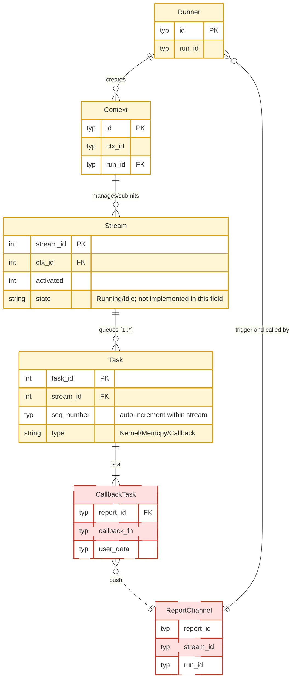

### 5.1 Key Relationship Description (Callback and Report Relationship Modeling)

When the **Device** executes a CallbackTask, it triggers the Host Runner thread to execute the callback.

#### 5.1.1 Interface Mapping Table (Callback and Report Relationship Modeling)

| Entity          | Key Management Interfaces                                                          |
| ------------- | --------------------------------------------------------------------- |
| CallbackTask  | `rtSetExceptionInfoCallback`, `rtLaunchCallback`,`rtSynchronizeEvent` |
| ReportChannel | `rtSubscribeReport`, `rtUnSubscribeReport`                            |
| Runner        | `rtProcessReport`                                                     |

## 6. Fine-Grained Low-Level Extension of the Base Device Model

Fine-grained low-level scheduling entities refined from the Device hierarchy in [section 2.1.1 Hierarchical Structure Overview](#211-hierarchical-structure-overview) (concept entities such as `Die` / `SuperPod` / `Plane` have no corresponding structs in the implementation in this repository).

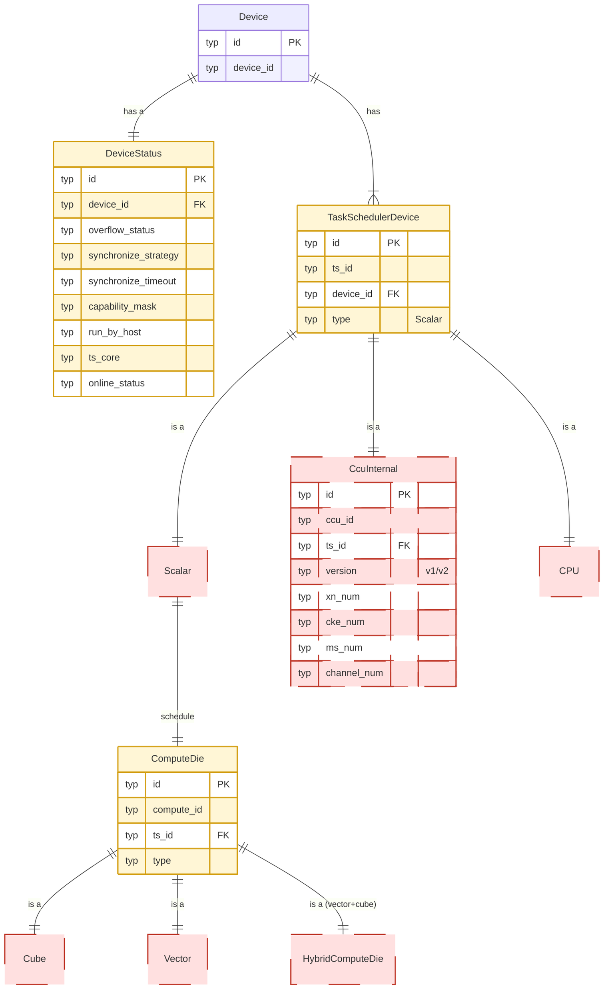

### 6.1 Key Relationship Description (Fine-Grained Low-Level Extension of the Base Device Model)

**Device scheduler hierarchy**:

- `TaskSchedulerDevice` is the abstraction of a device scheduler; one Device can contain multiple schedulers.
- Scheduler types include: `Scalar` (scalar processor), `CCU` (collective communication unit), `CPU` (AI CPU)
- The entity block names this CCU as `CcuInternal` to distinguish it from the `Ccu` (CCU resource allocation table) modeled in the database in section 2.1.1; the `type` field takes values `Scalar`/`CCU`/`CPU`.
- Different scheduler types handle different computation task types.

**ComputeDie computation unit**:

- `ComputeDie` is the abstraction of a computation unit; inheritance relationships indicate the computation unit type.
- `Vector`: Vector computation unit, processes vector operations.
- `Cube`: Cube computation unit, processes matrix operations.
- `HybridComputeDie`: Hybrid computation unit, supports both Vector and Cube simultaneously. (The implementation does not have this type; it is distinguished by `ComputeDie.type`; both this repository and `hcomm/` have 0 hits)

**CCU internal structure**:

- `xn_num`: Variable node count (cross-node communication)
- `cke_num`: Event engine count (Checksum engine)
- `ms_num`: CcuBuffer module count (Memory Scheduler)
- `channel_num`: Communication channel count.
- `version`: CCU version (v1/v2, determines feature differences)

**DeviceStatus state management**:

- `overflow_status`: Overflow status.
- `synchronize_strategy`: Synchronization policy configuration.
- `synchronize_timeout`: Synchronization timeout setting.
- `capability_mask`: Device capability mask.
- `run_by_host`: Whether running in Host mode.
- `ts_core`: Scheduler core count.
- `online_status`: Device online status.

**Scalar scheduling relationship**:

- The `Scalar` scheduler manages `ComputeDie` execution.
- Different ComputeDie types correspond to different computation workloads.

#### 6.1.1 Interface Mapping Table (Fine-Grained Low-Level Extension of the Base Device Model)

| Entity                | Key Management Interfaces                       |
| ------------------- | ---------------------------------- |
| TaskSchedulerDevice | `rtGetDeviceInfo`, `rtSetTsDevice` |
| DeviceStatus        | `rtGetRunMode`                     |

## 7. Kernel Runtime Relationship Modeling

Kernel-side entities are submitted through ACL interfaces and carried by Task / EventSyncTask (see [section 3.1 Data and Task Flow Modeling](#31-data-and-task-flow-modeling)); for the interfaces corresponding to each entity, see [section 7.1.1 Interface Mapping Table](#711-interface-mapping-table-kernel-runtime-relationship-modeling).

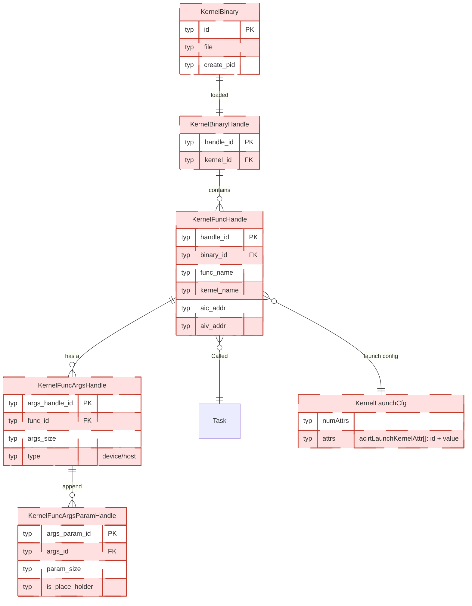

### 7.1 Key Relationship Description (Kernel Runtime Relationship Modeling)

**KernelBinary loading flow**:

1. `KernelBinary` stores the .o/.so binary file path and the creating process PID.
2. `rtBinaryLoadFromFile` or `rtBinaryLoadFromData` loads the binary into device memory.
3. After loading, a `KernelBinaryHandle` is generated, containing handle_id and kernel_id.
4. `KernelFuncHandle` represents a specific function within the binary, containing func_name, kernel_name, and address information.

**Kernel function call relationships**:

- `aic_addr` is the AI Core function address.
- `aiv_addr` is the AI Vector function address.
- `KernelFuncArgsHandle` stores function argument information.
- `KernelFuncArgsParamHandle` records argument size and whether it is a placeholder.
- `KernelLaunchCfg` configures Kernel launch parameters (block/grid and so on) (not a `sim_models.h` entity, not persisted in database; the implementation side uses the ACL type `aclrtLaunchKernelCfg`: `numAttrs` + `attrs[]`, with 9 attribute ids: `SCHEM_MODE`(1)/`DYN_UBUF_SIZE`(2)/`ENGINE_TYPE`(3)/`BLOCKDIM_OFFSET`(4)/`BLOCK_TASK_PREFETCH`(5)/`DATA_DUMP`(6)/`TIMEOUT`(7)/`TIMEOUT_US`(8)/`ENABLE_PROFILING`(9), the authoritative definition is in `runtime/include/external/acl/acl_rt.h:527-541` (`aclrtLaunchKernelAttrId`); `LOCAL_MEMORY_SIZE` is a deprecated alias for `DYN_UBUF_SIZE` (same value 2, `acl_rt.h:529-532`), `TIMEOUT` and `TIMEOUT_US` cannot be carried simultaneously (`acl_rt.h:538`); the stub in this repository only recognizes the first 8 types, and the 9th item is not implemented, see `src/proxy/level2/aclrt_kernel_stub.cc:564,1101`)

**Kernel lifecycle**:

```text
rtCreateBinary -> rtBinaryLoad -> rtBinaryGetFunction
                -> rtLaunchKernel(funcHandle, argsHandle, cfg)
                -> rtBinaryUnLoad -> rtDestroyBinary
```

**Parameter management mechanism**:

- args_handle_id supports both device and host types.
- is_place_holder identifies whether the parameter is a placeholder (deferred binding)
- param_size records the size of a single parameter.

#### 7.1.1 Interface Mapping Table (Kernel Runtime Relationship Modeling)

| Entity               | Key Management Interfaces                                                                                                    |
| ------------------ | --------------------------------------------------------------------------------------------------------------- |
| KernelBinary       | `rtCreateBinary`, `rtDestroyBinary`                                                                             |
| KernelBinaryHandle | `rtBinaryLoad`, `rtBinaryUnLoad`,`rtBinaryLoadFromFile`,`rtBinaryLoadFromData`                                  |
| KernelFuncHandle   | `rtBinaryGetFunction`, `rtBinaryGetFunctionByEntry`,`rtGetFunctionAddr`,`rtGetFunctionName`,`rtRegisterCpuFunc` |
| KernelLaunchCfg  | `rtLaunchKernelWithConfig` (ACL-side type, not a sim model)                                                       |

## 8. Model Loading Relationship Modeling
